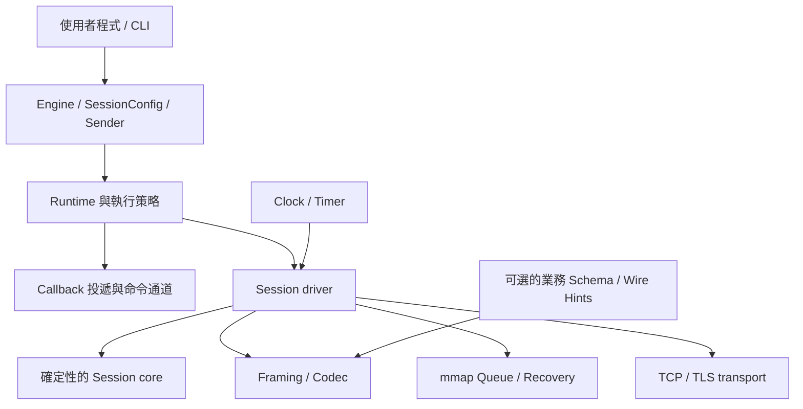

# NimbleFIX 從零重寫設計提案

- 日期：2026-10-20
- 分支：`rewrite/usability-first`
- 原版基準：`d74031b85af5cb9dbb11eec62a11881d99cae594`

本文件是新實作的設計基線。本分支目前只有設計文檔；文中的 API、命令、檔案結構與驗收目標均為提案，尚未實作，也不代表已有相應效能或相容性成果。

本次修訂確定三項基線：正式 session 一律使用檔案支援的 mmap queue；initiator 與 acceptor 都有完整的使用流程；業務字典為可選能力，基本 tag-value 收發不要求載入字典或執行 codegen。

## 1. 我會把 NimbleFIX 做成甚麼

**一個讓 C++ 開發者容易接入、能清楚理解執行行為、並能按需要降低延遲的嵌入式 FIX 引擎。**

使用者應能把時間用在訂單與回報邏輯，從公開 API 看懂何時可以發送、誰擁有訊息、失敗之後會發生甚麼。字典、執行緒、儲存與編碼策略由引擎提供一致且可驗證的契約。

保留的宗旨：

- C++20、可嵌入、低延遲、可控制資源使用。
- initiator 與 acceptor 都是第一級使用情境，共用協議核心。
- 完整的 session 生命週期、序號、重發與恢復能力。
- 每個正式 session 都有可恢復的 mmap queue store，沒有 memory store 選項。
- 不依賴業務字典的基本收發，以及可選的字典驅動型別化訊息與多層 repeating group。
- 對效能作分層量測，對第三方提供簡單且有文件的介面。

設計決策按以下順序取捨：

1. 協議與資料恢復的正確性。
2. API 的可理解性、錯誤可診斷性與行為一致性。
3. 延遲、尾延遲、分配次數與記憶體用量。
4. 功能廣度。

不以犧牲前兩項換取局部 benchmark 數字。每項優化必須同時通過協議、生命週期與使用者流程驗收。

## 2. 這次重寫的邊界

從乾淨的程式碼樹開始設計，不保留舊 API、舊設定格式、舊二進位 artifact 或相容包裝層。原版留在 `main` 與 Git 歷史中，作為行為參考及效能比較來源。

可以重新表達已確認的協議案例及需求，但新測試的預期結果必須經過規範核對。舊實作的輸出不能直接成為正確性的唯一依據。

第一個可交付版本聚焦：

- Linux 上的 C++20 函式庫、命令列工具與可直接執行的範例。
- FIX 4.4 tag-value、initiator、acceptor、完整 session 處理。
- 無業務字典的 flat 收發、可選型別化收發、巢狀 group、有限容量佇列。
- 從第一個 session 開始使用 mmap queue，持續保留序號、必要訊息與恢復狀態。
- TCP 與可選 TLS、重連、基本 session 時段設定。
- 真實外部程式的安裝、連結與部署驗證。

架構將 transport/session 版本與 application schema 分開；後續逐步加入 FIX 4.2、4.3 與 FIXT.1.1。每個版本必須獨立聲明和驗證支援範圍。

Router、HA、自動接管、熱更新、Orchestra 行為規則、Web 管理介面及其他編碼，延後到核心產品達標後再評估。這些能力各自有恢復、一致性或相容性成本，不能靠預留空介面宣稱支援。

## 3. 先定義使用者成功的樣子

| 使用者任務 | 產品承諾 | 驗收方式 |
| --- | --- | --- |
| 第一次執行 | 完成工具鏈準備後，一條範例命令完成本機登入、下單、回報與登出 | 在全新工作目錄執行，檢查退出碼及實際 FIX 流量 |
| 第一次寫程式 | 不提供業務字典也能建立 session、發送 flat 訊息與讀取 tag；需要 typed API 時直接使用內建 FIX44 schema | 無字典及 typed 範例都只用已安裝的公開頭與套件 target 編譯 |
| 接入對手方 | 常用的 CompID、Logon 欄位、TLS、心跳、重連及儲存都有直接入口 | 執行帶認證、TLS 和重啟恢復的整合案例 |
| 接受多個客戶端 | listener、允許的 session 身份、認證和資源上限可以分開配置 | 多個 initiator 同時登入、隔離錯誤，並回覆原 session |
| 重啟 acceptor | 同一客戶端重新登入時恢復自己的序號和重發資料，不受 TCP 來源端口改變影響 | 停止或終止服務後重新接入，驗證 session 身份與雙向 replay |
| 從其他執行緒下單 | 一般發送 handle 能安全使用，不受 callback 曾在哪條執行緒發送所影響 | 多生產者、callback 同時回覆及重連壓力測試 |
| 加入自訂欄位 | 修改一份可閱讀的 schema 輸入，建置系統自動生成並驗證 | 修改 schema 後只觸發必要的重新生成與編譯 |
| 發送失敗 | 能區分尚未接受、已接受但傳送失敗，以及對手方業務拒絕 | 針對各故障點驗證結果、事件與日誌 |
| 部署工具 | 執行檔離開原始碼目錄後仍可使用 | 移走原始碼、變更工作目錄後重跑案例 |
| 調校延遲 | 知道預設成本，能明確選擇 inline 與資源上限 | 對每種模式公布完整量測條件與結果 |

上手文檔的時間目標是：在支援的工具鏈已就緒時，讓未接觸過專案的 C++ 開發者在十分鐘內完成第一筆本機收發。這是需要實測的產品目標，不能把下載依賴或編譯時間隱藏在計時之外。

## 4. 一套業務 API，明確的進階選項

公開 namespace 統一為 `nimblefix`。標準 schema 使用 `nimblefix::fix44` 等可辨識名稱；自訂 schema 由使用者指定 namespace。

一般使用者只需理解五個概念：

| 概念 | 職責 |
| --- | --- |
| `Engine<Schema = FlatSchema>` | 擁有 runtime 與 mmap queue，預設不需要業務 schema，負責註冊、啟動及停止 |
| session / listener 設定 | session 描述對手方身份與恢復政策；listener 描述監聽與接入限制 |
| callback context | 當次回呼中的 session 資訊與發送能力 |
| message / view | 以有序 tag-value 或 generated 業務欄位建構、讀取訊息 |
| `Sender<Schema>` | 可保留、可交給普通應用執行緒的發送 handle |

不再要求使用者自行安排 Boot、LoadProfiles、Bind、建構 live wrapper 和開啟 listener 的順序。schema 綁定、資源初始化與執行緒建立都屬於引擎生命週期的一部分。

無字典與 typed 模式都使用相同的 session、發送結果與恢復契約；差別集中在業務訊息的建構、存取與驗證能力。codec-only、raw inspection 與手動驅動迴圈仍可獨立使用。

### 4.1 目標 API：typed initiator

以下示意一般 initiator 的形狀；標準 FIX 4.4 頭文件隨套件提供。正式實作時，此類範例必須直接來自可編譯的原始碼。

```cpp
#include <iostream>
#include <utility>

#include <nimblefix/engine.hpp>
#include <nimblefix/fix44.hpp>

namespace nf = nimblefix;
using namespace nf::literals;

int main()
{
    auto created = nf::Engine<nf::fix44::Schema>::create({
        .storage = {.directory = "./state/buy-side"},
    });
    if (!created.ok()) {
        std::cerr << created.error().message() << '\n';
        return 1;
    }
    auto engine = std::move(created).value();

    engine.on_error([](const nf::ErrorEvent& error) {
        std::cerr << error.format() << '\n';
    });

    engine.on<nf::fix44::ExecutionReport>(
        [&engine](auto& context, nf::fix44::ExecutionReportView report) {
            std::cout << context.session_name()
                      << " execution=" << report.exec_id() << '\n';
            engine.request_stop();
            return nf::Status::success();
        });

    engine.on_session_active([](auto& context) {
        auto sent = context.template send<nf::fix44::NewOrderSingle>(
            [](auto& order) {
                order.cl_ord_id("DEMO-001")
                    .symbol("AAPL")
                    .side(nf::fix44::Side::buy)
                    .transact_time(nf::UtcTimestamp::now())
                    .order_qty(100)
                    .ord_type(nf::fix44::OrdType::limit)
                    .price("150.25"_dec);
            });
        return sent.status();
    });

    auto session = engine.add_initiator({
        .name = "venue-a",
        .sender_comp_id = "BUY",
        .target_comp_id = "SELL",
        .endpoint = nf::TcpEndpoint{"127.0.0.1", 9876},
    });
    if (!session.ok()) {
        std::cerr << session.error().message() << '\n';
        return 1;
    }

    auto result = engine.run();
    if (!result.ok()) {
        std::cerr << result.error().message() << '\n';
        return 1;
    }
    return 0;
}
```

範例刻意只在 session active 事件中發送第一筆訊息。真實應用需自行決定重新登入後是否再次下單；引擎不替業務層決定訂單唯一性或自動重送策略。

範例的 store 是 mmap queue，預設採用同步確認。上手程式不需要先選擇 store backend，但必須提供明確的儲存目錄；測試範例由 harness 配置臨時目錄。

### 4.2 Callback 必須被可靠地綁定

- 用 `on<Message>(callable)` 明確註冊訊息處理器，保存具體 callable 與對應的呼叫入口。
- 簽名錯誤在編譯期給出聚焦的診斷；不使用「偵測不到 typed 方法就默默成功」的分派規則。
- 重複註冊、typed 模式所需 schema 缺失或設定不一致，在 `validate()` / `run()` 啟動前一次列出。flat 模式不因沒有業務字典而啟動失敗。
- `on()` 記錄冷路徑設定；正式啟動後凍結分派表，第一版不允許動態換 handler。
- 管理訊息由協議核心處理，業務 callback 不需要接管心跳或序號。
- typed 模式對有效但未支援的業務訊息套用明確的拒絕政策；flat 模式使用明確的 MsgType 註冊或 `on_message()` 通用入口。刻意忽略必須透過帶原因的 ignore 註冊聲明，不能因無字典而無聲丟棄。
- callback 回傳的失敗會觸發明確的 session 處理及 error event，不把業務邏輯故障偽裝成網路 EOF。

### 4.3 設定應覆蓋日常接入需求

session 設定直接提供：身份與可選 qualifier、連線或 listener 綁定、Logon 額外欄位、認證政策、TLS 要求、心跳、重連、儲存與恢復、驗證規則、session 時段。initiator 配置遠端 endpoint 與送出的認證；acceptor 配置本地 listener、允許的遠端身份與驗證認證的方法。

帳密是常用設定，不應迫使使用者改走另一套底層 API。標準身份與管理欄位由引擎產生；自訂 Logon 欄位不能覆寫序號、BodyLength 或 CheckSum 等受管理欄位。

`SessionId` 由引擎分配，使用者用名稱查詢與識別。持久化身份由協議 session key 明確定義，不能把可修改的人類可讀名稱當作唯一恢復依據。

### 4.4 目標 API：acceptor 是完整的接入端

acceptor 使用者的主要工作是建立 listener、聲明允許的 session、驗證登入、處理客戶訊息並回覆正確的 session。listener 與 session 分開配置：一個 listener 可以服務多個客戶端，同一條 TCP 連線在認證及身份匹配完成後綁定到一個 session。

以下是與 4.1 的 initiator 配對的示意程式，使用相同的執行策略與發送結果：

```cpp
#include <iostream>
#include <utility>

#include <nimblefix/engine.hpp>
#include <nimblefix/fix44.hpp>

namespace nf = nimblefix;
using namespace nf::literals;

int main()
{
    auto created = nf::Engine<nf::fix44::Schema>::create({
        .storage = {.directory = "./state/sell-side"},
    });
    if (!created.ok()) {
        std::cerr << created.error().message() << '\n';
        return 1;
    }
    auto engine = std::move(created).value();

    engine.on_error([](const nf::ErrorEvent& error) {
        std::cerr << error.format() << '\n';
    });

    engine.on<nf::fix44::NewOrderSingle>(
        [](auto& context, nf::fix44::NewOrderSingleView order) {
            auto sent = context.template send<nf::fix44::ExecutionReport>(
                [&](auto& report) {
                    report.order_id(order.cl_ord_id())
                        .exec_id(order.cl_ord_id())
                        .cl_ord_id(order.cl_ord_id())
                        .exec_type(nf::fix44::ExecType::new_order)
                        .ord_status(nf::fix44::OrdStatus::new_order)
                        .side(order.side())
                        .leaves_qty(order.order_qty().value_or(0))
                        .cum_qty(0)
                        .avg_px("0"_dec);
                });
            return sent.status();
        });

    auto listener = engine.add_listener({
        .name = "main",
        .endpoint = nf::TcpEndpoint{"127.0.0.1", 9876},
    });
    if (!listener.ok()) {
        std::cerr << listener.error().message() << '\n';
        return 1;
    }

    auto session = engine.add_acceptor({
        .name = "buy-side",
        .listener = "main",
        .local_comp_id = "SELL",
        .remote_comp_id = "BUY",
    });
    if (!session.ok()) {
        std::cerr << session.error().message() << '\n';
        return 1;
    }

    auto result = engine.run();
    if (!result.ok()) {
        std::cerr << result.error().message() << '\n';
        return 1;
    }
    return 0;
}
```

這個範例只對 4.1 的樣本訂單回覆一次確認，以 ClOrdID 示意 OrderID / ExecID 的關聯；實際業務需驗證條件必填欄位、管理唯一 ID、處理拒單與重複訂單，並持久化自己的訂單狀態。FIX session store 不等於訂單管理資料庫。

`context` 已指向收到該訊息的 session，使用者不必拿 CompID 去全域 map 找回連線。外部撮合或風控執行緒可取得該 session 的 sender；sender 與監聽 socket 解耦，不因一次 TCP 斷線失去 session 身份。

### 4.5 兩種角色各自需要的契約

| 流程 | Initiator | Acceptor |
| --- | --- | --- |
| 連線 | 指定遠端 endpoint，執行重連政策 | 指定本地 listener，等待客戶端連線 |
| Logon 身份 | 送出本地 SenderCompID 與遠端 TargetCompID | 將收到的 TargetCompID 視為 local、SenderCompID 視為 remote，核對允許的身份 |
| 認證 | 提供需要送出的 Logon 欄位與 TLS client 政策 | 驗證對手方的 Logon 與可選 TLS peer 身份，兩者是分開的政策 |
| 恢復 | 開啟自己的 mmap queue，與對手方協調序號 | 依穩定 session key 找回 queue，在回覆登入成功前完成恢復與序號處理 |
| 業務 | active 後發送訂單並接收回報 | 接收訂單，在原 session 回覆回報；不同客戶端互相隔離 |
| 斷線 | 根據政策發起重連 | 釋放舊連線但保留 session 與 queue，等待同一身份重新登入 |
| 停止 | 嘗試 Logout、同步必要記錄及停止重連 | 停止接入新連線，逐個 session Logout / 同步；達到期限後回收剩餘連線 |

acceptor 還必須明確處理以下情況：

- 預設採靜態 allowlist。未知身份拒絕，不能先建立任意 store 再決定是否允許登入。
- 可選的動態接入 factory 收到有界、已完成 framing 的 Logon 資訊，以及 listener、local / remote address 和 TLS peer 資訊；明確允許後才註冊 session、開啟 store。
- 外部認證需要有界的 pending 狀態與期限，不能在 I/O owner 上等待遠端服務，或讓一個慢登入阻塞其他客戶。
- 同一 session 同時只允許一條 active 連線；重複 Logon 採明確政策，第一版預設拒絕新連線，不能出現雙 writer。
- 重啟後以 transport 版本、local / remote CompID 及明確 qualifier 找回 store；TCP 來源端口與臨時的內部 SessionId 不參與持久化身份。
- listener 支援接入數、未認證連線數、Logon 時限、frame 大小與動態 session 數上限；資源耗盡時回報清楚原因。
- 單一 session 的認證、queue 或磁碟錯誤依故障範圍隔離；若共用儲存資源失效而無法安全隔離，engine 才進入 failed。
- 多 worker 下不同 session 的業務 callback 可並行；同一 session 維持順序。應用共用的訂單狀態需要明確的協調方式。

## 5. 生命週期與發送結果

### 5.1 啟動不做隱藏的網路操作

建立 engine、註冊 callback、加入 session 都不連接對手方。`validate()` 執行離線檢查；`run()` 或手動模式的 `start()` 才開啟網路與工作執行緒。

`run()` 與 `start()` 共用同一啟動狀態機。初始化失敗會回收已取得的 socket、執行緒與 store lock，不留下半啟動的 engine。

對外狀態使用可理解的階段：

```text
configured → connecting / listening → logging_on → active
                                            active → recovering → active
                                            active → logging_out → stopped
                                   connection loss → reconnect_wait
                                     unrecoverable → failed
```

這是產品狀態視圖，不能取代內部完整的 FIX session 狀態機。每次狀態轉移帶有 session 身份、時間與原因。

### 5.2 `send()` 的承諾

`send()` 成功表示引擎已取得完整訊息的所有權並接受處理，**不表示已寫入磁碟、已寫入 socket，或已被對手方接受**。

- 回傳 `SendReceipt`，提供本機關聯識別碼；它不是 FIX 序號或訂單識別碼。
- 未 active 時預設回傳 `not_ready`；容量不足回傳 `queue_full`，不靜默丟棄或無限堆積。
- 編碼、當前模式可驗證的 schema / 欄位錯誤在接受前回傳；拒絕接受的訊息不取得 FIX 序號。flat 模式不虛構 required field 或 enum 語義檢查。
- 接受後的持久化或傳輸失敗透過可關聯的事件回報，並保留可查詢的 session 錯誤狀態。
- 對手方業務接受與否由 ExecutionReport / Reject 等協議訊息表達。
- 預設不自動重試業務 `send()`；不能讓不明確的超時結果造成重複訂單。
- 所有失敗結果使用 `[[nodiscard]]`；文件明確說明每個錯誤是否可以原樣重試。

session owner 在首次對外寫出訊息之前，必須把對應的 outbound 記錄及序號決策提交到 mmap queue，並滿足該 session 選定的同步邊界。跨執行緒的 `send()` 可先只回覆命令已被接受；需要等待記錄提交或同步完成時，使用獨立的 receipt 進度通知，不能把 API 返回值混同於磁碟確認。

斷線期間的離線排隊是明確選項。啟用時需要容量、過期時間及恢復政策；尚未進入 session 發送順序的訊息不提前取得 FIX 序號，發送時間在實際發送流程中產生。

### 5.3 停止與資源擁有權

- `request_stop()` 可從普通應用執行緒呼叫，提出有期限的優雅停止要求。
- 引擎停止接收新業務發送，依政策處理已接受訊息，嘗試 Logout，完成必要儲存並 join 所有自有執行緒。
- 超時、強制停止與未完成訊息的處理都有事件和最終結果。
- callback 內只提出停止要求，不能等待自己所屬的工作執行緒退出。
- engine 析構保證資源被回收；需要確認最後發送和落盤狀態的程式，必須顯式停止並檢查結果。
- engine 已結束後仍保留的 sender 回傳 `engine_stopped`，不解參照失效的 runtime。

## 6. 執行緒模型：把易用性成本說清楚

### 6.1 預設使用 queued callback

`Engine<>` / `Engine<Schema>` 預設把業務 callback 放在與 session I/O 分離的應用 executor。每個 session 的事件保持順序，callback 不會對同一 session 並行執行；不同 worker 可並行處理不同 session。

這讓一般應用不必因一次稍慢的業務處理直接停止協議收發。預設也必須明說：有限佇列會飽和，同一應用 worker 上的其他 session 仍可能受慢 callback 影響；獨立 executor 不能消除無限阻塞的後果。

佇列容量、深度、高水位與 callback 執行時間都可觀察。可靠業務收發預設不使用 drop-newest；飽和時暫停相應投遞並執行有界的 backpressure。若持續飽和導致協議無法服務，明確關閉受影響 session 並記錄原因。

queued 投遞可使用 mmap queue 的獨立 reader cursor，加上有界的喚醒通知。通知是加速提示，已提交記錄和可恢復 cursor 才是交付依據；通知遺失不等於訊息遺失。它與非持久化的跨執行緒命令通道有不同職責，不能混稱為同一種 queue。

### 6.2 低延遲模式明確選擇 inline

`Engine<Schema, Inline>` 在 session owner 執行緒執行 callback。它保持相同的業務欄位與發送語義，但文件明確要求 callback 有界、不可阻塞。

兩種模式採用同一套協議狀態機及訊息模型，內部以 execution policy 實例化 worker 與 callback context。模式在建構或啟動邊界選定，穩態迴圈不反覆判斷 dispatch mode。

callback 的 `context.send()` 依具體 execution policy 選擇正確路徑：inline 可直接交給 session owner；queued 必須提交已擁有的訊息。公開 API 不會給 queued callback 一個只能在 inline 執行的 handle。

預設 queued 與可選 inline 都是正式產品路徑，必須分別量測與測試。對外效能宣稱必須標示使用哪一種模式。

### 6.3 普通執行緒發送有安全的預設

`session.sender()` 取得可保留的 `Sender<Schema>`。普通 sender 支援多生產者，以有限容量的命令通道交給 session owner；callback 發送與外部執行緒發送可以共存。

不把內部某個 worker 的 SPSC 限制偽裝成「每個 handle 可以各自指定一條執行緒」。多生產者成本必須計入預設模式的 benchmark。

需要進一步降低成本時，提供明確的 producer lane：每條 lane 綁定單一生產者與有限容量，跨執行緒誤用回報具體錯誤。lane 是進階的效能選項，不能成為普通多執行緒下單的前置知識。

來自同一 producer 的命令保持順序；不同 producer 的相對順序以 session owner 實際採納處理的順序為準，不能從呼叫開始、返回時間或 SendReceipt 推導全域順序。跨連線與跨 session 不提供額外的全域順序保證。

## 7. 訊息、schema 與所有權

### 7.1 字典不是基本收發的必要條件

必須區分三件事：應用是否提供 XML 字典、引擎是否帶有內建 schema，以及協議本身所需的最小 wire / session 規則。無業務字典模式仍然知道 BeginString、BodyLength、MsgType、序號、CompID、SendingTime、CheckSum 和所支援管理訊息的格式；不要求協議核心完全沒有 FIX 知識。

| 能力 | 不載入業務字典的 flat 模式 | 內建或自訂 schema 模式 |
| --- | --- | --- |
| framing、BodyLength、CheckSum | 支援 | 支援 |
| Logon、心跳、序號、重發與 mmap queue 恢復 | 支援，由內建 session 規則處理 | 相同契約 |
| 發送不帶 group 的有序 tag-value | 支援，使用者提供業務 tag 與值 | 支援，另提供 generated setter |
| 解析一般不含內嵌 SOH 的欄位 | 支援，保留有序欄位與原始值 | 支援，另提供型別與名稱 |
| 依明確型別轉換數值 / 時間 | 支援，呼叫者指定轉換型別並檢查結果 | 可由 schema 選擇型別 |
| 業務 required field、enum、欄位歸屬與順序驗證 | 沒有業務定義便無法完整驗證 | 依 schema 驗證 |
| repeating group 的層級與邊界 | 不自動猜測；需要 group 描述 | 依完整 schema 描述 |
| 含內嵌 SOH 的二進位 Data | 需要已知 Length/Data 配對，可獨立提供 wire hints | 從 schema 取得配對 |

因此，最小接入入口是 `Engine<>`，不必先提供字典。相同的 `add_initiator()` / `add_listener()` / `add_acceptor()` 適用；儲存與恢復也不能因採 flat 模式而被省略。

下面示意 `Engine<>` 啟動前註冊的基本收發邏輯，不 include generated schema 頭文件：

```cpp
// engine 的建立、storage.directory、session 註冊與錯誤檢查同第 4 節。
engine.on_session_active([](auto& context) {
    nf::FlatMessage order{"D"};
    order.field(11, "DEMO-001")
        .field(21, '1')
        .field(55, "AAPL")
        .field(54, '1')
        .field(60, nf::UtcTimestamp::now())
        .field(38, 100)
        .field(40, '2')
        .field(44, "150.25");
    return context.send(std::move(order)).status();
});

engine.on_message([](auto& context, nf::FlatMessageView message) {
    std::cout << context.session_name() << " type=" << message.msg_type() << '\n';
    for (auto field : message.fields()) {
        std::cout << field.tag << '=' << field.value << '\n';
    }
    return nf::Status::success();
});
```

上述 raw tag 是使用者明確選擇的業務表達方式；generated API 才負責消除這些數字。引擎管理 8、9、35、34、49、56、52、10 等 session / framing 欄位，禁止以業務欄位重複注入，並自動計算長度與校驗碼。

`FlatMessage::field()` 保留插入順序、取得欄位值的所有權，拒絕非法 tag、受管理欄位、重複的 flat 欄位及非法分隔符；它不宣稱已驗證 NewOrderSingle 的完整業務內容。發送端需按對手方要求填入欄位並保持必要順序。

接收 view 保留原始欄位次序，不把重複 tag 壓成一個 map 值。`find_unique(tag)` 只有在整個 frame 恰有一個該 tag 時才返回值，缺少與重複分開表示；它不證明欄位屬於最外層。帶 count=1 的未知 group 也可能沒有重複 tag，不能靠「沒有重複 tag」證明沒有 group。

acceptor 同樣可以使用 `on_message()`，在收到的 context 中建立 `FlatMessage` 回覆；不需要先生成所有客戶端業務型別，也不需要透過全域連線表發送。

純 codec 使用者另可執行無字典的 frame 編碼與 flat 解析，不啟動 engine。這類無狀態工具可以不開 store；一旦使用正式 FIX session 收發，就仍須使用 mmap queue 並由 session core 管理序號。

### 7.2 型別化與自訂 schema 是可逐步加入的能力

套件提供建置時生成的 FIX 4.4 型別及描述資料，範例與一般使用者直接 include。標準使用路徑不要求 runtime 尋找來源倉庫內的 `.nfa`。

自訂 schema 保留 codegen，但輸入從使用者已經持有的 FIX XML 字典開始；以一種有版本的 overlay 表達 venue 擴充。第一版不另要求學習中介 `.nfd` 格式。

生成器輸出：型別化欄位、enum、message builder/view、group 描述、驗證資料與 schema fingerprint。標準與自訂 schema 使用同一生成器，不維護兩套手寫訊息模型。

建置 helper 自動安排生成依賴、include 路徑及增量重建。輸出放在目前 build directory，內容可重現；來源目錄保持可唯讀。

fingerprint 由正規化 schema 內容及生成器格式版本決定。需要外部 schema 資產的工具在啟動時檢查一致性；錯誤包含預期與實際 fingerprint、來源路徑及重新生成指令。使用者不必手工管理數字 profile id。

### 7.3 Builder 安全地接受一般 C++ 值

- 使用者傳入的字串與欄位值在 setter 返回前取得穩定儲存，不能悄悄保留短命的 `string_view`。
- `send()` 返回後不保留 populate lambda 或其引用捕獲。
- 以預配置的訊息儲存與 byte arena 控制分配；超過設定容量會明確失敗，沒有隱藏的熱路徑 heap fallback。
- fluent setter 可以累積第一個建構錯誤，`send()` 統一驗證並回傳欄位路徑；錯誤不會被後續 setter 清除。
- 有 schema 時，型別、required field、enum、group count、管理欄位衝突在接受發送前完成檢查；無 schema 時只承諾當前 wire / 欄位格式可以驗證的部分。
- 價格與數量以 decimal / fixed-point 表達；示例的 `"150.25"_dec` 在編譯期解析，外部文字輸入則以可失敗的解析函數處理，避免預設經過二進位浮點數轉換。
- 時間欄位有明確的 UTC 與精度型別，不把格式化字串當成唯一介面。

### 7.4 View 的生命週期只有一條主要規則

callback 內的 view 有效至 callback 返回。callback context 不可複製或移動，不作為可長期保存的 session handle；需要在外部發送時取得 sender。需要跨 callback、跨執行緒或長期保存訊息時，呼叫明確的 `copy()` / 擁有化入口。

有 schema 時，inline、queued 與 owned message 的 group accessor 使用同一份結構描述；複製後不能失去巢狀 group 的存取能力。queued 路徑可持有 mmap queue record 的有限生命週期 lease，或取得獨立的穩定儲存，不能把 I/O buffer 的短命指標交給應用執行緒。

擁有化物件的拷貝、移動與共享成本要有文件。callback 的 lease 返回後釋放，跨 callback 的擁有化使用獨立且有上限的儲存資源，不能無限制保留接收 slab 或 mmap segment 而阻止回收。

### 7.5 自訂欄位與驗證政策

簡單業務可以使用 flat 欄位；需要完整欄位語義、generated setter 或 typed group 時選擇 schema。未知欄位、enum 擴充、非標準欄位順序及 malformed 欄位各有明確政策，不能用一個模糊的 permissive 開關關閉所有保護。

raw inspection / forwarding 是獨立的進階能力，明示會保留或修改哪些 wire bytes；它不能繞過必要的 frame 邊界、長度、資源與 session 安全檢查。

FIX 版本、schema 方言和驗證政策分開建模。多 schema 接收端在啟動時註冊明確的身份與協商路由，選定 schema 後才進入相應的 typed dispatcher，不在每次業務讀取時重新猜測字典。

### 7.6 無字典解析的兩個邊界

**Repeating group 需要結構資訊，但不必是一整份 XML 字典。** counter 的數值只給出項目數，不能完整表達 delimiter、成員與巢狀邊界；這些資訊可以來自內建 schema、自訂字典，或明確的局部 group descriptor。完全沒有描述時，flat view 只能保留有序欄位，不能把猜測結果當作正確的 group tree。FIX 官方對 group metadata 與 counter 的描述可參閱 [Message Structures](https://fixtrading.org/concepts-part1-messagestructures/)。

**沒有 group 仍不代表可以對所有 payload 直接 split(SOH)。** FIX Data 欄位可能含分隔符，必須依對應 Length 欄位讀取指定 byte 數；Length/Data 配對是必要的 wire 資訊。[FIX 官方 TagValue 說明](https://fixtrading.org/fix-session-protocol-submitted-to-iso/)與 [Data 欄位定義](https://github.com/FIXTradingCommunity/fix-orchestra-spec/blob/master/v1-0-RC3/orchestra_spec.md#data-fields)說明這個關係。

第一版的明確契約：

- `Engine<>` 的基本 flat-text 路徑支援對手方約定不含 group、一般值不含內嵌 SOH 的訊息，不進行業務 schema 驗證。
- 內建支援版本的管理訊息與標準 Length/Data 配對由小型 wire 規則表處理，不要求載入整份業務字典。
- 自訂二進位欄位可另外宣告 `WireHints` 的 Length/Data 配對，發送使用明確的 `data(length_tag, data_tag, bytes)` 入口；這不等於啟用整份業務 schema。
- 既沒有配對又可能收到自訂 Data 時，不宣稱支援完整欄位解析。可以保留依 BodyLength 取得的 opaque frame 作檢視，不能猜測二進位邊界。
- 不能自動辨識所有未知 group 或自訂 Data。flat-text 模式的輸入範圍是與對手方的明確契約，不是 parser 可以無中生有驗證的條件。
- 需要讀取 group、檢查欄位歸屬或完整業務有效性時，補上相應結構定義，仍沿用相同的 session、store 與發送結果契約。

## 8. 內部架構：讓核心足夠小、足夠可驗證



依賴方向保持單向：

- codec 不依賴 socket、執行緒、store 或 engine。
- session core 接收已定義的事件，輸出明確的 action，不直接讀時鐘、開 socket 或同步呼叫業務程式。
- driver 解譯 action、協調 mmap queue 與 transport，將 append、同步完成或失敗結果送回 core。
- runtime 安排 session owner、命令與投遞資源，不複製 initiator / acceptor 的協議邏輯。
- CLI 把設定轉成公開模型，格式化公開事件；它不能持有另一套 session 行為實作。

### 8.1 純粹且可重播的 session core

輸入包括已依當前模式驗證的 frame、連線事件、timer 到期、應用發送命令、mmap queue append / 同步完成與傳輸結果。輸出包括發送管理訊息、提交 queue record、請求 replay、投遞業務訊息、調整 timer 及關閉連線。

core 顯式記錄尚待完成的 action；需要落盤之後才能推進的狀態，必須等待相應完成事件。用固定容量的 action buffer 或回呼式 action sink 避免每次 transition 配置動態容器。

這使登入、斷線、gap、resend、replay、持久化失敗與日切可以在沒有真實網路、沒有真實 sleep 的情況下逐步重播。

### 8.2 所有 protocol state 由單一 owner 修改

每個 session 有且只有一個 owner。任何應用執行緒透過命令通道提出要求；protocol sequence、timer、重發範圍與 store 順序都由 owner 決定。

initiator / acceptor 共享同一 driver；差異集中在連線建立、Logon 身份匹配與重連。身份匹配以本地視角定義，診斷同時列出 local 與 remote CompID，避免 sender / target 在接收端產生歧義。

未知對手方預設拒絕。動態接入需要顯式 factory / allowlist 與建立 session 的資源上限；不能僅因開啟 acceptor 就接受任意身份。

### 8.3 transport 與 timer 的邊界

先以穩定的 socket backend 完成非阻塞 TCP。TLS 是相同 byte-stream 介面的另一實作，不改變 session 的序號與儲存語義。io_uring 與其他 backend 在量測證明有收益後再加入。

連線、TLS handshake、Logon、讀寫停滯、Logout 及重連都有獨立且可設定的期限。timer 使用 monotonic clock；FIX 時間欄位、session 時段與日切使用明確的 wall-clock 規則。

時鐘跳變、部分 frame、黏包、短寫、半關閉與暫時不可寫都是常規測試輸入。網路層有明確的 frame 大小和緩衝上限。

第一版 session 時段使用 UTC；其他時區在有明確時區模型與夏令時間測試後才開放，不能只依賴部署機器的隱含本地時區。

### 8.4 手動驅動模式保留完整語義

需要與既有 event loop 整合時，提供 `start()`、`poll_once()`、喚醒與下一個 deadline 的明確契約。手動模式由呼叫者服務 I/O 與 timer，不私下建立另一組自動輪詢執行緒。

業務 callback 的執行策略仍由 engine 型別決定；`poll_once()` 不改變 context 的發送合法性。第一版先支援自有 runtime，手動模式在同一 driver 上擴充，不能複製一份協議實作。

## 9. 協議正確性、持久化與恢復

### 9.1 完整 session 能力先於正式發布

首個正式版本需覆蓋所宣稱 FIX 4.4 範圍的 Logon / Logout、心跳與 TestRequest、序號檢查、ResendRequest、replay、GapFill、SequenceReset、重連與恢復。

重複與過期訊息、PossDup / OrigSendingTime、管理訊息 replay、同時發生的 resend、錯誤 frame、錯誤身份與 reset 政策都必須有獨立案例。不同 FIX 版本的差異以明確的版本規則處理，不靠使用者組合一堆不相容的布林開關。

建立支援矩陣，逐項區分「實作並驗證」「不適用」「尚未支援」。只公布已核對來源與預期語義的案例覆蓋，不能用測試總數代表協議完整性。

### 9.2 mmap queue 是唯一正式 store

移除 memory store。每個正式 FIX session 都必須使用磁碟檔案支援的 mmap append-only queue，作為訊息、序號及恢復事件的權威紀錄；記憶體索引與快取只能由 queue 重建，不能成為唯一狀態來源。

這個方向借鑑 Chronicle：其公開架構把 FIX 訊息與 session 狀態持久化到 Chronicle Queue，而 Queue 使用 memory-mapped、依序追加的檔案。[Chronicle FIX 架構](https://chronicle.software/tech-hub/technical-information/chronicle-fix/introduction)、[Chronicle Queue](https://chronicle.software/products/chronicle-queue) 支持這項參考。NimbleFIX 採用的是這個設計方向，暫不引入其實作依賴，也不承諾檔案格式相容或相同效能。

queue 在這裡是**可索引、可反覆重播的 journal**，不是讀出後刪除的 FIFO。它具有一個 appender 及獨立 reader cursor：

- appender 由 session owner 擁有，順序追加 inbound、outbound 與必要的 session transition。
- resend reader 依方向、session epoch 與 FIX 序號定位歷史紀錄。
- application reader 追蹤接收訊息的業務交付進度。
- 診斷與稽核 reader 可唯讀跟隨記錄，不修改正式交付或重發 cursor。

普通 sender 的記憶體命令通道只負責跨執行緒交接，不是另一種 session store。尚未取得 queue 提交回報的命令在程序崩潰時可能消失；需要已持久化確認的應用應等待 receipt 的相應進度，不能只檢查 `send()` 是否接受。

第一版以每個 session 獨立的 queue 與分段檔案隔離身份及恢復，不讓所有 session 爭用一個全域 writer。大量 session 的 mapping、檔案描述元及索引有明確資源預算；未來若共用 shard queue，必須保持每個 session 的順序、隔離與恢復契約。

### 9.3 mmap 與同步確認分開定義

使用 mmap 解決儲存介面和重播路徑，不自動等於斷電後每筆資料都存在。正式預設採用 `confirmation = synced`；需要降低同步成本時，使用者明確選擇 `appended`，或在 synced 政策下啟用 group commit。

| 確認政策 | 可以依賴的邊界 | 代價與限制 |
| --- | --- | --- |
| `synced`，預設 | 相應記錄及恢復所需 metadata 的同步完成後，才允許其對應的協議發送或業務投遞 | 磁碟與同步操作會影響延遲；承諾以支援的檔案系統及儲存設備故障模型為前提 |
| `appended`，明確選擇 | 完整記錄已提交到檔案的共享映射，可由仍正常運行的 OS 下的程序重啟驗證並恢復 | 未同步尾部不保證通過 OS crash、斷電或裝置故障；不能把此模式宣稱為已同步落盤 |

group commit 是同步排程政策，不是第三種 store。一次同步可以確認多筆，但每筆在進度事件中明確區分 appended / synced，且必須等它所屬批次成功才跨過 synced 邊界。批次大小、最大等待時間與 writer backpressure 都有上限。

實作需要依所選檔案系統處理映射頁與檔案 / 目錄 metadata 的同步。Linux 的 [msync(2)](https://man7.org/linux/man-pages/man2/msync.2.html) 說明映射內容的同步，[fsync(2)](https://man7.org/linux/man-pages/man2/fsync.2.html) 另外指出檔案同步不能代替目錄項目的同步。不能只呼叫一次函數或使用 CPU memory barrier，就宣稱整個 crash-consistency 協議成立。

基本 codec 單元測試可使用 test double；它不是可配置、可部署的 memory store。session 整合測試與 hello-fix 使用臨時目錄內的真實 mmap queue；重啟案例保留該目錄直到驗收完成，不以 tmpfs 的結果代表實體磁碟耐久性。

### 9.4 queue 格式與恢復流程

- 記錄包含 queue 格式版本、session 身份、epoch、方向、序號或事件型別、長度、內容完整性資訊與提交狀態；有業務 schema 時可額外記錄 fingerprint，無字典記錄沒有這項前置要求。
- 以固定格式、offset 與穩定的記錄識別保存資料，不寫入 C++ 指標、物件佈局或程序內地址。
- append 完成、reader 可見與 synced watermark 各有明確邊界；commit marker、checksum 與 checkpoint 的順序以故障注入驗證，不能只假設一個 marker 寫入是所有故障下的原子提交。
- checkpoint 記錄可重建的序號與交付進度，索引映射 `(epoch, direction, FIX sequence)` 到 queue 位置；損壞或過期的索引可由已驗證記錄重建。
- 恢復時從有效 checkpoint 掃描連續紀錄，辨識未提交或 torn tail；不能越過不明損壞繼續猜測序號。修復與截尾有明確且可稽核的政策。
- 同一 session queue 有排他 writer lock，避免兩個 engine 或 acceptor 的兩條連線同時推進同一身份。
- outbound wire frame、序號決策與 checkpoint 使用一致的提交模型，之後才按政策寫入 socket；replay 從保存記錄重建需要的重發 header，不原地覆寫歷史紀錄。
- inbound 記錄、預期序號、callback 投遞與 delivery cursor 的順序明確；callback 返回後才推進相應完成 cursor。崩潰可能重複投遞，回呼需要 replay 標記和穩定關聯識別碼。
- 不承諾應用 callback、外部資料庫與對手方之間的 exactly-once；業務層需要自己的去重或交易協調。
- segment 預先配置並按容量或時間輪替；輪替不等於 FIX 日切，也不自動 reset sequence。所有跨 segment 的 cursor 都能在重啟後重新定位。
- reader lease 與 segment 回收有界；retention 同時考慮協議可重發範圍、未完成業務交付與有效 reader，不因讀取完畢就刪除資料。達到磁碟預算時明確 backpressure 或停止 session，不覆寫仍需恢復的紀錄。
- store 損壞、磁碟滿、檔案延伸失敗、映射存取故障、同步失敗與不相容格式都阻止不安全推進；預先配置和監控空間可降低風險，不能假設 mmap 寫入永遠不失敗。
- reset sequence 透過明確的 session epoch 與可稽核操作表達；一般重新啟動不重置身份、序號或 queue。

純 session core 測試使用 fake clock、fault-injecting store 和可控制的 transport；真正的 queue 另做每個提交邊界、程序中止、斷電模型、segment 輪替與 reader 落後的恢復測試。一般 kill-process 測試不能代表斷電測試。

## 10. 一個可預期的命令列入口

對使用者提供一個 `nimblefix` 執行檔，子命令共用參數、設定與診斷實作：

| 命令 | 用途 |
| --- | --- |
| `nimblefix init` | 產生配對的 initiator / acceptor 設定與獨立 store 目錄配置；遇到既有檔案預設拒絕覆寫 |
| `nimblefix validate --config PATH` | 離線檢查格式、跨欄位規則、資源與本機功能相容性 |
| `nimblefix run --config PATH` | 執行 initiator / acceptor，顯示生命週期與結構化錯誤 |
| `nimblefix schema ...` | 自訂字典生成、檢查及摘要 |
| `nimblefix inspect ...` | 查看 flat 訊息、schema 或 mmap queue，預設唯讀；無 schema 時不假造 group 結構 |
| `nimblefix doctor` | 顯示編譯能力、TLS/backend 狀態與本機設定問題 |
| `nimblefix bench ...` | 執行明確指定邊界的量測；屬於可選開發元件 |

`validate` 不開 listener、不連接對手方，也不聲稱已驗證遠端認證或網路可達性。可能會修改 journal 的恢復工具必須與唯讀 inspect 分開，明示修改計畫並採用明確的寫入選項。

### 10.1 使用一份有版本的 TOML 設定

選擇 TOML 作為 CLI 公開設定格式，以具名欄位表達，不使用依賴位置的長欄位紀錄。使用固定版本的解析器，不自行發明通用格式解析器。函式庫接受相同的結構化設定模型，不要求應用一定從檔案載入。

```toml
version = 1

[engine]
dispatch = "queued"
schema = "fix44"

[engine.storage]
directory = "./state/buy-side"
confirmation = "synced"

[[sessions]]
name = "venue-a"
role = "initiator"
transport = "FIX.4.4"
sender_comp_id = "BUY"
target_comp_id = "SELL"
endpoint = "127.0.0.1:9876"

[sessions.logon]
username = "demo"
password_env = "FIX_PASSWORD"
```

配對的 acceptor 明確聲明監聽端點、允許的本地 / 遠端身份及登入驗證：

```toml
version = 1

[engine]
dispatch = "queued"
schema = "fix44"

[engine.storage]
directory = "./state/sell-side"
confirmation = "synced"

[[listeners]]
name = "main"
endpoint = "127.0.0.1:9876"

[[sessions]]
name = "buy-side"
role = "acceptor"
listener = "main"
transport = "FIX.4.4"
local_comp_id = "SELL"
remote_comp_id = "BUY"

[sessions.authentication]
method = "credentials"
username = "demo"
password_env = "FIX_PASSWORD"
```

加入另一位客戶時，在同一 listener 下新增 session 與自己的認證政策；store 依協議身份分開，不以 listener 的一個序號服務全部客戶。

CLI 的 `dispatch` 在啟動時選擇 queued 或 inline engine 實例；`schema = "none"` 或省略 schema 選擇無業務字典的 flat 模式，`schema = "fix44"` 選擇內建 typed 模式。兩種角色都適用，其他連線與儲存設定不變。第一版同一 engine 使用一個業務模式；多 schema listener 路由屬後續擴充，不能用尚未實作的混合設定暗示支援。設定不能在穩態收發時改變 execution policy。

設定契約：

- 命令列直接指定的路徑相對於目前工作目錄。
- 設定檔內的相對路徑相對於該設定檔所在目錄；若日後允許 include，各檔案以自身目錄解析。
- 不從編譯機的原始碼根目錄推導任何執行期路徑。
- 優先順序固定為內建預設、設定檔、明確 CLI override；不隱含讀取同名環境變數覆寫任意欄位。
- 密碼等秘密使用明確的環境變數或 secret provider 參照；錯誤、dump 和有效設定摘要都必須遮蔽。
- 沒有 storage directory、身份衝突、重複 active session 或 store 已有其他 writer 時直接失敗，不能降級成 memory store。
- 未知欄位直接報錯，防止拼字錯誤被忽略；格式升級有版本和遷移說明。
- 本機憑證與 key 的格式、可讀性，以及所需 TLS 能力在預檢時確認；遠端身份驗證在 handshake 時執行。
- 設定要求 TLS 而套件未包含 TLS 時明確失敗，不能降級成明文連線。

### 10.2 CLI 的錯誤契約

`--help` / `--version` 成功退出；操作成功用 0、執行失敗用 1、參數或設定錯誤用 2。中斷訊號觸發有期限的優雅停止，並保留對應的訊號退出語義。

數字解析必須消耗完整輸入並檢查符號和範圍；錯誤值不能截斷或環繞。輸入錯誤不會以未捕捉的例外終止程序。

設定錯誤一次彙整，包含來源位置、欄位路徑、原值、合法範圍與修正方向。例如：

```text
venue.toml:12:12: invalid_value [sessions.venue-a.endpoint]
  received: "127.0.0.1:65537"
  expected: TCP port in 1..65535 for an initiator
  fix: set endpoint to a valid remote host and port
```

同樣要求適用於 XML、overlay、schema 與 journal 診斷。提供穩定的錯誤代碼及 JSON 輸出；人類可讀文字可以改善，不作為程式解析介面。

## 11. 可觀察性是基本能力

每個 session 至少可取得：角色、listener 或遠端 endpoint、狀態與最近原因、local / remote 身份、下一個收發序號、最後收發時間、重連或接入次數、重發範圍、佇列深度、queue offset、reader lag 與 synced watermark。

事件帶有 session、operation、error code 與可用的關聯識別碼。CLI 預設顯示登入成功、斷線原因、重連、恢復與停止結果；函式庫提供結構化事件、查詢 snapshot 及可選 sink。

- callback 失敗、queue 飽和和 store 錯誤必須保留原始原因。
- 正常收發不在 owner 執行緒同步格式化或寫入文字日誌；使用有界事件記錄及非熱路徑格式化。
- 日誌通道飽和時增加丟失計數，保留可查詢的最後錯誤，不能造成無界記憶體增長。
- 未註冊 error observer 時仍保留錯誤 snapshot；engine 級致命錯誤透過 `run()` 結果傳回。
- 對應用 callback 的例外有明確政策：在啟用例外的建置中捕捉、標記 callback failure 並停止受影響 session；error observer 再次失敗則停止 engine，不能靜默繼續。
- 正式 mmap store 保留恢復 / replay 所需的完整業務 payload；診斷文字與匯出預設只顯示摘要並遮蔽秘密。Logon 的秘密欄位以非秘密的恢復事件代替直接留存，不能把「診斷不列印 payload」誤當成「磁碟沒有 payload」。store 權限、留存與匯出規則是部署契約的一部分。

## 12. 建置、安裝與對外整合

### 12.1 開發主路徑使用 xmake

倉庫開發、測試及 benchmark 以 xmake 為主要入口。首次成功收發不要求先編譯全部測試、QuickFIX、fuzzer 或效能比較工具。

目標上手命令為：

```sh
xmake build hello-fix
xmake run hello-fix --self-test
```

`--self-test` 在本機配置臨時端口和獨立狀態目錄，啟動真實 acceptor / initiator，完成登入、下單、回報、登出後自行結束。輸出清楚的成功結果及非零失敗碼，使用者不需要猜測執行檔所在架構目錄。

另提供兩個終端的分開啟動流程、只啟動 acceptor 的流程，以及多個 initiator 接入同一 listener 的範例。範例分別涵蓋 `Engine<>` 無字典收發與 typed 收發；有一個 restart 案例會保留雙方 mmap queue 目錄，重新啟動後驗證序號及重發。

範例與正式 engine 一樣開啟 mmap queue，不能為了縮短上手命令而偷偷改用 memory store。正常範例使用正式公開 API，不把內部測試 harness 當作使用者工具。

### 12.2 CMake 消費入口必須完整

提供 CMake 的函式庫建置及安裝套件；公開 target 為 `NimbleFIX::nimblefix`。使用者以 `find_package(NimbleFIX CONFIG REQUIRED)` 取得 include、C++20 要求及所有必要的連結依賴。

TLS、系統執行緒或可選 backend 的依賴由 target 傳遞，不要求使用者手工猜測 `-lssl`、`-lcrypto` 或 `-luring`。套件檢查版本與必要 component；不支援的功能在預檢時列出。

自訂 schema 提供 xmake rule 與 CMake helper；兩者呼叫同一生成器並驗證其版本。優先支援建置主機與執行目標相同的環境；交叉編譯需要可顯式指定的 host codegen 工具，不能嘗試執行目標平台二進位。

公開頭不包含原始碼路徑，不透過可選巨集改變公開物件佈局。第一版公開聲明原始碼相容性範圍，暫不承諾跨 compiler / 標準函式庫的二進位 ABI。

### 12.3 依賴與生成物保持乾淨

- 核心協議與 codec 的依賴保持精簡；XML / TOML 解析器限於需要的工具或設定元件。
- 無業務字典模式不需要 XML 解析器、codegen 或完整 FIX application schema；標準管理訊息與 wire 規則直接隨核心提供。typed schema 是可選的已生成元件。
- TLS 為明確的建置能力；基本 TCP 不依賴 TLS。
- Catch2、QuickFIX 與 fuzz 工具只屬於測試或可選 benchmark，關閉相關目標後不能阻礙核心函式庫的 configure / build。
- 依賴版本與來源固定，離線發行包包含相應來源及授權資訊；建置過程不能暗中下載。
- 所有輸出寫入 build directory，不同建置目錄互不污染，支援唯讀 source tree。
- 重建時恢復必要的生成物，不把測試生成資產寫回來源 fixture。
- 載入 XML 或 overlay 的生成器也要限制深度、項目數與輸入大小，並拒絕未明確允許的外部資源解析。
- 開始實作時恢復適用的 LICENSE，保留原專案及重新採用之第三方內容的授權與歸屬。

## 13. 以使用者流程組織測試

測試分成四層，任何一層都不能取代其餘三層。

### 13.1 協議與資料模型

使用 fake clock、純 session core 與內部 fault-injecting store double，覆蓋版本規則、frame 邊界、序號、resend、group、required field、enum、容量及恢復。double 不作為可供 engine 部署的 backend；mmap queue 另做實體檔案測試。搭配 property-based / fuzz 測試驗證長度、巢狀結構與 parser 邊界。

無字典案例獨立驗收：不載入 XML 或 generated application schema 的 flat 發送、解析與重發；保留有序欄位、重複 tag 的明確結果、管理欄位防注入、Length/Data 含 SOH、未提供自訂配對及無法判定 group 的限制。不能只測不含 SOH 的二進位樣本就宣稱已支援 Data。

### 13.2 對外 API 的契約

- 不正確的 callback 簽名有可理解的編譯失敗；正確 callback 必須真的被呼叫。
- queued 與 inline 分別驗證 callback 所在執行緒、session 順序及發送結果。
- 跨執行緒 sender、producer lane、停止後 handle、慢 callback、queue 飽和與取消都有驗收。
- 短命字串、臨時值、view 複製、巢狀 group 和保留訊息都以生命週期工具驗證。
- 啟動失敗的資源回收、callback 內停止、重複停止與析構不會死鎖。
- flat 與 typed 模式都經過相同的 session 和 mmap queue 路徑；不提供記憶體 store 讓部分測試繞過恢復契約。

### 13.3 真實使用流程

以 subprocess 與 loopback socket 驗證 CLI、TLS、Logon 認證、登入到訂單回報、斷線恢復及 mmap queue 重啟。端口由 OS 配置，不依賴固定端口或特定 cwd。

acceptor 專用案例至少包括：同一 listener 下多客戶端、local / remote 身份反轉、未知身份、錯誤認證、慢 Logon、重複登入、正確 session 回覆、單客戶故障隔離，以及服務重啟後從穩定身份找回 queue。兩個角色都要測 queued / inline、flat / typed、同步政策和雙向 resend。

store 案例包括程序中止時各 append / commit / 同步邊界、損壞或過期索引、torn tail、磁碟滿、segment 輪替、reader 落後及 callback 完成 cursor。恢復後逐項核對實際訊息與序號，不能只檢查檔案仍然存在。

錯誤案例核對退出碼、診斷內容與 session 結果；不只斷言內部函數有返回值。特別保留跨目錄執行、錯誤端口、schema 不匹配及業務 callback 失敗案例。

### 13.4 真正的外部消費者

CI 把套件安裝到臨時 prefix，再在倉庫外建置獨立應用。驗證時不提供內部 include、原始碼根目錄或倉庫 build 產物，並測試 TLS 開關、可選 backend 和支援的 build configuration。

README 的程式碼片段、上手命令和預期輸出由同一批可執行範例產生或檢查。文件中的程式碼若無法編譯，視為產品回歸。

舊版可以作為差異比較對象；協議相容性另以獨立對手方和經核對的標準案例驗證，避免兩端同時存在相同錯誤而互相通過。

## 14. 效能策略與衡量邊界

不沿用舊版數字作為重寫版的成果。先建立可重現的基準，再以 profile 決定優化順序。

| 量測邊界 | 包含 | 必須額外標示 |
| --- | --- | --- |
| codec | framing、flat / typed 解析、驗證、group 存取、建構與編碼 | 無字典或 schema、訊息大小、group 數、字串複製成本 |
| session | protocol transition、timer、序號、queue 提交、重發 action | mmap queue 確認政策、管理或業務訊息、正常或恢復路徑 |
| 應用交付 | flat / typed dispatch、queue reader、sender 提交 | queued / inline、producer 數量、callback 工作量 |
| 端到端 | 真實 socket、重連、TLS、儲存與應用交付 | 機器、核心綁定、負載模型、同步政策、網路條件 |

每層提供 throughput、p50 / p99 / p99.9、分配次數、記憶體與飽和點；同步儲存和恢復路徑不能混進「純 codec」數字。

正式 session benchmark 一律啟用 mmap queue，分別公布 appended、synced 及 group commit 的結果；不能用 memory store 的成績宣傳可恢復 session 的效能。initiator 與多客戶端 acceptor 分開量測，另外列出 append、同步、page fault、segment 輪替、reader lag 與重啟掃描的成本。

同時測試低負載、接近容量與過載，使用能辨識排隊延遲的負載方法，避免只測串行 request-response 而隱藏壅塞。樣本數、暖機、編譯器、CPU、schema 和原始結果都要可取得。

設計目標：在明確配置的容量內，inline 的穩態 codec / session 路徑不做 heap allocation、不取共享鎖；queued 路徑的訊息儲存與佇列預配置，維持有界使用量。這些都是需要量測證明的目標，不涵蓋啟動、診斷格式化、業務程式自行配置或外部 I/O 成本。

第一份穩定 baseline 建立後才訂定數值回歸預算。一般 CI 做功能與 benchmark smoke；專用機重複量測效能，避免把共享 runner 的單次抖動當作效能結論。

優化順序為：資料結構與複製次數、生成程式碼與查表、buffer 重用、批次與 cache locality，最後才考慮 SIMD、busy poll 及可選 I/O backend。優化不能讓使用者改寫業務 API。

## 15. 建議的程式碼與文檔結構

下列是未來實作目標；本次重置只保留這份設計文檔。

```text
include/nimblefix/        少量公開頭與標準 schema 入口
src/codec/               framing、欄位與 group 編解碼
src/session/             狀態機、版本規則與 action
src/runtime/             owner、driver、執行策略與命令通道
src/transport/           TCP、TLS 與 poller
src/store/               mmap queue、segment、索引、checkpoint 與恢復
src/schema/              生成器共用的 schema 模型
src/diagnostics/         錯誤、事件與 snapshot
tools/nimblefix/          單一 CLI
tools/schema/             字典生成器
schemas/                 固定版本來源與自訂 overlay 範例
examples/                flat / typed 收發、acceptor、多客戶端、認證、TLS、重啟、外部 sender
tests/                   契約、協議、整合與外部消費者驗收
bench/                   分層量測與固定負載資料
cmake/                   匯出套件與 schema helper
docs/                    使用者文件與設計決策
```

公開頭直接位於可安裝的 `include/nimblefix`，私有頭留在 `src` 的相應模組。生成細節不作為使用者需要 include 的文件入口。

README 聚焦產品定位與第一筆收發，讓使用者分別找到「我要主動連線」及「我要接受客戶連線」的入口。後續文件依任務安排：無字典收發、typed 收發、acceptor 接入與隔離、執行緒、認證/TLS、mmap queue 恢復、自訂 schema、部署排查及效能。各選項都寫出預設值、效果、成本和失敗行為。

中文與英文至少同步覆蓋上述核心使用流程；詳細設計先集中維護一份權威文件，避免多份過時設計稿互相矛盾。重大決策記錄原因及驗收證據，不保留與現況混雜的歷史 API 指令。

## 16. 實作順序與完成條件

| 階段 | 交付內容 | 進入下一階段的條件 |
| --- | --- | --- |
| 0：設計基線 | 本提案、公開契約、錯誤與支援範圍 | 對 API 和容量/所有權契約完成審查；尚無可執行產品 |
| 1：第一條垂直流程 | build / install、無字典 codec、內建 FIX44 schema、基本 core/runtime、真實 mmap queue、雙角色 hello-fix | flat / typed 與 queued / inline 都完成登入、下單、回報、登出；重啟基本序號恢復；外部應用能連結 |
| 2：完整 FIX44 session | 全部宣稱的 session 行為、group、分層驗證、acceptor 多客戶端與 backpressure | 支援矩陣、雙角色協議案例、故障注入及獨立對手方驗收通過 |
| 3：部署與恢復加固 | queue 完整故障恢復、索引、輪替、reader、認證、TLS、時段與診斷 CLI | 雙角色重啟、損壞與同步邊界、資源回收、錯誤輸出及離開來源目錄部署全部通過 |
| 4：方言與擴充 | XML / overlay、建置 helper、其他 FIX 版本、手動驅動 | 各版本獨立驗收，自訂 schema 增量生成，公開 API 維持一致 |
| 5：效能與發布 | 壓測、benchmark、依證據優化、文件與套件穩定化 | 預設模式與 inline 都有數據，回歸預算達標，正式發布範圍完全通過驗收 |

階段交付可以只有部分功能，但必須使用最終架構中的真實元件，標明尚未支援的能力；不以固定回應或空實作假裝功能完成。第一階段的連通性示範不等於可投入交易使用。

每階段都同時交付程式碼、公開 API 說明、可執行範例及對應測試。不存在「先把功能堆完，最後再補易用性」的階段。

第一個正式發布的最小門檻為階段 1 至 3，以及階段 5 的品質與量測要求全部滿足；階段 4 的每項擴充獨立列入支援範圍，未通過前不宣稱支援。

## 17. 對審核與後續討論的設計回應

| 已發現的使用障礙 | 新設計的根本約束 |
| --- | --- |
| queue 範例在錯誤的執行環境發送 | execution policy 決定 context 實作；兩模式各跑真實訂單收發驗收 |
| typed callback 被基底型別抹除後默默略過 | 明確的 `on<Message>(callable)` 註冊與編譯期簽名檢查 |
| 外部連結需要猜測傳遞依賴 | 安裝套件匯出完整 target，CI 建置真正的外部應用 |
| 非法 CLI 參數造成例外終止或截斷 | 共用的完整輸入解析、範圍檢查與穩定退出碼 |
| 執行路徑綁定來源倉庫 | CLI cwd / config 所在目錄的固定規則，部署移除來源樹驗收 |
| 簡易 API 無法提供 Logon 認證欄位 | 常用接入設定直接納入唯一的 session 設定模型 |
| 首次成功需要自行拼接大量步驟 | 無字典基本入口、可選內建 schema、自動生成依賴及可自行結束的 hello-fix |
| 錯誤找不到來源與欄位 | 結構化診斷攜帶來源位置、欄位路徑、原因與修正方式 |
| memory store 不能提供程序重啟恢復 | 移除正式 memory backend，從第一個 session 開始使用 mmap append-only queue |
| 使用方式偏重 initiator | acceptor 有配對程式、獨立 listener / session 設定、多客戶端與重啟驗收 |
| 字典成為簡單收發的前置障礙 | `Engine<>` 支援 flat 收發；group 與二進位欄位依各自所需結構資訊逐步擴充 |

## 18. 仍需用實作與量測回答的問題

本提案已選定 mmap queue 作為唯一正式 store、預設同步確認、initiator / acceptor 對等使用、可選業務字典、預設 queued、可選 inline、可多生產者的普通 sender、純 session core、有版本 TOML 及完整安裝套件等方向。以下細節在建立 baseline 後決定，不能先用無依據的 magic number 固化：

- 每種負載的預設 queue、frame、group、slab 與擁有化容量，以及對應記憶體預算。
- 多生產者命令通道的實作、爭用成本與 producer lane 的實際收益。
- builder 的穩定欄位儲存與最終編碼之間，哪些複製可以安全消除。
- mmap queue record / segment / index / checkpoint 佈局、讀取 lease、同步與批次政策的成本及故障驗證。
- 無字典 wire 規則表的支援範圍、局部 group descriptor 介面，以及 flat / typed 共享的解析資料模型。
- 每個 execution policy 的效能回歸預算、長時間負載下的尾延遲與飽和行為。
- 哪些額外 backend 或編碼優化有足夠收益，值得增加建置與維護成本。

如果某個機制需要大量說明才能讓一般使用者避免誤用，應先調整 API 或預設值；如果某項優化無法用一致的公開契約描述，就不能直接進入主要業務路徑。
