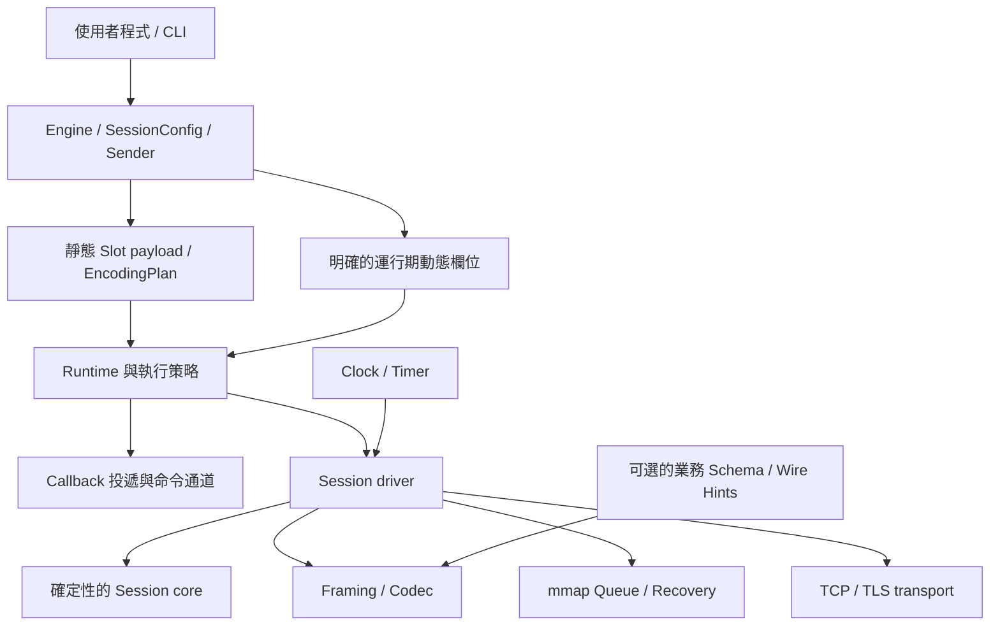

# NimbleFIX 從零重寫設計提案

- 日期：2026-10-20
- 最近修訂：2026-10-26
- 分支：`rewrite/usability-first`
- 原版基準：`d74031b85af5cb9dbb11eec62a11881d99cae594`

本文件是新實作的設計基線。本分支目前只有設計文檔；文中的 API、命令、檔案結構與驗收目標均為提案，尚未實作，也不代表已有相應效能或相容性成果。

設計基線：低延遲是首要優化目標，協議正確性、程序崩潰恢復與易用性是產品必須滿足的約束。預設使用 inline callback 與 appended 確認；正式 session 一律使用檔案支援的 mmap queue，保留程序崩潰後重啟與重發所需資料，收發熱路徑不等待逐筆磁碟同步。TCP 背壓、有限資源與恢復從第一個真實網路流程開始驗收。initiator 與 acceptor 都有完整的使用流程；業務字典可選且只使用 XML；generated getter/setter 與編譯期已知 tag 的收發介面共用 slot 表示與編碼後端。基本收發不要求使用者提供字典或執行 codegen，只有運行期才確定的動態 tag / 欄位結構允許使用字串追加路徑。

## 1. 我會把 NimbleFIX 做成甚麼

**一個以低延遲為首要目標，同時具備協議正確性、程序崩潰恢復與清楚使用契約的嵌入式 C++ FIX 引擎。**

使用者應能把時間用在訂單與回報邏輯，從公開 API 看懂何時可以發送、誰擁有訊息、失敗之後會發生甚麼。字典、執行緒、儲存與編碼策略由引擎提供一致且可驗證的契約。

保留的宗旨：

- C++20、可嵌入、低延遲、可控制資源使用。
- initiator 與 acceptor 都是第一級使用情境，共用協議核心。
- 完整的 session 生命週期、序號、重發與恢復能力。
- 每個正式 session 都有可恢復的 mmap queue store，預設先提交記錄再發送或交付，不等待逐筆 fsync / msync，沒有 memory store 選項。
- 收發皆有界，TCP 與應用背壓遵守 FIX 序號、心跳及重發規則；慢 session 不得無限制佔用其他 session 的資源。
- 不依賴業務字典的基本收發，以及可選的字典驅動型別化訊息與多層 repeating group。
- 字典統一為 XML；預生成的欄位名稱與直接使用靜態 tag 都在編譯期歸一為 slot 存取，不形成兩套不同成本的編碼器。
- slot 是按實際訊息形狀壓縮的邏輯欄位位置；儲存、初始化與編碼成本不能隨最大 tag 或整份 XML 字典大小增長。
- 對效能作分層量測，對第三方提供簡單且有文件的介面。

設計決策按以下原則取捨：

1. 協議正確性與已聲明的程序崩潰恢復保證是准入條件，不能用丟棄消息、破壞序號或隱藏失敗換取速度。
2. 在上述條件內，優先降低延遲與尾延遲，同時控制配置、複製、鎖、系統呼叫及資源用量；預設路徑就是主要低延遲路徑。
3. 易用性約束 API、預設值與診斷，讓使用者能理解成本、背壓與失敗後的處理，不必先掌握內部排程才能正確收發。
4. 功能廣度按依賴與證據逐步增加，不反向拖慢核心路徑。

每項優化必須同時通過協議、生命週期與使用者流程驗收。恢復的首要故障模型是程序異常退出、abort 或 kill 後，在 OS、檔案系統與儲存裝置仍正常的同一主機重新啟動程序；斷電、OS crash、磁碟損壞與跨主機災難恢復不列入首版保證或發布門檻，不為這些情境增加預設收發的同步等待。

## 2. 這次重寫的邊界

從乾淨的程式碼樹開始設計，不保留舊 API、舊設定格式、舊二進位 artifact 或相容包裝層。原版留在 `main` 與 Git 歷史中，作為行為參考及效能比較來源。

可以重新表達已確認的協議案例及需求，但新測試的預期結果必須經過規範核對。舊實作的輸出不能直接成為正確性的唯一依據。

首個正式發布版本聚焦；中途以第 16 節的可驗收切片交付：

- Linux 上的 C++20 函式庫、命令列工具與可直接執行的範例。
- FIX 4.4 tag-value、initiator、acceptor、完整 session 處理。
- 無業務字典的 flat 收發、可選型別化收發、巢狀 group、有限容量佇列。
- 從第一個 session 開始使用 mmap queue，持續保留序號、必要訊息與程序重啟恢復狀態，預設使用 appended 確認。
- 預設 inline 收發，以及發送端快於接收端時的有界背壓、短寫、停滯期限與重連恢復。
- TCP 與可選 TLS、重連、基本 session 時段設定。
- 真實外部程式的安裝、連結與部署驗證。

架構將 transport/session 版本與 application schema 分開；後續逐步加入 FIX 4.2、4.3 與 FIXT.1.1。每個版本必須獨立聲明和驗證支援範圍。

Router、HA、自動接管、熱更新、Orchestra 行為規則、Web 管理介面及其他編碼，延後到核心產品達標後再評估。這些能力各自有恢復、一致性或相容性成本，不能靠預留空介面宣稱支援。

## 3. 先定義使用者成功的樣子

| 使用者任務 | 產品承諾 | 驗收方式 |
| --- | --- | --- |
| 第一次執行 | 完成工具鏈準備後，一條範例命令完成本機登入、下單、回報與登出 | 在全新工作目錄執行，檢查退出碼及實際 FIX 流量 |
| 第一次寫程式 | 不提供業務字典也能建立 session、發送 flat 訊息與讀取 tag；需要 typed API 時直接使用內建 FIX44 schema | 無字典及 typed 範例都只用已安裝的公開頭與套件 target 編譯 |
| 接入對手方 | 常用的 CompID、Logon 欄位、TLS、心跳、重連及儲存都有直接入口 | 執行帶認證、TLS 和重啟恢復的整合案例 |
| 接受多個客戶端 | listener、允許的 session 身份、認證和資源上限可以分開配置 | 多個 initiator 同時登入、隔離錯誤，並回覆原 session |
| 重啟 acceptor | 同一客戶端重新登入時恢復自己的序號和重發資料，不受 TCP 來源端口改變影響 | 停止或終止服務後重新接入，驗證 session 身份與雙向 replay |
| 從其他執行緒下單 | 一般發送 handle 能安全使用，不受 callback 曾在哪條執行緒發送所影響 | 多生產者、callback 同時回覆及重連壓力測試 |
| 加入自訂欄位 | 修改 XML 字典，建置系統自動生成並驗證；不區分基底與擴充字典角色 | 修改 XML 後只觸發必要的重新生成與編譯 |
| 直接按 tag 填值 | 編譯期已知的 tag 與 generated setter 共用 slot 與 encoder，運行期值不影響這項保證 | 比較相同消息形狀的 layout、wire 結果、配置次數與效能 |
| 發送失敗 | 能區分尚未接受、已接受但傳送失敗，以及對手方業務拒絕 | 針對各故障點驗證結果、事件與日誌 |
| 對手方接收變慢 | 有限容量與明確的 queue_full、容量恢復通知及停滯期限，不阻塞其他 session | 對端限速或停止讀取，驗證短寫、記憶體上限、延遲與恢復 |
| 本地業務處理變慢 | 在有界 journal / 投遞預算內吸收短暫突發，必要時透過 TCP 背壓或斷線停止積壓 | 慢 callback、接收暫停、心跳及重啟後交付游標驗收 |
| 部署工具 | 執行檔離開原始碼目錄後仍可使用 | 移走原始碼、變更工作目錄後重跑案例 |
| 調校延遲 | 預設即使用 inline + appended，能明確選擇 queued 隔離及資源上限 | 對每種模式公布完整量測條件與結果 |

上手文檔的時間目標是：在支援的工具鏈已就緒時，讓未接觸過專案的 C++ 開發者在十分鐘內完成第一筆本機收發。這是需要實測的產品目標，不能把下載依賴或編譯時間隱藏在計時之外。

## 4. 一套業務 API，明確的進階選項

公開 namespace 統一為 `nimblefix`。標準 schema 使用 `nimblefix::fix44` 等可辨識名稱；自訂 schema 由使用者指定 namespace。

一般使用者只需理解五個概念：

| 概念 | 職責 |
| --- | --- |
| `Engine<Schema = FlatSchema>` | 擁有 runtime 與 mmap queue，預設不需要業務 schema，負責註冊、啟動及停止 |
| session / listener 設定 | session 描述對手方身份與恢復政策；listener 描述監聽與接入限制 |
| callback context | 當次回呼中的 session 資訊與發送能力 |
| message / view | 以有序 tag-value 或 generated 業務欄位建構、讀取訊息 |
| `Sender<Schema>` | 可保留、可交給普通應用執行緒的發送 handle |

不再要求使用者自行安排 Boot、LoadProfiles、Bind、建構 live wrapper 和開啟 listener 的順序。schema 綁定、資源初始化與執行緒建立都屬於引擎生命週期的一部分。

無字典與 typed 模式都使用相同的 session、發送結果與恢復契約。generated 欄位名稱提供便利的開發介面；編譯期已知的 tag 也直接填 slot，不因缺少業務字典而改用字串拼接。真正運行期決定的 tag / 欄位結構使用明確的動態入口。codec-only、raw inspection 與手動驅動迴圈仍可獨立使用。

### 4.1 目標 API：typed initiator

以下示意一般 initiator 的形狀；標準 FIX 4.4 頭文件隨套件提供。正式實作時，此類範例必須直接來自可編譯的原始碼。

```cpp
#include <iostream>
#include <utility>

#include <nimblefix/engine.hpp>
#include <nimblefix/fix44.hpp>

namespace nf = nimblefix;
using namespace nf::literals;

int main()
{
    auto created = nf::Engine<nf::fix44::Schema>::create({
        .storage = {.directory = "./state/buy-side"},
    });
    if (!created.ok()) {
        std::cerr << created.error().message() << '\n';
        return 1;
    }
    auto engine = std::move(created).value();

    engine.on_error([](const nf::ErrorEvent& error) {
        std::cerr << error.format() << '\n';
    });

    engine.on<nf::fix44::ExecutionReport>(
        [&engine](auto&, nf::fix44::ExecutionReportView) {
            engine.request_stop();
            return nf::Status::success();
        });

    engine.on_session_active([](auto& context) {
        auto order = nf::fix44::NewOrderSingle::make()
            .cl_ord_id("DEMO-001")
            .symbol("AAPL")
            .side(nf::fix44::Side::buy)
            .transact_time(nf::UtcTimestamp::now())
            .order_qty(100)
            .ord_type(nf::fix44::OrdType::limit)
            .price("150.25"_dec);
        auto sent = context.send(std::move(order));
        return sent.status();
    });

    auto session = engine.add_initiator({
        .name = "venue-a",
        .sender_comp_id = "BUY",
        .target_comp_id = "SELL",
        .endpoint = nf::TcpEndpoint{"127.0.0.1", 9876},
    });
    if (!session.ok()) {
        std::cerr << session.error().message() << '\n';
        return 1;
    }

    auto result = engine.run();
    if (!result.ok()) {
        std::cerr << result.error().message() << '\n';
        return 1;
    }
    return 0;
}
```

範例刻意只在 session active 事件中發送第一筆訊息。真實應用需自行決定重新登入後是否再次下單；引擎不替業務層決定訂單唯一性或自動重送策略。

範例預設使用 inline callback 與 appended mmap queue，先提交記錄再發送，不等待磁碟同步。業務 callback 不輸出終端文字；需要顯示結果時交給非 owner 執行緒的有界事件 sink。上手程式不需要先選擇 store backend，但必須提供明確的儲存目錄；測試範例由 harness 配置臨時目錄。

### 4.2 Callback 必須被可靠地綁定

- 用 `on<Message>(callable)` 明確註冊訊息處理器，保存具體 callable 與對應的呼叫入口。
- 簽名錯誤在編譯期給出聚焦的診斷；不使用「偵測不到 typed 方法就默默成功」的分派規則。
- 重複註冊、typed 模式所需 schema 缺失或設定不一致，在 `validate()` / `run()` 啟動前一次列出。flat 模式不因沒有業務字典而啟動失敗。
- `on()` 記錄冷路徑設定；正式啟動後凍結分派表，第一版不允許動態換 handler。
- 管理訊息由協議核心處理，業務 callback 不需要接管心跳或序號。
- typed 模式對有效但未支援的業務訊息套用明確的拒絕政策；flat 模式使用明確的 MsgType 註冊或 `on_message()` 通用入口。刻意忽略必須透過帶原因的 ignore 註冊聲明，不能因無字典而無聲丟棄。
- callback 回傳的失敗會觸發明確的 session 處理及 error event，不把業務邏輯故障偽裝成網路 EOF。
- 發送被拒絕不會自行變成 callback failure。範例中的 `return sent.status()` 是刻意選擇「回覆未被接受便停止受影響 session，保留未完成交付」；實際應用也可使用有界、可恢復的業務流程等待容量，但不能吞掉發送失敗後宣稱處理完成。業務拒單依消息語義明確回覆，不把所有失敗自動映射成 Reject 或 BusinessMessageReject。

### 4.3 設定應覆蓋日常接入需求

session 設定直接提供：身份與可選 qualifier、連線或 listener 綁定、Logon 額外欄位、認證政策、TLS 要求、心跳、重連、儲存與恢復、驗證規則、session 時段。initiator 配置遠端 endpoint 與送出的認證；acceptor 配置本地 listener、允許的遠端身份與驗證認證的方法。

帳密是常用設定，不應迫使使用者改走另一套底層 API。標準身份與管理欄位由引擎產生；自訂 Logon 欄位不能覆寫序號、BodyLength 或 CheckSum 等受管理欄位。

`SessionId` 由引擎分配，使用者用名稱查詢與識別。持久化身份由協議 session key 明確定義，不能把可修改的人類可讀名稱當作唯一恢復依據。

### 4.4 目標 API：acceptor 是完整的接入端

acceptor 使用者的主要工作是建立 listener、聲明允許的 session、驗證登入、處理客戶訊息並回覆正確的 session。listener 與 session 分開配置：一個 listener 可以服務多個客戶端，同一條 TCP 連線在認證及身份匹配完成後綁定到一個 session。

以下是與 4.1 的 initiator 配對的示意程式，使用相同的執行策略與發送結果：

```cpp
#include <iostream>
#include <utility>

#include <nimblefix/engine.hpp>
#include <nimblefix/fix44.hpp>

namespace nf = nimblefix;
using namespace nf::literals;

int main()
{
    auto created = nf::Engine<nf::fix44::Schema>::create({
        .storage = {.directory = "./state/sell-side"},
    });
    if (!created.ok()) {
        std::cerr << created.error().message() << '\n';
        return 1;
    }
    auto engine = std::move(created).value();

    engine.on_error([](const nf::ErrorEvent& error) {
        std::cerr << error.format() << '\n';
    });

    engine.on<nf::fix44::NewOrderSingle>(
        [](auto& context, nf::fix44::NewOrderSingleView order) {
            auto report = nf::fix44::ExecutionReport::make()
                .order_id(order.cl_ord_id())
                .exec_id(order.cl_ord_id())
                .cl_ord_id(order.cl_ord_id())
                .exec_type(nf::fix44::ExecType::new_order)
                .ord_status(nf::fix44::OrdStatus::new_order)
                .side(order.side())
                .leaves_qty(order.order_qty().value_or(0))
                .cum_qty(0)
                .avg_px("0"_dec);
            auto sent = context.send(std::move(report));
            return sent.status();
        });

    auto listener = engine.add_listener({
        .name = "main",
        .endpoint = nf::TcpEndpoint{"127.0.0.1", 9876},
    });
    if (!listener.ok()) {
        std::cerr << listener.error().message() << '\n';
        return 1;
    }

    auto session = engine.add_acceptor({
        .name = "buy-side",
        .listener = "main",
        .local_comp_id = "SELL",
        .remote_comp_id = "BUY",
    });
    if (!session.ok()) {
        std::cerr << session.error().message() << '\n';
        return 1;
    }

    auto result = engine.run();
    if (!result.ok()) {
        std::cerr << result.error().message() << '\n';
        return 1;
    }
    return 0;
}
```

這個範例只對 4.1 的樣本訂單回覆一次確認，以 ClOrdID 示意 OrderID / ExecID 的關聯；實際業務需驗證條件必填欄位、管理唯一 ID、處理拒單與重複訂單，並持久化自己的訂單狀態。FIX session store 不等於訂單管理資料庫。

`context` 已指向收到該訊息的 session，使用者不必拿 CompID 去全域 map 找回連線。外部撮合或風控執行緒可取得該 session 的 sender；sender 與監聽 socket 解耦，不因一次 TCP 斷線失去 session 身份。

### 4.5 兩種角色各自需要的契約

| 流程 | Initiator | Acceptor |
| --- | --- | --- |
| 連線 | 指定遠端 endpoint，執行重連政策 | 指定本地 listener，等待客戶端連線 |
| Logon 身份 | 送出本地 SenderCompID 與遠端 TargetCompID | 將收到的 TargetCompID 視為 local、SenderCompID 視為 remote，核對允許的身份 |
| 認證 | 提供需要送出的 Logon 欄位與 TLS client 政策 | 驗證對手方的 Logon 與可選 TLS peer 身份，兩者是分開的政策 |
| 恢復 | 開啟自己的 mmap queue，與對手方協調序號 | 依穩定 session key 找回 queue，在回覆登入成功前完成恢復與序號處理 |
| 業務 | active 後發送訂單並接收回報 | 接收訂單，在原 session 回覆回報；不同客戶端互相隔離 |
| 斷線 | 根據政策發起重連 | 釋放舊連線但保留 session 與 queue，等待同一身份重新登入 |
| 停止 | 嘗試 Logout、提交必要 journal 記錄及停止重連 | 停止接入新連線，逐個 session Logout / 提交；達到期限後回收剩餘連線 |

acceptor 還必須明確處理以下情況：

- 預設採靜態 allowlist。未知身份拒絕，不能先建立任意 store 再決定是否允許登入。
- 可選的動態接入 factory 收到有界、已完成 framing 的 Logon 資訊，以及 listener、local / remote address 和 TLS peer 資訊；明確允許後才註冊 session、開啟 store。
- 外部認證需要有界的 pending 狀態與期限，不能在 I/O owner 上等待遠端服務，或讓一個慢登入阻塞其他客戶。
- 同一 session 同時只允許一條 active 連線；重複 Logon 採明確政策，第一版預設拒絕新連線，不能出現雙 writer。
- 重啟後以 transport 版本、local / remote CompID 及明確 qualifier 找回 store；TCP 來源端口與臨時的內部 SessionId 不參與持久化身份。
- listener 支援接入數、未認證連線數、Logon 時限、frame 大小與動態 session 數上限；資源耗盡時回報清楚原因。
- 單一 session 的認證、queue 或磁碟錯誤依故障範圍隔離；若共用儲存資源失效而無法安全隔離，engine 才進入 failed。
- 多 worker 下不同 session 的業務 callback 可並行；同一 session 維持順序。應用共用的訂單狀態需要明確的協調方式。

## 5. 生命週期與發送結果

### 5.1 啟動不做隱藏的網路操作

建立 engine、註冊 callback、加入 session 都不連接對手方。`validate()` 執行離線檢查；`run()` 或手動模式的 `start()` 才開啟網路與工作執行緒。

`run()` 與 `start()` 共用同一啟動狀態機。初始化失敗會回收已取得的 socket、執行緒與 store lock，不留下半啟動的 engine。

對外狀態使用可理解的階段：

```text
configured → connecting / listening → logging_on → active
                                            active → recovering → active
                                            active → logging_out → stopped
                                   connection loss → reconnect_wait
                                     unrecoverable → failed
```

這是產品狀態視圖，不能取代內部完整的 FIX session 狀態機。每次狀態轉移帶有 session 身份、時間與原因。

### 5.2 `send()` 的承諾

`send()` 成功表示引擎已取得完整訊息的所有權並接受處理，**不表示已寫入磁碟、已寫入 socket，或已被對手方接受**。

- 回傳 `SendReceipt`，提供本機關聯識別碼；它不是 FIX 序號或訂單識別碼。
- 未 active 時預設回傳 `not_ready`；命令、待發送 byte 預算或背壓准入容量不足時回傳 `queue_full`，不等待 socket、不靜默丟棄或無限堆積。被拒絕的結果須讓呼叫者保留或取回原訊息，不能要求從已消耗的 builder 重試。
- 接受前驗證欄位、數值格式、當前模式可驗證的 schema 規則與最終 frame 長度上界，並保留命令、payload 與待發送所需容量。長度上界涵蓋 owner 稍後填入的序號、時間及管理欄位；owner 最終編碼不得再因輸入格式或 buffer 不足而失敗。不以完整編碼兩次實現此保證，預驗證與資源預留成本納入基準。
- 拒絕接受的訊息不取得 FIX 序號。flat 模式不虛構 required field 或 enum 語義檢查。
- 接受後的持久化或傳輸失敗透過可關聯的事件回報，並保留可查詢的 session 錯誤狀態。
- 對手方業務接受與否由 ExecutionReport / Reject 等協議訊息表達。
- 預設不自動重新提交業務 `send()`。接受前的 `queue_full` 可以等待容量後重試；已接受消息的 socket 短寫與 EAGAIN 由引擎繼續，應用不能再次提交同一訂單。接受後失敗或結果不明時，依 receipt、恢復及業務去重處理，不能把超時當成未發送。
- 所有失敗結果使用 `[[nodiscard]]`；文件明確說明每個錯誤是否可以原樣重試。

session owner 在首次對外寫出訊息之前，必須把對應的 outbound 記錄及序號決策一起提交到 mmap queue。預設以完整記錄已提交的 appended 邊界繼續，不等待 fsync / msync。跨執行緒的 `send()` 可先只回覆命令已被接受；程序重啟恢復保證從 appended 開始，不從記憶體命令入隊開始。

| Receipt 進度 | 含義 |
| --- | --- |
| `accepted` | 取得完整訊息與所需容量，尚不保證程序崩潰後存在 |
| `appended` | 訊息與序號決策已提交到 mmap journal，可在既定程序故障模型下恢復 |
| `written` | 完整 frame 已交給本機 transport；TCP 模式表示本機 socket 已接受全部 bytes，不代表對端已接收或業務已處理 |

進度以有界通知或查詢取得，不要求每筆消息配置 promise / future 或同步等待。斷線或停止可能使已接受消息進入未完成狀態，必須保留可關聯的結果；通知丟失不改變保留期間內可查詢的進度。receipt 查詢有明確保留容量與期限，過期回報具體狀態，不能把查不到當成未發送或無限制保留所有 receipt。若日後增加顯式同步模式，另提供 `synced` watermark，不改變上述進度含義。

斷線期間的離線排隊是明確選項。啟用時需要容量、過期時間及恢復政策；尚未進入 session 發送順序的訊息不提前取得 FIX 序號，發送時間在實際發送流程中產生。

### 5.3 停止與資源擁有權

- `request_stop()` 可從普通應用執行緒呼叫，提出有期限的優雅停止要求。
- 引擎停止接收新業務發送，依政策處理已接受訊息，嘗試 Logout，完成必要 journal 提交與交付 checkpoint 並 join 所有自有執行緒；預設不以逐筆同步磁碟作為停止前的收發門檻。
- 超時、強制停止與未完成訊息的處理都有事件和最終結果。
- callback 內只提出停止要求，不能等待自己所屬的工作執行緒退出。
- engine 析構保證資源被回收；需要確認最後發送、journal 提交與未完成消息的程式，必須顯式停止並檢查結果。
- engine 已結束後仍保留的 sender 回傳 `engine_stopped`，不解參照失效的 runtime。

## 6. 執行緒模型：把易用性成本說清楚

### 6.1 預設使用 inline callback

`Engine<>` / `Engine<Schema>` 預設等同 `Engine<Schema, Inline>`，在 session owner 執行緒執行業務 callback。接收消息提交 journal 後直接交付；callback 的 `context.send()` 可直接交給 owner，不增加一次跨執行緒命令往返。

callback 必須有界，不得等待 socket 可寫、磁碟、外部服務、其他 callback 或 engine 停止，也不在 owner 上格式化及輸出文字日誌。需要這些工作時顯式使用 queued 或外部工作執行緒。單一 callback 過慢會阻塞同一 owner 上其他 session 的 I/O 與 timer，執行緒拓撲與隔離見 8.2。

提供 callback 執行時間量測與 debug 告警；同執行緒計時只能在 callback 返回後發現超時，不能承諾強制中止任意阻塞的 C++ callback。故意永久阻塞的業務程式不在 inline 隔離保證內。

### 6.2 明確選擇 queued 隔離業務處理

`Engine<Schema, Queued>` 把業務 callback 放在與 session I/O 分離的有界應用 executor。每個 session 的事件保持順序，callback 不對同一 session 並行執行；不同 worker 可並行處理不同 session。同一應用 worker 仍會受慢 callback 影響，獨立 executor 不能解決永久阻塞。

queued 穩態投遞比較兩種候選：直接以 mmap journal reader cursor 交付，或以預配置 ring 傳遞記錄描述符並提供有界喚醒。ring 若持有 journal 位置，同樣受 lease 與 retention 約束；若複製消息，需計入複製與儲存成本。以相同負載、積壓、工作集及恢復契約量測後選定，不預先宣稱其中一種一定更快。

已提交記錄與完成交付 cursor 是恢復依據，ring 和喚醒通知不成為另一份權威狀態。穩態通知不要求逐筆 eventfd 系統呼叫；通知遺失不得讓已提交消息永久失去投遞機會。投遞資源達高水位時先停止排入更多 callback，接收端依 8.5 的有界預算繼續或暫停讀取，不使用 drop-newest。

兩種模式共用同一 session core 及消息模型，execution policy 在建構或啟動時選定，穩態迴圈不反覆判斷模式。協議核心不因策略模板複製成兩套實作；策略包裝、分派與是否內聯以編譯體積及延遲量測決定。

`context.send()` 依具體 policy 選擇正確路徑：inline 直接交給 owner；queued 提交已擁有的消息。兩者保持相同的接受、提交、失敗與恢復契約。預設 inline 與可選 queued 都是正式產品路徑，對外數據必須標明模式。

### 6.3 普通執行緒發送有安全的預設

`session.sender()` 取得可保留的 `Sender<Schema>`。普通 sender 支援多生產者，以有限容量的命令通道交給 session owner；callback 發送與外部執行緒發送可以共存。

不把內部某個 worker 的 SPSC 限制偽裝成「每個 handle 可以各自指定一條執行緒」。多生產者成本必須計入預設模式的 benchmark。

需要進一步降低成本時，提供明確的 producer lane：每條 lane 綁定單一生產者與有限容量，跨執行緒誤用回報具體錯誤。lane 是進階的效能選項，不能成為普通多執行緒下單的前置知識。

來自同一 producer 的命令保持順序；不同 producer 的相對順序以 session owner 實際採納處理的順序為準，不能從呼叫開始、返回時間或 SendReceipt 推導全域順序。跨連線與跨 session 不提供額外的全域順序保證。

## 7. 訊息、schema 與所有權

### 7.1 字典不是基本收發的必要條件

必須區分三件事：應用是否提供 XML 字典、引擎是否帶有內建 schema，以及協議本身所需的最小 wire / session 規則。無業務字典模式仍然知道 BeginString、BodyLength、MsgType、序號、CompID、SendingTime、CheckSum 和所支援管理訊息的格式；不要求協議核心完全沒有 FIX 知識。

| 能力 | 不載入業務字典的 flat 模式 | 內建或自訂 schema 模式 |
| --- | --- | --- |
| framing、BodyLength、CheckSum | 支援 | 支援 |
| Logon、心跳、序號、重發與 mmap queue 恢復 | 支援，由內建 session 規則處理 | 相同契約 |
| 發送不帶 group 的有序 tag-value | 支援；靜態 tag 在編譯期形成 slot plan，值可在運行期填入 | 相同 slot / encoder，另提供 generated setter |
| 解析一般不含內嵌 SOH 的欄位 | 支援，保留有序欄位與原始值 | 支援，另提供型別與名稱 |
| 依明確型別轉換數值 / 時間 | 支援，呼叫者指定轉換型別並檢查結果 | 可由 schema 選擇型別 |
| 業務 required field、enum、欄位歸屬與順序驗證 | 沒有業務定義便無法完整驗證 | 依 schema 驗證 |
| repeating group 的層級與邊界 | 不自動猜測；需要 group 描述 | 依完整 schema 描述 |
| 含內嵌 SOH 的二進位 Data | 需要已知 Length/Data 配對，可獨立提供 wire hints | 從 schema 取得配對 |

因此，最小接入入口是 `Engine<>`，不必先提供字典。相同的 `add_initiator()` / `add_listener()` / `add_acceptor()` 適用；儲存與恢復也不能因採 flat 模式而被省略。

下面示意 `Engine<>` 啟動前註冊的基本收發邏輯，不 include generated schema 頭文件。MsgType 與 tag 透過 template 參數成為編譯期資訊；欄位值可以來自實際業務資料：

```cpp
// engine 的建立、storage.directory、session 註冊與錯誤檢查同第 4 節。
engine.on_session_active([](auto& context) {
    auto order = nf::message<"D">()
        .set<11>("DEMO-001")
        .set<21>('1')
        .set<55>("AAPL")
        .set<54>('1')
        .set<60>(nf::UtcTimestamp::now())
        .set<38>(100)
        .set<40>('2')
        .set<44>("150.25"_dec);
    return context.send(std::move(order)).status();
});

engine.on_message([](auto&, nf::FlatMessageView message) {
    for (auto field : message.fields()) {
        // 在此以 field.tag / field.value 執行有界處理；終端檢視交給非 owner 的 sink。
        (void)field;
    }
    return nf::Status::success();
});
```

上述 raw tag 是使用者明確選擇的業務表達方式；generated API 才負責消除這些數字。引擎管理 8、9、35、34、49、56、52、10 等 session / framing 欄位，禁止以業務欄位重複注入，並自動計算長度與校驗碼。

`message<MsgType>().set<Tag>()...` 以型別攜帶有序的欄位集合，形成編譯期 slot layout；沒有 XML 時，宣告順序就是 wire plan 的欄位順序。它取得欄位值的所有權，拒絕非法 tag、受管理欄位、重複宣告的 flat 欄位及非法分隔符，但不宣稱已驗證 NewOrderSingle 的完整業務內容。發送端需按對手方要求填入欄位並保持必要順序。

接收 view 保留原始欄位次序，不把重複 tag 壓成一個 map 值。`find_unique(tag)` 只有在整個 frame 恰有一個該 tag 時才返回值，缺少與重複分開表示；它不證明欄位屬於最外層。帶 count=1 的未知 group 也可能沒有重複 tag，不能靠「沒有重複 tag」證明沒有 group。

acceptor 同樣可以使用 `on_message()`，在收到的 context 中以 `message<MsgType>().set<Tag>()...` 填 slot 並回覆；不需要先生成所有客戶端業務型別，也不需要透過全域連線表發送。

純 codec 使用者另可執行無字典的 frame 編碼與 flat 解析，不啟動 engine。這類無狀態工具可以不開 store；一旦使用正式 FIX session 收發，就仍須使用 mmap queue 並由 session core 管理序號。

### 7.2 XML 是唯一的字典文件格式

放棄 `.nfa`、`.nfd`、`.nfo` 及其編譯、載入和部署流程；字典只使用 FIX XML，不另設 overlay 格式或身分。schema 可以來自一份 XML，也可以由多份相同格式的 XML 共同提供定義；venue 擴充也直接用 XML 表達，不把第一份視為基底、後續份視為隱含覆寫層。

多份輸入依欄位、component、message 與 group 的識別合併，最終引用必須完整。完全相同的定義可去重，互相衝突的定義回報雙方 XML 來源位置，不能靠輸入次序靜默覆寫。wire 欄位順序來自 XML 中明確的結構定義，不來自載入文件的先後。

使用方式只有以下三種，不產生額外的字典 artifact：

- 不提供 XML：使用編譯期 tag / 欄位集合進行基本收發，協議核心保留內建的最小 wire 規則。
- 事先從 XML 生成 C++：取得有名稱的 getter/setter、enum、訊息與 group 描述，以及編譯期 slot layout。套件提供已生成的標準 FIX44 元件，使用者直接 include。
- 在需要的工具或應用啟動時直接讀 XML：建立必要的驗證與解析 metadata；它不能讓編譯期已知的 tag 改走動態字串建構。

內部正規化的 schema 模型只存在於生成器或程序記憶體中，不成為另一種使用者需要維護或部署的文件格式。`Fields`、slot descriptor 與 `WireHints` 是 C++ 型別或記憶體內的設定，不是替代 XML 的另一套外部字典語言。

生成器輸出 C++ getter/setter、slot 描述、group 描述與驗證 metadata。標準與自訂 XML 使用同一生成器；名稱存取與數字 tag 存取使用相同的底層欄位模型。

建置 helper 自動安排 XML 依賴、include 路徑及增量重建。生成的 C++ 放在目前 build directory，內容可重現；來源目錄保持可唯讀。使用者不需額外生成、安裝或尋找二進位字典。

若同時使用預生成 C++ 與運行期 XML，fingerprint 僅用來比對正規化 XML 定義與生成器版本，避免定義不一致；錯誤包含預期與實際 fingerprint、XML 來源位置及重新生成指令。不引入手工 profile id 或額外的 fingerprint 文件。

### 7.3 靜態 tag 與 generated API 在編譯期歸一為 slot

發送路徑的分界是 **tag / 欄位結構是否在編譯期已知**，與欄位值是不是運行期產生無關。來自交易流程的 ClOrdID、價格、數量與時間通常在運行期改變，仍然填入既定 slot。

例如，同一個 XML message 的兩種寫法。fluent expression 同時攜帶實際欄位形狀，不建立涵蓋整個 XML message 的巨型 builder：

```cpp
auto named = nf::fix44::NewOrderSingle::make()
    .cl_ord_id(client_order_id)
    .symbol(symbol);

auto tagged = nf::fix44::NewOrderSingle::make()
    .set<11>(client_order_id)
    .set<55>(symbol);
```

兩者的結構都歸一為：

```text
generated setter: cl_ord_id(value) ─┐
                                   ├─ set_slot<SlotOf<Shape, 11>>(value)
static tag:       set<11>(value) ───┘
                                         │
                              compact SlotStorage<Shape>
                                         │
                              compile-time EncodingPlan
                                         │
                                  bounded frame encoder
```

getter 同理：在已知 message layout 下，有名稱的 `view.cl_ord_id()` 與 `view.get<11>()` 使用同一個接收 slot / offset，不各自實作查找和轉換。在無 schema 的通用 view 中，parser 仍保留有序欄位與 offset 索引；不能憑靜態 tag 就假設 wire 上的欄位位置固定。

內部契約如下：

- `SlotLayout<Shape>` 在編譯期決定該形狀的緊湊 slot 索引、儲存型別、presence bit、group 子結構及輸出次序；相同 schema、message 與 shape 的兩種存取方式共用同一 layout。XML 中其他允許欄位不佔用此實例的 slot。
- `SlotStorage` 保存整數、decimal、時間、enum 的值及變長資料的穩定 byte 儲存。slot 是邏輯欄位位置，不表示變長 FIX frame 中的 byte offset 都是常數。
- `set<Tag>()` 在編譯期解析到 slot，不能在每次呼叫時查 map、建立 tag 的文字或組裝 `tag=value` 片段。generated setter 只是這個操作的具名入口。
- `EncodingPlan` 包含編譯期已知的 tag prefix、欄位 / group 次序及對應值編碼器。XML 模式依字典 wire 規則排列；無字典模式依明確的欄位宣告順序排列。
- setter 階段只填 slot、取得值的穩定所有權及記錄建構錯誤，不產生中間 FIX 字串。最終 encoder 才將值寫入有界的連續 frame buffer。
- 變動值的數字格式化、實際長度、BodyLength、SendingTime、序號和 CheckSum 仍在需要時求值；不能把「編譯期 layout」描述成所有 wire bytes 都能在編譯期決定。
- 最終 frame 寫入包含必要的 byte copy 與數字輸出，但不經過 `std::string` 加號、`ostringstream` 或逐欄位文字片段追加來建構靜態訊息。
- 跨執行緒發送攜帶擁有化的 slot payload 與對應 plan，session owner 再填入管理欄位並編碼、提交 mmap queue；不能先拼成字串，之後再解析回 slot。
- slot 佈局與生成的 C++ 不是磁碟格式；mmap queue 仍保存已定義的記錄及 wire bytes，不保存程序內指標或 C++ 物件佈局。

無 XML 的 `message<MsgType>().set<Tag>()...` 透過有序的 template 欄位集合形成自己的 layout，也進入相同的 slot / encoder 後端。具體做法是讓 fluent expression 的返回型別攜帶欄位形狀；不能假設一般的命令式 lambda 會自動向外回傳它呼叫過的 tag 清單。

需要在運行期條件分支中選填欄位時，先以 `Fields<Field<Tag, Type>...>` 宣告固定 layout，再由 `set<Tag>()` 與 presence bits 決定哪些欄位存在。不能因為某個 optional 欄位這次不填，就把整個訊息降為動態字串路徑。schema-known group 的 entry 數量和欄位值可以在運行期改變，其成員 layout 與編碼 plan 仍然是靜態的。

公開介面以 `set<11>(value)` 明示靜態 tag；不以「希望 compiler 把 `field(11, value)` 內聯折疊」代替這項保證。靜態 builder 不接受運行期 tag 參數，也不提供自動降級 overload；真正需要這項能力時使用 7.7 的動態入口。

#### 7.3.1 先區分兩種稀疏，不能只把 tag 改名為 slot

- **tag 數字稀疏**：只有 `11、55、900001` 三個欄位。對應的實體 slot 是 `0、1、2`，不能配置 `max_tag + 1` 格陣列或以 tag 數值作 byte offset。靜態 tag 到 shape-local slot 的關係在編譯期求得。
- **欄位出現稀疏**：XML 允許某訊息有很多 optional 欄位，但每次只填少量。即使 tag 已壓縮成連續編號，若每個實例仍為全部允許欄位配置、初始化和掃描，也會浪費記憶體及時間。

以下成本模型區分幾個量：`N` 是 XML 中該 message 允許的欄位數，`S` 是發送 shape 宣告的欄位數，`K` 是本次實際存在的欄位數，`B` 是實際欄位內容與 wire bytes。正常稀疏發送應使 `S` 接近 `K`，而不是讓 `S = N`。

| 做法 | 實例成本 | 問題或適用範圍 |
| --- | --- | --- |
| 以 tag 數字索引大陣列 | 隨最大 tag 增長 | 數字稀疏時不可接受 |
| 全 XML message 的 dense slots | 儲存 / 初始化隨 `N` 增長，完整編碼掃描也隨 `N` 增長 | 壓縮了 tag 數字，仍未處理 optional 欄位稀疏 |
| shape-local compact slots，主要快路徑 | 儲存與建構隨 `S` 及使用的 byte 儲存增長；只處理 shape 或存在欄位 | `S` 小且接近 `K`，不依賴字典的其他欄位 |
| 大範圍 mutable builder 的稀疏儲存 | 實際值可隨 `K` 增長，但需付索引、首次觸碰及有序列舉成本 | 只有確實需要此能力時提供，不宣稱與緊湊 shape 成本相同 |

例如，純為說明成本，假設每格均為 16 bytes：一份允許 2,000 個欄位的 message 若只填 12 個，完整 dense slots 為 32,000 bytes，12-slot shape 則為 192 bytes。這尚未計入對齊、presence、metadata、變長內容與管理 header，並非實際實作尺寸或量測結果。

真正的收益來自避開運行期 tag 查找、提前確定 prefix 與欄位編碼器，以及減少無用的初始化、掃描和資料搬移。slot 本身的名稱或一次 `O(1)` setter，不能證明整筆訊息更快。

#### 7.3.2 完整 schema 與每個發送實例分開

XML 生成的 `SchemaDescriptor` 保存完整合法欄位、canonical wire rank、required / conditional 規則及 group 定義，作為共享、唯讀的 metadata。它不決定每個訊息實例都要配置多少欄位值。

`Shape` 保存這個發送形式會使用的欄位集合。named setter 與 `set<Tag>()` 對相同 shape 產生同一 layout；值、presence 組合和 group entry 數量不各自生成新的 shape。以 schema 和 shape 共用 plan，不按 lambda 的來源位置重複生成，也不展開所有 optional 欄位組合。

有 schema 時，最終 shape / plan 依欄位與 group 結構及 schema wire rank 歸一；不同 setter 呼叫順序不要求產生不同 encoder。無字典時，明確的宣告順序本身就是 wire plan 的一部分，不能一律按 tag 數字排序。中間 expression 型別可以不同，共用的目標是最終 layout / plan；populate callable 的內聯或薄型別擦除以成本驗證，不把某一種 callback wrapper 當成唯一實作。

常規快路徑採 `make().named_setter(...)...` 或 `message<MsgType>().set<Tag>()...` 的型別化 expression。需要命令式條件填值時，先宣告小型 `Shape` / `Fields`，再使用 `send<Message, Shape>(populate)`；以少量可選 slot 表達必要的分支。

不把無 shape 限制的 mutable lambda 宣稱為零額外成本的 shape 推導方式。C++ 呼叫介面若沒有攜帶其欄位集合，就不能假設 compiler 能把一份涵蓋全 XML 的大 builder 自動縮到實際使用的幾格。若後續提供全 schema mutable builder，它仍填 slot，必須使用另外驗證過的稀疏儲存策略並揭露成本，不能默默改走文字追加。

slot 的值儲存依型別對齊與壓縮，讓常用欄位集中在少量 cache lines；不要求每格使用能容納所有型別的巨大 variant。字串等變長資料放在只記錄實際使用量的 byte arena，不為每個 optional 字串配置其最大長度。重用 pool 可以有明確容量上限，但每次不能清零整個容量、複製整個 builder 或把未使用的容量送進命令佇列。

fluent expression 也有自己的風險：若每追加一個欄位都重建 tuple 並搬移之前的所有值，`K` 次 setter 可累積成 `O(K²)` 次欄位搬移，變長內容更可能反覆複製。需驗證暫存節點、arena handle 與一次物化的實作，並提供可重用的明確 shape 建構方式；不能把 compiler 必定消除全部中間搬移當作 API 保證。

inline 情境允許 compiler 在遵守所有權與錯誤契約下消除中間 slot 物件或搬移；queued 情境則只擁有化並交接所需的 slot 與 bytes。統一 slot 中間表示不代表所有模式都必須經過一次實體的大物件複製。

#### 7.3.3 初始化、presence 與有序編碼一起處理

小型固定 shape 可直接使用緊湊 presence bits 和短 plan；只有真正的 optional 欄位需要 presence 判斷。大量可能欄位而 `K` 很小的情境，不能只增加一個大 bitmap 然後仍逐格或逐 word 掃描。

掃描 `S` 個 slot 的成本是 `O(S)`；掃描所有 bitmap word 仍是 `O(S / word_bits)` 加上輸出成本。bit scan 能加速列舉已存在欄位，但不會自動消除未碰觸 word 的掃描。

大而稀疏的已宣告集合需比較 active-slot list、touched-word list、分層 presence 或分塊儲存等策略。重複 setter 不可重複登記同一 active slot；一輪結束只清除本輪觸碰或建構的狀態，不讀取未初始化值，也不殘留上一筆的 presence 或資料。若使用 generation stamp，需計入 stamp 索引空間、併發隔離和計數回繞的處理，不能把成本藏進全域表。

有 schema 時，canonical wire order 不能被 setter 呼叫順序取代。小型 shape 在編譯期生成正確順序；全 schema 的稀疏 fallback 若採 active list，必須計入按 wire rank 排序或有序列舉的成本，不能把 `O(K log K)` 排序隱藏在聲稱 `O(K)` 的編碼中。排序只操作索引，不搬動變長值。無字典模式仍依明確宣告的 wire 順序輸出。

required / conditional 驗證仍依承諾執行：能由 shape 判定的缺失在編譯期診斷，其餘依已生成的規則與存在欄位檢查。不能為了宣稱成本與 `K` 成正比就略過協議或業務驗證；任意條件規則的成本應另外量測。

此策略同樣適用於 repeating group：依實際 entry 與各 entry 的 shape 儲存，不把所有可能成員與最大 entry 數的乘積配置成每筆訊息的實例大小。

#### 7.3.4 接收端不為整份字典清零或物化

接收仍須掃過實際 wire bytes，至少支付與訊息內容相關的解析成本；靜態 getter 不能消除這項工作。parser 對本筆出現的欄位建立緊湊 offset / length 索引，或依已宣告的接收 projection 填入小型 slot 集合，避免每筆建立或清零全 schema 的值物件。

tag 值分布很稀疏時，wire tag 到 schema 欄位或 projection 的識別成本也要計入。靜態 decoder 可以共用生成的分派資料，但不因此默認使用按最大 tag 配置的大表。已知 layout 的具名 getter 與 `get<Tag>()` 共用存取路徑；通用 flat view 保留明確的查找成本，不能把缺少 projection 的通用查找也宣稱為直接 slot 存取。

解析、保留原始欄位、型別轉換與驗證分別量測；不把「只讀少量 getter」和「只驗證少量欄位」混為一談。沒有被應用讀取的欄位，仍可能需要為 framing、group、合法性及 replay 保留或檢查。

### 7.4 Builder 與 view 的所有權契約

- 使用者傳入的字串與欄位值在 setter 返回前取得穩定儲存，不能悄悄保留短命的 `string_view`；把字串內容複製到 byte arena 不等於把欄位提前拼成 FIX 文字。
- `send()` 返回後不保留 populate lambda 或其引用捕獲。
- 以預配置的 slot、訊息儲存與 byte arena 控制分配；超過設定容量會明確失敗，沒有隱藏的熱路徑 heap fallback。
- fluent setter 可以累積第一個建構錯誤，`send()` 統一驗證並回傳欄位路徑；錯誤不會被後續 setter 清除。
- 有 schema 時，型別、required field、enum、group count、管理欄位衝突在接受發送前完成檢查；無 schema 時只承諾當前 wire / 欄位格式可以驗證的部分。
- 價格與數量以 decimal / fixed-point 表達；示例的 `"150.25"_dec` 在編譯期解析，外部文字輸入則以可失敗的解析函數處理，避免預設經過二進位浮點數轉換。
- 時間欄位有明確的 UTC 與精度型別，不把格式化字串當成唯一介面。

callback 內的 view 有效至 callback 返回。callback context 不可複製或移動，不作為可長期保存的 session handle；需要在外部發送時取得 sender。需要跨 callback、跨執行緒或長期保存訊息時，呼叫明確的 `copy()` / 擁有化入口。

有 schema 時，inline、queued 與 owned message 的 group accessor 使用同一份結構描述；複製後不能失去巢狀 group 的存取能力。queued 路徑可持有 mmap queue record 的有限生命週期 lease，或取得獨立的穩定儲存，不能把 I/O buffer 的短命指標交給應用執行緒。

擁有化物件的拷貝、移動與共享成本要有文件。callback 的 lease 返回後釋放，跨 callback 的擁有化使用獨立且有上限的儲存資源，不能無限制保留接收 slab 或 mmap segment 而阻止回收。

### 7.5 自訂欄位與驗證政策

簡單業務可以使用 flat 欄位；需要完整欄位語義、generated setter 或 typed group 時選擇 schema。未知欄位、enum 擴充、非標準欄位順序及 malformed 欄位各有明確政策，不能用一個模糊的 permissive 開關關閉所有保護。

raw inspection / forwarding 是獨立的進階能力，明示會保留或修改哪些 wire bytes；它不能繞過必要的 frame 邊界、長度、資源與 session 安全檢查。

FIX 版本、schema 方言和驗證政策分開建模。多 schema 接收端在啟動時註冊明確的身份與協商路由，選定 schema 後才進入相應的 typed dispatcher，不在每次業務讀取時重新猜測字典。

### 7.6 無字典解析的兩個邊界

**Repeating group 需要結構資訊，但不必是一整份 XML 字典。** counter 的數值只給出項目數，不能完整表達 delimiter、成員與巢狀邊界；這些資訊可以來自內建 schema、自訂字典，或明確的局部 group descriptor。完全沒有描述時，flat view 只能保留有序欄位，不能把猜測結果當作正確的 group tree。FIX 官方對 group metadata 與 counter 的描述可參閱 [Message Structures](https://fixtrading.org/concepts-part1-messagestructures/)。

**沒有 group 仍不代表可以對所有 payload 直接 split(SOH)。** FIX Data 欄位可能含分隔符，必須依對應 Length 欄位讀取指定 byte 數；Length/Data 配對是必要的 wire 資訊。[FIX 官方 TagValue 說明](https://fixtrading.org/fix-session-protocol-submitted-to-iso/)與 [Data 欄位定義](https://github.com/FIXTradingCommunity/fix-orchestra-spec/blob/master/v1-0-RC3/orchestra_spec.md#data-fields)說明這個關係。

第一版的明確契約：

- `Engine<>` 的基本 flat-text 路徑支援對手方約定不含 group、一般值不含內嵌 SOH 的訊息，不進行業務 schema 驗證。
- 內建支援版本的管理訊息與標準 Length/Data 配對由小型 wire 規則表處理，不要求載入整份業務字典。
- 自訂二進位欄位可另外宣告 `WireHints` 的 Length/Data 配對；靜態發送使用 `data<LengthTag, DataTag>(bytes)` 填入對應 slot，長度可在運行期決定。這不等於啟用整份業務 schema。
- 既沒有配對又可能收到自訂 Data 時，不宣稱支援完整欄位解析。可以保留依 BodyLength 取得的 opaque frame 作檢視，不能猜測二進位邊界。
- 不能自動辨識所有未知 group 或自訂 Data。flat-text 模式的輸入範圍是與對手方的明確契約，不是 parser 可以無中生有驗證的條件。
- 需要讀取 group、檢查欄位歸屬或完整業務有效性時，補上相應結構定義，仍沿用相同的 session、store 與發送結果契約。

### 7.7 只有真正的運行期 tag / 欄位結構允許字串追加

當 tag、欄位集合或次序只能由運行期資料決定，例如讀取未知欄位表、互動式工具或通用轉接器時，才使用顯式的 `DynamicMessage` / 動態欄位入口：

```cpp
nf::DynamicMessage message{runtime_msg_type};
for (const auto& field : runtime_fields) {
    message.field(field.tag, field.value);
}
auto sent = context.send(std::move(message));
```

這個入口允許有界的 tag-value 文字追加，也可在合適時使用運行期 slot；不強制使用低效率的通用字串串接實作。其容量、配置、欄位順序與格式化成本必須單獨量測。

值在運行期改變，甚至 MsgType 的文字在運行期改變，都不足以把已知欄位 layout 降級為動態拼接。是否採動態欄位路徑取決於欄位結構是否真的未知，以及使用者是否明確選擇這個入口。

動態入口仍取得值的所有權、拒絕管理欄位注入並遵守 Data 配對、容量和 session 規則；它不能接收任意片段繞過 framing、序號或 mmap queue。若日後支援靜態與動態欄位混合，只有明確的動態節點可以追加文字，已知部分仍使用原來的 slot plan，不能整體降級。

## 8. 內部架構：讓核心足夠小、足夠可驗證



依賴方向保持單向：

- codec 不依賴 socket、執行緒、store 或 engine。
- message 層統一定義 slot layout、欄位值、view offset 與編碼 plan；XML 生成的介面和直接靜態 tag 共用此層。動態欄位入口與靜態 slot 路徑有明確邊界。
- session core 接收已定義的事件，輸出明確的 action，不直接讀時鐘、開 socket 或同步呼叫業務程式。
- driver 解譯 action、協調 mmap queue 與 transport，將 append 完成或失敗結果送回 core。
- runtime 安排 session owner、命令與投遞資源，不複製 initiator / acceptor 的協議邏輯。
- CLI 把設定轉成公開模型，格式化公開事件；它不能持有另一套 session 行為實作。

### 8.1 純粹且可重播的 session core

輸入包括已依當前模式驗證的 frame、連線事件、timer 到期、應用發送命令、mmap queue append 完成或失敗與傳輸結果。輸出包括發送管理訊息、提交 queue record、請求 replay、投遞業務訊息、調整 timer 及關閉連線。

core 顯式記錄尚待完成的 action；需要 journal 提交之後才能推進的狀態，必須等待 append 完成事件。預設流程不等待磁碟同步完成。用固定容量的 action buffer 或回呼式 action sink 避免每次 transition 配置動態容器。

這使登入、斷線、gap、resend、replay、持久化失敗與日切可以在沒有真實網路、沒有真實 sleep 的情況下逐步重播。

### 8.2 所有 protocol state 由單一 owner 修改

每個 session 有且只有一個 owner。任何應用執行緒透過命令通道提出要求；protocol sequence、timer、重發範圍與 store 順序都由 owner 決定。

owner 是單一執行權，不表示每個 session 各自建立一條執行緒。自有 runtime 由明確數量的 event loop 分別擁有多個 session；啟動時固定 session 到 loop 的配置，首版不在連線存續或重連期間自動遷移。每輪對每個 session 設定收取 bytes、frame、命令、replay 及發送 bytes 的處理預算，並服務到期 timer，避免大量積壓獨佔 loop。需要強隔離時可把指定 session 放在獨立 loop；CPU 綁定與輪詢策略由明確部署選項控制。

initiator / acceptor 共享同一 driver；差異集中在連線建立、Logon 身份匹配與重連。身份匹配以本地視角定義，診斷同時列出 local 與 remote CompID，避免 sender / target 在接收端產生歧義。

未知對手方預設拒絕。動態接入需要顯式 factory / allowlist 與建立 session 的資源上限；不能僅因開啟 acceptor 就接受任意身份。

### 8.3 transport 與 timer 的邊界

先以穩定的 socket backend 完成非阻塞 TCP。TLS 是相同 byte-stream 介面的另一實作，不改變 session 的序號與儲存語義。io_uring 與其他 backend 在量測證明有收益後再加入。

連線、TLS handshake、Logon、讀寫停滯、Logout 及重連都有獨立且可設定的期限。timer 使用 monotonic clock；FIX 時間欄位、session 時段與日切使用明確的 wall-clock 規則。

時鐘跳變、部分 frame、黏包、短寫、半關閉與暫時不可寫都是常規測試輸入。網路層有明確的 frame 大小和緩衝上限。

TCP 使用非阻塞 socket；正常低負載立即嘗試發送，不為湊批主動等待。可寫事件只在存在待發送資料且需要恢復進展時監聽，排空後移除，避免空閒 socket 持續喚醒。若採 edge-triggered poller，處理預算用盡但尚未到 EAGAIN 的 session 保留在 ready list，不能等待一個可能不再出現的邊緣事件。[Linux send(2)](https://man7.org/linux/man-pages/man2/send.2.html) 與 [epoll(7)](https://man7.org/linux/man-pages/man7/epoll.7.html) 是短寫、可寫等待及公平排程的實作依據。

第一版 session 時段使用 UTC；其他時區在有明確時區模型與夏令時間測試後才開放，不能只依賴部署機器的隱含本地時區。

### 8.4 手動驅動模式保留完整語義

需要與既有 event loop 整合時，提供 `start()`、`poll_once()`、喚醒與下一個 deadline 的明確契約。手動模式由呼叫者服務 I/O 與 timer，不私下建立另一組自動輪詢執行緒。

業務 callback 的執行策略仍由 engine 型別決定；`poll_once()` 不改變 context 的發送合法性。第一版先支援自有 runtime，手動模式在同一 driver 上擴充，不能複製一份協議實作。

### 8.5 TCP 與應用背壓是核心契約

背壓從第一個真實 TCP initiator / acceptor 流程開始實作及驗收。長期輸入速率大於消費速率時，緩衝只能吸收有限突發；引擎必須把壓力傳回生產者，或在有界期限內結束受影響連線，不能無限增加記憶體或 journal。

#### 8.5.1 資源與進度分開計算

每個 session 分別追蹤有界命令通道、未完成 socket 發送、已接收但未完成業務交付、以及保留供 replay 的歷史記錄。上限同時包含消息數、bytes 及最老待處理消息年齡；不能用單一「queue depth」混淆這些階段。引擎另有總記憶體、journal 空間及執行預算，避免大量 session 合計超額。

每個方向使用有回差的高低水位：高水位限制新准入或投遞，降到低水位才解除，避免邊界抖動。預留完整 frame 的接收緩衝與在途操作所需空間，不能先超量讀取再丟棄；歷史 retention 與仍未完成的消息都計入磁碟預算。mmap journal 不作為無限離線發送佇列。

#### 8.5.2 發送端快、對手方讀取慢

| 情況 | 引擎行為 | 對應用的契約 |
| --- | --- | --- |
| 無積壓且容量足夠 | owner 編號、提交記錄後立即嘗試發送 | 成功接受由 receipt 識別，不代表對端已處理 |
| 短寫或 EAGAIN / EWOULDBLOCK | 保留當前 frame 的 byte offset，等待可寫並繼續剩餘 bytes，期間服務其他 session | 已接受消息不要求應用重新提交 |
| 積壓達准入上限 | 停止接受新的業務消息，保留管理資源及已接受消息 | 接受前回傳 queue_full，不分配序號、不消耗可重試的原消息 |
| 積壓降到低水位 | 發出容量恢復提示，更新可查詢狀態 | 普通應用執行緒可重試；多生產者競爭下重試仍可能 queue_full |
| 持續無進展或消息等待超出期限 | 停止新業務，嘗試有期限的 Logout，必要時關閉 transport | 回報明確的 write_stalled / backlog_timeout 原因及未完成 receipt |

同一連線先完成當前 frame，再依已決定的正常發送順序處理下一筆；不能在半條 FIX 消息中插入其他消息。待寫描述符可引用已提交 journal 記錄及 byte offset，避免完整 payload 再複製；segment 在 transport 不再引用前不可回收。已有多筆積壓時可使用有界 sendmsg / writev 批次，仍需準確處理跨 frame 的短寫與公平預算。

容量恢復通知是提示，應用可查詢最新准入狀態；註冊與重查的順序須避免漏掉恢復事件後永久等待。callback 不可同步等待容量，外部應用也不應以緊密重試迴圈消耗 owner 的 CPU。短暫 EAGAIN 本身不視為 session failure；停滯期限以實際 transport byte 進展計算，新命令入隊或建立 Heartbeat 不能刷新此期限。

#### 8.5.3 本地接收快、業務消費慢

queued 投遞達高水位時停止排入更多 callback；在剩餘 journal 與接收預算內，owner 可繼續 framing、協議處理及提交 inbound，以吸收短暫突發並回應管理消息。這段緩衝有明確 bytes、年齡與磁碟上限，不隱藏持續消費不足。

逼近接收硬上限時減少或暫停該 socket 的讀取，讓 TCP 接收窗口把壓力傳回對端；降到低水位後主動恢復服務，含 edge-triggered 下重新排入 ready list。只暫停相應 session，不阻塞整個 loop。inline 不具備 callback 與 I/O 隔離；慢 callback 返回後限制後續處理與讀取，永久阻塞 callback 依 6.1 的限制處理。

FIX 管理消息與業務消息共用 TCP byte stream。Heartbeat / TestRequest 可能排在業務 bytes 之後，不能承諾「停止讀業務但仍只讀心跳」。讀取暫停期間保留真實的協議 timer 與背壓原因，不偽造活動時間、不私自放寬對端心跳要求；超過資源或停滯期限時嘗試有期限的 Logout，無法完成便斷線。對端也可能因心跳逾時先斷線，必須能按相同恢復流程重新接入。

#### 8.5.4 FIX 順序、管理消息與恢復

- 為 Heartbeat、TestRequest 回覆、Logout、Reject 與恢復動作保留命令、buffer 及必要 journal 空間；owner 可優先處理管理動作，再為尚未編號的業務命令分配下一序號。此安排不承諾管理消息能越過已排入 TCP 的 bytes，也不任意改變已編號的正常發送順序。
- 心跳與 TestRequest 的判定、回覆、Logout 及 resend 依所支援 FIX session 規則執行。建立一筆管理消息不等於它已送出；transport 進展、協議活動及業務完成時間分別記錄。
- 重連後丟棄舊 TCP 連線的 byte offset，按 session 序號與 journal 協調缺口。被要求重發的消息使用原 MsgSeqNum、PossDupFlag 與 OrigSendingTime，重建完整 frame；不能把已編號消息當作新訂單再取一次序號，也不能把舊 frame 的剩餘片段送進新連線。
- 預設可靠訂單與回報不因 queue 滿而丟棄、合併或覆寫。重發時若業務確有過期訂單等跳過需求，須有顯式、符合對手方約定的 replay 政策及 GapFill；不能把 GapFill 或 sequence reset 當成清空積壓的捷徑。
- inbound journal 記錄與 NextNumIn 的推進一致提交；業務完成 cursor 另行記錄。已提交但未完成 callback 的消息從本地 journal 重投遞，尚未完成協議接收的範圍按 FIX 序號恢復，不能因 callback 慢就把已接收消息重複當成網路缺口。
- replay 也受發送容量、公平預算及停滯期限限制，避免重連時一次讀出整段歷史造成另一輪無界積壓。已完成 socket 寫入不作為刪除重發歷史的充分條件。
- TLS 實作把明文、密文及內部待寫緩衝計入相同容量模型，保留 transport 所需的重試狀態；不能用 TLS 隱藏的無界緩衝繞過背壓。

協議依據為 [FIX Session Layer §4.5–4.8](https://www.fixtrading.org/wp-content/uploads/download-manager-files/FIX_Session_Layer_June_2020.pdf)；水位、資源預留、公平預算及本地停滯期限是 NimbleFIX 的實作政策，不宣稱為 FIX 統一定義的參數。

## 9. 協議正確性、持久化與恢復

### 9.1 完整 session 能力先於正式發布

首個正式版本需覆蓋所宣稱 FIX 4.4 範圍的 Logon / Logout、心跳與 TestRequest、序號檢查、ResendRequest、replay、GapFill、SequenceReset、重連與恢復。

重複與過期訊息、PossDup / OrigSendingTime、管理訊息 replay、同時發生的 resend、錯誤 frame、錯誤身份與 reset 政策都必須有獨立案例。不同 FIX 版本的差異以明確的版本規則處理，不靠使用者組合一堆不相容的布林開關。

建立支援矩陣，逐項區分「實作並驗證」「不適用」「尚未支援」。只公布已核對來源與預期語義的案例覆蓋，不能用測試總數代表協議完整性。

### 9.2 mmap queue 是唯一正式 store

移除 memory store。每個正式 FIX session 都必須使用磁碟檔案支援的 mmap append-only queue，作為訊息、序號及恢復事件的權威紀錄；記憶體索引與快取只能由 queue 重建，不能成為唯一狀態來源。

這個方向借鑑 Chronicle：其公開架構把 FIX 訊息與 session 狀態持久化到 Chronicle Queue，而 Queue 使用 memory-mapped、依序追加的檔案。[Chronicle FIX 架構](https://chronicle.software/tech-hub/technical-information/chronicle-fix/introduction)、[Chronicle Queue](https://chronicle.software/products/chronicle-queue) 支持這項參考。NimbleFIX 採用的是這個設計方向，暫不引入其實作依賴，也不承諾檔案格式相容或相同效能。

queue 在這裡是**可索引、可反覆重播的 journal**，不是讀出後刪除的 FIFO。它具有一個 appender 及獨立 reader cursor：

- appender 由 session owner 擁有，順序追加 inbound、outbound 與必要的 session transition。
- resend reader 依方向、session epoch 與 FIX 序號定位歷史紀錄。
- application reader 追蹤接收訊息的業務交付進度。
- 診斷與稽核 reader 可唯讀跟隨記錄，不修改正式交付或重發 cursor。

普通 sender 的記憶體命令通道只負責跨執行緒交接，不是另一種 session store。尚未取得 queue 提交回報的命令在程序崩潰時可能消失；需要已持久化確認的應用應等待 receipt 的相應進度，不能只檢查 `send()` 是否接受。

第一版以每個 session 獨立的 queue 與分段檔案隔離身份及恢復，不讓所有 session 爭用一個全域 writer。大量 session 的 mapping、檔案描述元及索引有明確資源預算；未來若共用 shard queue，必須保持每個 session 的順序、隔離與恢復契約。

### 9.3 預設 appended，恢復範圍聚焦程序崩潰

正式預設採用 `confirmation = "appended"`。store 使用檔案的共享映射，完整記錄及其序號決策提交後即可繼續協議發送或業務投遞，收發熱路徑不等待逐筆 fsync / msync。這個選擇同時服務低延遲與程序重啟恢復，不能把匿名記憶體或 MAP_PRIVATE 當成相同 store。

| 方向 / 狀態 | 預設承諾 |
| --- | --- |
| outbound | 訊息與序號決策提交後才首次寫出；程序重啟可找回已提交記錄並按 FIX 規則恢復 |
| inbound | 已依協議接收的消息與 NextNumIn 決策提交後才交付；未完成交付從 journal 恢復，可能重複但可識別 |
| transition / checkpoint | 恢復所需事件按提交順序保存；checkpoint 及索引可由已提交 journal 重建，不先於其依賴記錄發布 |
| 僅 accepted 的命令 | 尚在記憶體命令通道，程序崩潰可能消失；receipt 的 appended 才是可恢復邊界 |

保證前提是程序異常退出後 OS、檔案系統與裝置仍正常，store 目錄保留。斷電、OS crash、裝置損壞與跨主機接管不列入首版恢復保證，也不安排斷電測試作為發布前置條件。程序崩潰中斷 append 仍在範圍內，必須辨認未提交尾部，不能把部分記錄當成完整消息。

首版只承諾 appended；`synced`、group commit 及完整磁碟同步確認可依實際需求後續增加，未實作的 confirmation 值在預檢時報錯。日後若提供，須另定明確故障模型與 synced watermark，不把非同步背景回寫命名為「發送前已同步」。正常 OS 回寫可以進行，但不能以每筆等待同步作為預設路徑。

共享映射及同步的系統語義參閱 [mmap(2)](https://man7.org/linux/man-pages/man2/mmap.2.html) 與 [msync(2)](https://man7.org/linux/man-pages/man2/msync.2.html)。省去逐筆同步不代表 mmap 存取永遠不阻塞；預配置、預觸頁、長時間背景回寫與輪轉的成本仍需量測。

基本 codec 單元測試可使用 test double；它不是可配置、可部署的 memory store。session 整合測試與 hello-fix 使用臨時目錄內的真實 mmap queue；重啟案例保留該目錄直到驗收完成。正式效能量測揭露實際儲存裝置及檔案系統，不能用 tmpfs 取代正式 store 的長時間成本。

### 9.4 queue 格式與恢復流程

- 記錄包含 queue 格式版本、session 身份、epoch、方向、序號或事件型別、長度、內容完整性資訊與提交狀態；有業務 schema 時可額外記錄 fingerprint，無字典記錄沒有這項前置要求。
- 以固定格式、offset 與穩定的記錄識別保存資料，不寫入 C++ 指標、物件佈局或程序內地址。
- append 完成與 reader 可見有明確邊界；先寫完整 header / payload 與完整性資訊，再以定義好的原子發布及記憶體順序提交。commit marker、checksum 與 checkpoint 的順序以程序中止故障注入驗證，不能把尚未完整寫入的記錄發布給 reader 或 transport；release / acquire 不代表磁碟同步。
- checkpoint 記錄可重建的序號與交付進度，索引映射 `(epoch, direction, FIX sequence)` 到 queue 位置；損壞或過期的索引可由已驗證記錄重建。
- 恢復時從有效 checkpoint 掃描連續紀錄，辨識未提交或 torn tail；不能越過不明損壞繼續猜測序號。修復與截尾有明確且可稽核的政策。
- 同一 session queue 有排他 writer lock，避免兩個 engine 或 acceptor 的兩條連線同時推進同一身份。
- outbound wire frame 與序號決策使用一致的提交模型，完成後才寫入 socket；checkpoint 不可先於其引用的記錄。比較直接在預留 journal payload 編碼與先編碼再追加的成本，無論採哪種都不得暴露部分 frame；replay 從保存記錄重建需要的重發 header，不原地覆寫歷史紀錄。
- inbound 記錄、預期序號、callback 投遞與 delivery cursor 的順序明確；callback 返回後才推進相應完成 cursor。崩潰可能重複投遞，回呼需要 replay 標記和穩定關聯識別碼。
- callback 的完成事件經 owner 排序，若處理結果依賴該次 callback 提交的回覆，須先確認相關 outbound 已 appended，才提交 inbound 完成 cursor。queued 的 send 命令與完成事件也須保留此依賴；不能在回覆僅 accepted 時先標記接收消息完成，造成崩潰後回覆與重投遞依據同時消失。這不把外部資料庫副作用納入同一交易。
- 不承諾應用 callback、外部資料庫與對手方之間的 exactly-once；業務層需要自己的去重或交易協調。
- segment 預先配置並按容量或時間輪替；輪替不等於 FIX 日切，也不自動 reset sequence。所有跨 segment 的 cursor 都能在重啟後重新定位。
- 預先準備可用 segment 並預觸寫入頁，輪轉所需開檔、空間配置及索引維護盡量移出逐消息路徑；備用容量耗盡時以背壓或明確失敗處理，不隱藏 heap fallback 或無界同步擴展。
- reader lease 與 segment 回收有界；retention 同時考慮協議可重發範圍、未完成業務交付與有效 reader，不因讀取完畢就刪除資料。達到磁碟預算時明確 backpressure 或停止 session，不覆寫仍需恢復的紀錄。
- store 損壞、磁碟滿、檔案延伸失敗、映射存取故障、同步失敗與不相容格式都阻止不安全推進；預先配置和監控空間可降低風險，不能假設 mmap 寫入永遠不失敗。
- reset sequence 透過明確的 session epoch 與可稽核操作表達；一般重新啟動不重置身份、序號或 queue。

純 session core 測試使用 fake clock、fault-injecting store 和可控制的 transport；真正的 queue 另做每個提交邊界、程序中止、segment 輪替與 reader 落後的恢復測試。逐項核對記錄、序號及交付結果，不以「檔案仍存在」代表恢復成功。磁碟滿、損壞及映射錯誤至少要求可診斷地停止不安全推進，不擴展為磁碟故障後自動恢復的承諾。

## 10. 一個可預期的命令列入口

對使用者提供一個 `nimblefix` 執行檔，子命令共用參數、設定與診斷實作：

| 命令 | 用途 |
| --- | --- |
| `nimblefix init` | 產生配對的 initiator / acceptor 設定與獨立 store 目錄配置；遇到既有檔案預設拒絕覆寫 |
| `nimblefix validate --config PATH` | 離線檢查格式、跨欄位規則、資源與本機功能相容性 |
| `nimblefix run --config PATH` | 執行 initiator / acceptor，顯示生命週期與結構化錯誤 |
| `nimblefix schema ...` | XML 字典檢查、摘要及 C++ getter/setter 生成，不產出另一種字典格式 |
| `nimblefix inspect ...` | 查看 flat 訊息、schema 或 mmap queue，預設唯讀；無 schema 時不假造 group 結構 |
| `nimblefix doctor` | 顯示編譯能力、TLS/backend 狀態與本機設定問題 |
| `nimblefix bench ...` | 執行明確指定邊界的量測；屬於可選開發元件 |

`validate` 不開 listener、不連接對手方，也不聲稱已驗證遠端認證或網路可達性。可能會修改 journal 的恢復工具必須與唯讀 inspect 分開，明示修改計畫並採用明確的寫入選項。

### 10.1 使用一份有版本的 TOML 設定

選擇 TOML 作為 CLI 公開設定格式，以具名欄位表達，不使用依賴位置的長欄位紀錄。使用固定版本的解析器，不自行發明通用格式解析器。函式庫接受相同的結構化設定模型，不要求應用一定從檔案載入。

```toml
version = 1

[engine]
dispatch = "inline"
schema = "fix44"

[engine.storage]
directory = "./state/buy-side"
confirmation = "appended"

[[sessions]]
name = "venue-a"
role = "initiator"
transport = "FIX.4.4"
sender_comp_id = "BUY"
target_comp_id = "SELL"
endpoint = "127.0.0.1:9876"

[sessions.logon]
username = "demo"
password_env = "FIX_PASSWORD"
```

配對的 acceptor 明確聲明監聽端點、允許的本地 / 遠端身份及登入驗證：

```toml
version = 1

[engine]
dispatch = "inline"
schema = "fix44"

[engine.storage]
directory = "./state/sell-side"
confirmation = "appended"

[[listeners]]
name = "main"
endpoint = "127.0.0.1:9876"

[[sessions]]
name = "buy-side"
role = "acceptor"
listener = "main"
transport = "FIX.4.4"
local_comp_id = "SELL"
remote_comp_id = "BUY"

[sessions.authentication]
method = "credentials"
username = "demo"
password_env = "FIX_PASSWORD"
```

加入另一位客戶時，在同一 listener 下新增 session 與自己的認證政策；store 依協議身份分開，不以 listener 的一個序號服務全部客戶。

CLI 的 `dispatch` 預設為 inline，在啟動時選擇 inline 或 queued engine 實例；`confirmation` 預設為 appended。兩個選項職責獨立，不因選擇 queued 改成同步落盤。`schema = "fix44"` 選擇預生成的 C++ typed 綁定，`schema = "none"` 或省略 schema 不啟用具名綁定。兩種角色都適用，其他連線與儲存設定不變。第一版同一 engine 使用一個業務模式；多 schema listener 路由屬後續擴充，不能用尚未實作的混合設定暗示支援。設定不能在穩態收發時改變 execution policy。

背壓設定由每個 session 的 `flow_control` 模型承載，engine 提供有限預設與總資源預算，session 可覆寫。至少包含以下項目；具體容量及期限在 baseline 後制定，首版不得以無限值作為預設配置：

| 設定項 | 含義與驗證 |
| --- | --- |
| 命令消息數 / bytes 上限 | 涵蓋尚未編號的跨執行緒與離線命令，不以 wire 積壓代替這項計數 |
| 待發送消息數 / bytes 高低水位與硬上限 | 限制未完成 transport 寫入的積壓；低水位小於高水位，高水位不超過硬上限，計入已接受命令的預留額度 |
| 未完成接收交付的消息數 / bytes 高低水位與硬上限 | 限制 journal 到業務完成 cursor 之間的積壓，包含投遞中消息 |
| 最老命令 / 待發送 / 待交付消息的期限 | 分別限制各階段等待時間，不能只靠容量維持高延遲積壓 |
| transport 無進展與接收背壓期限 | 持續停滯時結束連線，與協議心跳及 Logout deadline 分開觀察 |
| 管理資源預留與每輪處理預算 | 支援必要管理動作及多 session 公平性，不承諾繞過已阻塞的 TCP bytes |

資源預檢列出 session 及 engine 的預配置記憶體、journal 空間與檔案 / mapping 預算；上限互相矛盾、總額超出能力或不足以容納最大 frame 與管理預留時報錯。顯式設定的 socket send / receive buffer 也揭露有效值，不能靠巨大 kernel buffer 隱藏背壓。

若需要直接讀取業務字典，使用 `dictionary = "./venue-FIX44.xml"` 指定 XML，不另提供基底 / 擴充模式。`schema` 指已生成的 C++ 綁定，`dictionary` 指 XML 來源；兩者同時存在時檢查定義一致性，兩者都沒有時才完全不啟用業務 schema。沒有預生成綁定但有 XML 的工具可使用通用 callback 與 XML 驗證資料，不能假造有名稱的 C++ 方法。

設定契約：

- 命令列直接指定的路徑相對於目前工作目錄。
- 設定檔內的相對路徑相對於該設定檔所在目錄；若日後允許 include，各檔案以自身目錄解析。
- 不從編譯機的原始碼根目錄推導任何執行期路徑。
- 優先順序固定為內建預設、設定檔、明確 CLI override；不隱含讀取同名環境變數覆寫任意欄位。
- 密碼等秘密使用明確的環境變數或 secret provider 參照；錯誤、dump 和有效設定摘要都必須遮蔽。
- 沒有 storage directory、身份衝突、重複 active session 或 store 已有其他 writer 時直接失敗，不能降級成 memory store。
- 未知欄位直接報錯，防止拼字錯誤被忽略；格式升級有版本和遷移說明。
- 本機憑證與 key 的格式、可讀性，以及所需 TLS 能力在預檢時確認；遠端身份驗證在 handshake 時執行。
- 設定要求 TLS 而套件未包含 TLS 時明確失敗，不能降級成明文連線。

### 10.2 CLI 的錯誤契約

`--help` / `--version` 成功退出；操作成功用 0、執行失敗用 1、參數或設定錯誤用 2。中斷訊號觸發有期限的優雅停止，並保留對應的訊號退出語義。

數字解析必須消耗完整輸入並檢查符號和範圍；錯誤值不能截斷或環繞。輸入錯誤不會以未捕捉的例外終止程序。

設定錯誤一次彙整，包含來源位置、欄位路徑、原值、合法範圍與修正方向。例如：

```text
venue.toml:12:12: invalid_value [sessions.venue-a.endpoint]
  received: "127.0.0.1:65537"
  expected: TCP port in 1..65535 for an initiator
  fix: set endpoint to a valid remote host and port
```

同樣要求適用於 XML 字典、schema 綁定與 journal 診斷。提供穩定的錯誤代碼及 JSON 輸出；人類可讀文字可以改善，不作為程式解析介面。

## 11. 可觀察性是基本能力

每個 session 至少可取得：角色、listener 或遠端 endpoint、狀態與最近原因、local / remote 身份、下一個收發序號、最後實際收發時間、重連或接入次數、重發範圍、queue offset、appended 進度、協議接收與業務完成 cursor。可選同步功能實作後才增加 synced watermark。

背壓觀察分別顯示：命令消息數 / bytes、未完成發送消息數 / bytes、最老待發送年齡、最後寫入進展、當前短寫 offset、接收投遞積壓與年齡、讀取暫停狀態、journal 使用量及 reader lag。累計 queue_full、EAGAIN、短寫、高低水位轉移、暫停時長與 write_stalled / backlog_timeout；不能只提供一個無法定位瓶頸的 queue depth。必要時抽樣觀察 kernel 待送 bytes，避免把全部資料移入 socket buffer 後宣稱無積壓。

事件帶有 session、operation、error code 與可用的關聯識別碼。CLI 預設顯示登入成功、斷線原因、重連、恢復與停止結果；函式庫提供結構化事件、查詢 snapshot 及可選 sink。

- callback 失敗、queue 飽和和 store 錯誤必須保留原始原因。
- 正常收發不在 owner 執行緒同步格式化或寫入文字日誌；使用有界事件記錄及非熱路徑格式化。
- 熱路徑 metrics 以 owner / 執行緒本地計數及有界採樣維護，匯總與輸出移出熱路徑；error observer 由非 owner 的有界診斷通道呼叫，不讓範例的錯誤文字輸出阻塞正常 I/O。
- 日誌通道飽和時增加丟失計數，保留可查詢的最後錯誤，不能造成無界記憶體增長。
- 未註冊 error observer 時仍保留錯誤 snapshot；engine 級致命錯誤透過 `run()` 結果傳回。
- 對應用 callback 的例外有明確政策：在啟用例外的建置中捕捉、標記 callback failure 並停止受影響 session；error observer 再次失敗則停止 engine，不能靜默繼續。
- 正式 mmap store 保留恢復 / replay 所需的完整業務 payload；診斷文字與匯出預設只顯示摘要並遮蔽秘密。Logon 的秘密欄位以非秘密的恢復事件代替直接留存，不能把「診斷不列印 payload」誤當成「磁碟沒有 payload」。store 權限、留存與匯出規則是部署契約的一部分。

## 12. 建置、安裝與對外整合

### 12.1 開發主路徑使用 xmake

倉庫開發、測試及 benchmark 以 xmake 為主要入口。首次成功收發不要求先編譯全部測試、QuickFIX、fuzzer 或效能比較工具。

目標上手命令為：

```sh
xmake build hello-fix
xmake run hello-fix --self-test
```

`--self-test` 在本機配置臨時端口和獨立狀態目錄，啟動真實 acceptor / initiator，完成登入、下單、回報、登出後自行結束。輸出清楚的成功結果及非零失敗碼，使用者不需要猜測執行檔所在架構目錄。

另提供兩個終端的分開啟動流程、只啟動 acceptor 的流程，以及多個 initiator 接入同一 listener 的範例。範例分別涵蓋 `Engine<>` 無字典收發與 typed 收發；有一個 restart 案例會保留雙方 mmap queue 目錄，重新啟動後驗證序號及重發。

範例與正式 engine 一樣開啟 mmap queue，不能為了縮短上手命令而偷偷改用 memory store。正常範例使用正式公開 API，不把內部測試 harness 當作使用者工具。

### 12.2 CMake 消費入口必須完整

提供 CMake 的函式庫建置及安裝套件；公開 target 為 `NimbleFIX::nimblefix`。使用者以 `find_package(NimbleFIX CONFIG REQUIRED)` 取得 include、C++20 要求及所有必要的連結依賴。

TLS、系統執行緒或可選 backend 的依賴由 target 傳遞，不要求使用者手工猜測 `-lssl`、`-lcrypto` 或 `-luring`。套件檢查版本與必要 component；不支援的功能在預檢時列出。

自訂 XML 字典提供 xmake rule 與 CMake helper；兩者直接從 XML 生成 C++ getter/setter 與 slot plan，不要求中介字典檔。生成器與編譯器共用 slot 定義及驗證型別，不能各自產生行為不同的 backend。優先支援建置主機與執行目標相同的環境；交叉編譯需要可顯式指定的 host codegen 工具，不能嘗試執行目標平台二進位。

公開頭不包含原始碼路徑，不透過可選巨集改變公開物件佈局。第一版公開聲明原始碼相容性範圍，暫不承諾跨 compiler / 標準函式庫的二進位 ABI。

### 12.3 依賴與生成物保持乾淨

- 核心協議與 codec 的依賴保持精簡；XML / TOML 解析器限於需要的工具或設定元件。
- 無業務字典模式不需要 XML 解析器、codegen 或完整 FIX application schema；標準管理訊息與 wire 規則直接隨核心提供。直接靜態 tag 的 slot 模板可獨立使用；具名 getter/setter 是從 XML 生成的可選元件。
- TLS 為明確的建置能力；基本 TCP 不依賴 TLS。
- Catch2、QuickFIX 與 fuzz 工具只屬於測試或可選 benchmark，關閉相關目標後不能阻礙核心函式庫的 configure / build。
- 依賴版本與來源固定，離線發行包包含相應來源及授權資訊；建置過程不能暗中下載。
- 所有輸出寫入 build directory，不同建置目錄互不污染，支援唯讀 source tree。
- 重建時恢復必要的生成物，不把測試生成資產寫回來源 fixture。
- 直接載入 XML 的生成器與工具都要限制深度、項目數與輸入大小，並拒絕未明確允許的外部資源解析；錯誤指向 XML 的檔案、位置與定義名稱。
- 開始實作時恢復適用的 LICENSE，保留原專案及重新採用之第三方內容的授權與歸屬。

## 13. 以使用者流程組織測試

測試分成四層，任何一層都不能取代其餘三層。

### 13.1 協議與資料模型

使用 fake clock、純 session core 與內部 fault-injecting store double，覆蓋版本規則、frame 邊界、序號、resend、group、required field、enum、容量及恢復。double 不作為可供 engine 部署的 backend；mmap queue 另做實體檔案測試。搭配 property-based / fuzz 測試驗證長度、巢狀結構與 parser 邊界。

無字典案例獨立驗收：不載入 XML 或 generated application schema 的 flat 發送、解析與重發；保留有序欄位、重複 tag 的明確結果、管理欄位防注入、Length/Data 含 SOH、未提供自訂配對及無法判定 group 的限制。不能只測不含 SOH 的二進位樣本就宣稱已支援 Data。

### 13.2 對外 API 的契約

- 不正確的 callback 簽名有可理解的編譯失敗；正確 callback 必須真的被呼叫。
- queued 與 inline 分別驗證 callback 所在執行緒、session 順序及發送結果。
- 跨執行緒 sender、producer lane、停止後 handle、慢 callback、queue 飽和與取消都有驗收。
- accepted 前的驗證、容量預留與被拒絕消息的可重試所有權有明確驗收；最長管理 header、序號位數變化及 buffer 邊界不能導致 owner 接受後才發現輸入編碼錯誤。
- queue_full 不分配序號；已接受消息遇到 EAGAIN 不要求應用重送。容量恢復提示、註冊與重查、MPSC 競爭、消息及 byte 水位與最老年齡限制分別驗證。
- 短命字串、臨時值、view 複製、巢狀 group 和保留訊息都以生命週期工具驗證。
- 啟動失敗的資源回收、callback 內停止、重複停止與析構不會死鎖。
- flat 與 typed 模式都經過相同的 session 和 mmap queue 路徑；不提供記憶體 store 讓部分測試繞過恢復契約。
- 相同 schema、message 與 shape 的 generated setter 和 `set<Tag>()` 必須填入相同的緊湊 slot，對相同值產生相同 wire bytes、相同驗證結果及相同生命週期行為；getter 與 `get<Tag>()` 同樣比對。
- 無 XML 的靜態 tag 形狀也必須使用 slot / EncodingPlan 後端。以可觀察的編碼入口驗證：即使值在運行期改變，靜態案例對動態文字 encoder 的呼叫次數仍須為零。
- optional presence、變動字串長度、運行期 group entry 數量與分支選填都不能觸發靜態訊息降級；使用運行期 tag 呼叫靜態 builder 則應給出聚焦的編譯失敗。
- 真正的運行期 tag / 欄位集合只經顯式動態入口，與靜態 encoder 比對相同輸入的 wire 結果及容量錯誤，另測動態欄位的配置與追加成本。
- 固定實際 shape，只增加 XML 中不參與該訊息的 optional 欄位或擴大 tag 數字間距時，實例 slot 數、清零量與靜態 plan 遍歷數不能跟著增長；tag 文字位數變化所增加的 wire bytes 另外核對。
- 重用同一儲存池交替發送不同 presence、不同長度及不同 group entry 數的訊息，確認不輸出上一筆留下的欄位、未初始化值或過期 arena offset。
- setter 呼叫順序與 XML canonical wire rank 不同時仍輸出正確順序；重複 setter 的 active 登記、索引排序與 generation stamp 回繞有獨立案例。
- 排入命令佇列的 slot / byte payload 按實際使用量交接，不以完整 schema builder 或最大 arena 容量作為複製大小；owned 與 borrowed 生命週期契約維持一致。

### 13.3 真實使用流程

以 subprocess 與 loopback socket 驗證 CLI、TLS、Logon 認證、登入到訂單回報、斷線恢復及 mmap queue 重啟。端口由 OS 配置，不依賴固定端口或特定 cwd。

acceptor 專用案例至少包括：同一 listener 下多客戶端、local / remote 身份反轉、未知身份、錯誤認證、慢 Logon、重複登入、正確 session 回覆、單客戶故障隔離，以及服務重啟後從穩定身份找回 queue。兩個角色都要測預設 inline / 可選 queued、flat / typed、appended 提交與雙向 resend；尚未實作的同步模式不列入首版門檻。

store 案例包括程序中止時各 append / commit / send 邊界、損壞或過期索引、未提交尾部、磁碟滿、segment 輪替、reader 落後及 callback 完成 cursor。特別在 inbound 已提交、回覆 accepted / appended、socket 已寫出與完成 cursor 提交之間中止，確認回覆依賴與交付進度不會造成靜默遺失。恢復後逐項核對實際訊息與序號；保證已提交記錄可恢復，允許有標記的重複業務投遞，不要求 exactly-once。斷電與 OS crash 不列入首版驗收。

TCP 背壓驗收從首個真實網路切片開始，fake transport 可確定性注入，loopback 對手程式另以限速、暫停讀取及受控 buffer 製造實際壅塞：

| 案例 | 必須核對的結果 |
| --- | --- |
| 限速讀取、停止讀取、恢復讀取 | EAGAIN 與短寫可繼續，無高 CPU 忙重試；消息 / byte 預算及等待年齡有界；低水位解除准入限制 |
| 半條 frame 後斷線或殺進程 | 同連線不插入其他 frame；新連線不沿用舊 offset；依 FIX 規則以完整 frame 與原序號恢復 |
| 發送飽和時產生 Heartbeat / TestRequest / Logout | 管理資源可用，timer 與真實寫入進展不混淆；無法送出時按期限斷線，不無限等待 Logout |
| queued callback 消費變慢 | 短暫積壓由有限 journal 吸收；硬上限前暫停讀取；不丟棄、覆寫或越過未完成的同 session 交付 |
| 接收暫停時收到管理消息 | 不假造只讀心跳能力；期限與斷線原因清楚，雙方可透過正常 session 恢復重新接入 |
| 積壓或 replay 期間重啟 | 已接收但未交付走本地 journal；未完成協議接收的消息走 FIX 缺口恢復；序號、內容及 replay 標記正確 |
| 一個 session 持續慢讀或大量 replay | 其他 session 的 I/O、timer 與 callback 仍有公平進展，尾延遲與資源隔離有數據 |
| 長時間持續負載 | journal 回寫、預配置及 segment 輪轉不造成未觀察的無界積壓，磁碟預算耗盡時有明確結果 |

錯誤案例核對退出碼、診斷內容與 session 結果；不只斷言內部函數有返回值。特別保留跨目錄執行、錯誤端口、schema 不匹配及業務 callback 失敗案例。

### 13.4 真正的外部消費者

CI 把套件安裝到臨時 prefix，再在倉庫外建置獨立應用。驗證時不提供內部 include、原始碼根目錄或倉庫 build 產物，並測試 TLS 開關、可選 backend 和支援的 build configuration。

分別驗證只有核心元件的靜態 tag 應用，以及直接從 XML 生成 getter/setter 的應用；兩者都不能依賴額外的自訂字典 artifact。XML 修改後必須正確觸發增量生成、編譯與一致性檢查；多份 XML 的角色相同，調換輸入文件次序不改變相容定義的生成結果，衝突則報出來源。

README 的程式碼片段、上手命令和預期輸出由同一批可執行範例產生或檢查。文件中的程式碼若無法編譯，視為產品回歸。

舊版可以作為差異比較對象；協議相容性另以獨立對手方和經核對的標準案例驗證，避免兩端同時存在相同錯誤而互相通過。

## 14. 效能策略與衡量邊界

不沿用舊版數字作為重寫版的成果。先建立可重現的基準，再以 profile 決定優化順序。

| 量測邊界 | 包含 | 必須額外標示 |
| --- | --- | --- |
| codec | framing、flat / typed 解析、驗證、group 存取、建構與編碼 | 無字典或 schema、訊息大小、group 數、字串複製成本 |
| 靜態訊息建構 | generated setter、靜態 tag、slot 填充與最終 frame 編碼 | 相同消息形狀、運行期值、presence、配置與複製次數；另列動態路徑 |
| session | protocol transition、timer、序號、queue 提交、重發 action | mmap queue 確認政策、管理或業務訊息、正常或恢復路徑 |
| 應用交付 | flat / typed dispatch、queue reader、sender 提交 | queued / inline、producer 數量、callback 工作量 |
| 端到端 | 真實 socket、重連、TLS、儲存與應用交付 | 機器、核心綁定、負載模型、同步政策、網路條件 |

每層提供 throughput、p50 / p99 / p99.9、最大值、分配次數、記憶體與飽和點；樣本數足夠時另外提供 p99.99。恢復路徑與日後可選的同步儲存不能混進「純 codec」數字；應用排隊時間與從 API 接受到實際寫出的等待時間另外揭露，不能只量 owner 開始處理後的服務時間。

同一 shape-local layout 的具名 setter 與靜態 tag 先驗證共用 slot / plan，再比較完整成本；不能只因某次 compiler 最佳化後數字接近，就認定兩條實作已經統一。API 的型別與後端結構提供這項保證，不承諾所有 compiler 都輸出逐 byte 相同的機器碼。

同時追蹤 XML 生成時間、C++ 編譯時間、template 實例數和 binary 大小。共用相同 layout 的介面應重用 plan，不能為每種 getter/setter 拼法建立一套重複的巨型 encoder；fluent 靜態形狀的中間值搬移也必須納入成本，檢查增加 `K` 時有沒有反覆搬移前綴而形成平方成長。

### 14.1 專門驗證稀疏 slot 的成本

slot 是候選的統一中間表示，不是已經量測過的效能結論。基準必須拆開初始化、填值、驗證、presence 列舉、長度計算、編碼、reset 及跨執行緒交接，避免只量最快的一次 setter。

| 測試軸 | 固定條件 | 要找出的退化 |
| --- | --- | --- |
| tag 數字間距增大 | 欄位數、值長度、順序和驗證規則不變 | 按最大 tag 配置陣列、識別資料變大；tag 位數增加造成的 wire bytes 另計 |
| XML 允許欄位數 `N` 增大 | 實際 shape `S`、presence `K` 和相同相關驗證規則不變 | 每實例隱含的完整 builder、全 schema 清零或掃描 |
| 宣告的 `S` 很大但存在的 `K` 很小 | 實際 payload 與 wire 結果不變 | 大 bitmap 掃描、active 索引、排序與稀疏儲存的真正成本 |
| 實際 `K` 增加 | tag 位數、值型別和相關規則受控 | slot 建構、遍歷與 reset 的成長曲線，以及 shape / plan 的 code size |
| 變長內容 `B` 增加 | 相同 shape 與 presence | arena 複製、長度計算、編碼及 queue 交接是否重複搬移 |
| group 數量與稀疏度改變 | 成員 schema 相同 | 按最大 entry 數或完整成員集合配置與清零 |

候選比較至少包括 shape-local slots、完整 schema dense slots 的測試參考、以 active 索引處理的大型稀疏集合，以及直接生成的有界定序 writer。後者只作內部效能對照，不提供另一套公共訊息 API，也不使用通用字串拼接代替靜態編碼。

除了 latency 與 throughput，記錄實例大小、實際配置量、初始化 / reset bytes、搬移 bytes、slot / bitmap word 遍歷數、active 索引及排序成本，並在可用的量測環境記錄 cache miss 和指令成本。hot / cold 工作集、多 session 並行和排隊後交接都要測，不能只反覆重用一個永遠熱的 message。

固定 `S、K、B` 增加 `N` 時，主要快路徑的實例儲存、清零及 plan 遍歷量應保持不變；這是可直接檢查的結構要求。接收端的 tag 識別、完整驗證規則及共享 metadata 的成本則獨立報告，不承諾它們完全不受 schema 影響。

如果短小訊息的 slot 物化、presence 或二階段編碼比直接定序 writer 更慢，應優先縮小 shape、融合可消除的中間表示與避免重複長度計算；不能僅以「set 是 O(1)」忽略完整路徑的退化。所有消除中間狀態的優化都必須維持 setter 所有權、錯誤檢查與 session 提交契約。

### 14.2 端到端與發布基線

benchmark harness 與第一個 codec / journal 切片一起建立，每個後續切片都有相應邊界的數據，不等功能完成後才檢查效能架構。基線包括以下三類：

| 基線 | 用途與條件 |
| --- | --- |
| 絕對數據 | 公布實際延遲、吞吐、資源用量及吞吐與延遲曲線，先有可重現結果再訂數值 SLO |
| 空基線 | 最小非阻塞 TCP echo 與最小 parse / encode，揭露網路及 codec 基礎成本；不帶 session / store，不能當成正式引擎成績，也不直接相減兩個 p99 宣稱引擎開銷 |
| QuickFIX 對照 | 同機、相同消息組合、速率、warmup、CPU 配置、TCP 選項與記錄設定；公開版本、編譯參數、store 及實際同步行為，不僅憑 MemoryStore / FileStore 名稱判定耐久性相同 |

QuickFIX 互通是獨立的正確性驗收，快於 QuickFIX 只代表該配置下的相對結果。Chronicle 作為架構參考，跨語言、硬體與測量邊界的公開數字不作直接對比。

正式 session benchmark 一律啟用 appended mmap queue，分別量測預設 inline、queued、普通多生產者 sender 與進階 lane；不能用 memory store 的成績宣傳可恢復 session 的效能。若日後實作 synced 或 group commit，另列其同步邊界與結果。initiator 與多客戶端 acceptor 分開量測，列出 append、page fault、segment 輪替、reader lag、背景回寫及重啟掃描的成本。

端到端使用獨立、可控制速率的 open-loop load generator，避免 coordinated omission，保留到達速率、實際接受率、queue_full 及完整排隊延遲。串行 request-response 可作補充，不代替過載量測。測試低負載、接近容量、突發、持續過載及接收端限速，報告健康 session 在其他 session 壅塞時的尾延遲。

公開硬體、儲存裝置、檔案系統、內核、編譯器與 flags、CPU 綁定、SMT / turbo、dispatch、確認政策、schema、消息組合、warmup、時長、樣本數及多次結果差異。原始數據、腳本、設定與 commit 一同保存。量測邊界區分使用者態、內核及硬體時間戳，未取得 wire 時間戳時不宣稱 wire-to-callback。

設計目標：在明確配置的容量內，inline 的穩態 codec / session 路徑不做 heap allocation、不取共享鎖；queued 路徑的訊息儲存與佇列預配置，維持有界使用量。這些都是需要量測證明的目標，不涵蓋啟動、診斷格式化、業務程式自行配置或外部 I/O 成本。

用 allocator hook、系統呼叫追蹤與 perf 診斷分配、鎖、page fault、cache miss 及預設逐消息零 fsync / msync；正式延遲量測與 strace 等侵入式診斷分開執行。長時間測試涵蓋背景回寫、輪轉及工作集變化，不能只量永遠駐留 cache 的單一消息。

第一份穩定 baseline 建立後才訂定數值回歸預算。一般 CI 做功能與 benchmark smoke；專用機重複量測效能，避免把共享 runner 的單次抖動當作效能結論。

優化順序為：資料結構與複製次數、生成程式碼與查表、buffer 重用、批次與 cache locality，最後才考慮 SIMD、busy poll 及可選 I/O backend。優化不能讓使用者改寫業務 API。

## 15. 建議的程式碼與文檔結構

下列是未來實作目標；目前分支只有設計與評審文檔，尚無相應實作。

```text
include/nimblefix/        少量公開頭與標準 schema 入口
include/nimblefix/detail/ 安裝所需的 slot / plan 模板支援，不作為直接使用入口
src/message/             slot、欄位值、view 與共用編碼 plan
src/codec/               framing、欄位與 group 編解碼
src/session/             狀態機、版本規則與 action
src/runtime/             owner、driver、執行策略與命令通道
src/transport/           TCP、TLS 與 poller
src/store/               mmap queue、segment、索引、checkpoint 與恢復
src/schema/              生成器共用的 schema 模型
src/diagnostics/         錯誤、事件與 snapshot
tools/nimblefix/          單一 CLI
tools/schema/             字典生成器
schemas/                 固定版本及 venue 自訂的 XML 字典
examples/                flat / typed 收發、acceptor、多客戶端、認證、TLS、重啟、外部 sender
tests/                   契約、協議、整合與外部消費者驗收
bench/                   分層量測與固定負載資料
cmake/                   匯出套件與 schema helper
docs/                    使用者文件與設計決策
```

公開頭直接位於可安裝的 `include/nimblefix`，私有的非模板實作留在 `src` 的相應模組。需要讓外部應用實例化的 slot / plan 模板支援隨套件安裝於 `detail`，不要求使用者直接 include 或依賴其穩定性；生成細節不作為主要文件入口。

README 聚焦產品定位與第一筆收發，讓使用者分別找到「我要主動連線」及「我要接受客戶連線」的入口。後續文件依任務安排：無字典收發、typed 收發、acceptor 接入與隔離、執行緒、認證/TLS、mmap queue 恢復、自訂 schema、部署排查及效能。各選項都寫出預設值、效果、成本和失敗行為。

中文與英文至少同步覆蓋上述核心使用流程；詳細設計先集中維護一份權威文件，避免多份過時設計稿互相矛盾。重大決策記錄原因及驗收證據，不保留與現況混雜的歷史 API 指令。

## 16. 實作順序與完成條件

| 階段 | 交付內容 | 進入下一階段的條件 |
| --- | --- | --- |
| 0：設計基線 | 本提案、低延遲預設、程序故障模型、發送 / 背壓 / 所有權契約及支援範圍 | 重要不變量與驗收邊界完成審查；尚無可執行產品 |
| 1：codec / slot 驗證 | shape-local slot、靜態 tag、最小 XML 生成介面與共用 encoder、framing / flat parse、benchmark harness | 名稱與 tag 路徑 wire / layout 一致；稀疏成本、所有權、編譯診斷及編譯體積有證據；公布 codec baseline；不依賴網路或正式 session |
| 2：journal / inline session 驗證 | 真實 appended mmap queue、純 core、fake clock / transport、inline callback、receipt 及交付依賴 | 每個 append / commit / send 邊界的程序中止恢復；序號與未完成交付正確；EAGAIN / 短寫可確定性重播；session baseline，逐消息不等待 fsync / msync |
| 3：首條真實 TCP 流程 | build / install、FIX44 樣本消息預生成、雙角色 hello-fix、非阻塞 transport、有界背壓及基本多 session 排程 | 登入、下單、回報、登出與重啟；外部應用能連結；對端慢讀、短寫、半 frame 斷線、停滯期限及健康 session 公平性驗收；端到端與空基線 |
| 4：完整 FIX44 與 queued | 全部宣稱的 session 行為、group、分層驗證、完整內建 FIX44 綁定、queued、多客戶端、MPSC sender | 支援矩陣、雙角色獨立對手方互通；兩種投遞候選有對照；飽和、接收暫停、重投遞與 replay 背壓驗收；並行生命週期工具通過 |
| 5：部署與恢復加固 | queue 索引 / checkpoint / 輪轉 / reader、認證、TLS、時段、診斷 CLI 及長時間負載 | 程序重啟恢復與 store 故障停止、TLS 背壓、資源上限、結構化診斷及離開來源目錄部署通過；背景回寫和輪轉的尾延遲有數據 |
| 6：方言與擴充 | 自訂 XML、運行期 XML 載入、建置 helper、明確動態欄位入口、其他 FIX 版本、手動驅動 | 各版本獨立驗收，XML 增量生成與一致性檢查，動態成本獨立量測，公開 API 維持一致 |
| 7：優化與發布凍結 | 依 profile 優化、完整性能報告、回歸預算、文件與套件穩定化 | 預設 inline + appended、queued 及各發送入口的數據可重現；背壓、恢復與發布範圍全部達標；凍結前不再擴功能 |

階段交付可以只有部分功能，但必須使用最終架構中的真實元件，標明尚未支援的能力；不以固定回應或空實作假裝功能完成。階段 1、2 用於驗證架構，階段 3 是第一個使用者可執行的網路 demo，尚不等於可投入交易使用。

每個實作切片交付公開 API / 設定變更、不變量、可重現範例、測試與相應邊界的原始性能數據、已知限制及可回退點。協議預期由已核對規範和獨立對手方驗證，不只用同一實作的兩端互測。AI 實施也按此驗收，不能用產生程式碼的速度代替性能或恢復證據。

首個正式發布的最小門檻為階段 1 至 5，以及階段 7 的品質與量測要求全部滿足；階段 6 的每項擴充獨立列入支援範圍，未通過前不宣稱支援。synced、斷電恢復及災難恢復不列入本次發布門檻。

## 17. 對審核與後續討論的設計回應

| 已發現的使用障礙 | 新設計的根本約束 |
| --- | --- |
| queue 範例在錯誤的執行環境發送 | execution policy 決定 context 實作；兩模式各跑真實訂單收發驗收 |
| typed callback 被基底型別抹除後默默略過 | 明確的 `on<Message>(callable)` 註冊與編譯期簽名檢查 |
| 外部連結需要猜測傳遞依賴 | 安裝套件匯出完整 target，CI 建置真正的外部應用 |
| 非法 CLI 參數造成例外終止或截斷 | 共用的完整輸入解析、範圍檢查與穩定退出碼 |
| 執行路徑綁定來源倉庫 | CLI cwd / config 所在目錄的固定規則，部署移除來源樹驗收 |
| 簡易 API 無法提供 Logon 認證欄位 | 常用接入設定直接納入唯一的 session 設定模型 |
| 首次成功需要自行拼接大量步驟 | 無字典基本入口、可選內建 schema、自動生成依賴及可自行結束的 hello-fix |
| 錯誤找不到來源與欄位 | 結構化診斷攜帶來源位置、欄位路徑、原因與修正方式 |
| memory store 不能提供程序重啟恢復 | 移除正式 memory backend，從第一個 session 開始使用 mmap append-only queue |
| 使用方式偏重 initiator | acceptor 有配對程式、獨立 listener / session 設定、多客戶端與重啟驗收 |
| 字典成為簡單收發的前置障礙 | `Engine<>` 支援 flat 收發；group 與二進位欄位依各自所需結構資訊逐步擴充 |
| 字典有多種自訂格式與擴充角色 | 只使用 XML，直接生成 C++，不區分基底和覆寫層，不要求二進位字典部署 |
| 按 tag 填值退化成文字組裝 | generated setter 與靜態 `set<Tag>()` 編譯期歸一為 slot / EncodingPlan，只有顯式動態 tag 入口允許文字追加 |
| tag 數字或 optional 欄位很稀疏，slot 仍浪費空間與掃描 | 完整 XML metadata 與 shape-local payload 分離；初始化、presence、排序、reset、group 與交接成本獨立驗收 |
| 低延遲只存在於非預設配置 | 預設 inline + appended，從 codec / journal 階段建立基準，逐階段驗證完整成本 |
| 為斷電保證增加逐筆同步等待 | 首版聚焦 OS 仍正常下的程序崩潰恢復，完整記錄提交後繼續收發，同步確認延後獨立驗收 |
| TCP 慢接收端令積壓無界或忙重試 | 消息 / bytes / 年齡限制、短寫 offset、可寫等待、高低水位與有界停滯期限 |
| 誤以為管理消息能繞過 TCP 堵塞 | 預留資源但遵守 byte stream 與發送順序，無法前進時有限嘗試 Logout 後斷線恢復 |
| 收到消息與完成業務處理混為一談 | 協議接收 cursor、業務完成 cursor 及回覆提交依賴分開，已接收未完成消息走本地重投遞 |

## 18. 仍需用實作與量測回答的問題

本提案已選定低延遲優先、mmap queue 作為唯一正式 store、預設 inline + appended、以程序崩潰重啟為恢復範圍、有界 TCP / 應用背壓、initiator / acceptor 對等使用、可選且只用 XML 的業務字典、靜態 tag 與 generated API 共用 shape-local slot / plan、顯式動態入口、可選 queued、可多生產者的普通 sender、純 session core、有版本 TOML 及完整安裝套件等方向。這些方向不再留待 baseline 決定；以下實作細節以證據選擇，不能先用無依據的 magic number 固化：

- 每種負載的預設 queue、frame、group、slab 與擁有化容量，以及對應記憶體預算。
- 發送及接收各階段的消息 / byte 水位、最大等待年齡、停滯期限、管理預留與每輪公平預算，以及對應的資源估算與過載曲線。
- 多生產者命令通道的實作、爭用成本與 producer lane 的實際收益。
- slot 的變長資料儲存、fluent 靜態形狀的中間值搬移、layout / plan 重用，以及最終 frame 編碼之間可安全消除的複製。
- 大型已宣告集合在低 presence 下應選擇哪種稀疏儲存、列舉與 reset 策略；是否值得提供全 schema mutable builder，以及應公開的成本界線。
- mmap queue record / segment / index / checkpoint 佈局、讀取 lease、預配置、直接編碼及輪轉策略的成本與程序中止驗證。
- queued 的直接 journal reader 與描述符 ring，在相同恢復及 retention 契約下的延遲、複製、工作集及飽和成本。
- 無字典 wire 規則表的支援範圍、局部 group descriptor 介面，以及 flat / typed 共享的解析資料模型。
- 每個 execution policy 的效能回歸預算、長時間負載下的尾延遲與飽和行為。
- 哪些額外 backend 或編碼優化有足夠收益，值得增加建置與維護成本。

如果某個機制需要大量說明才能讓一般使用者避免誤用，應先調整 API 或預設值；如果某項優化無法用一致的公開契約描述，就不能直接進入主要業務路徑。
