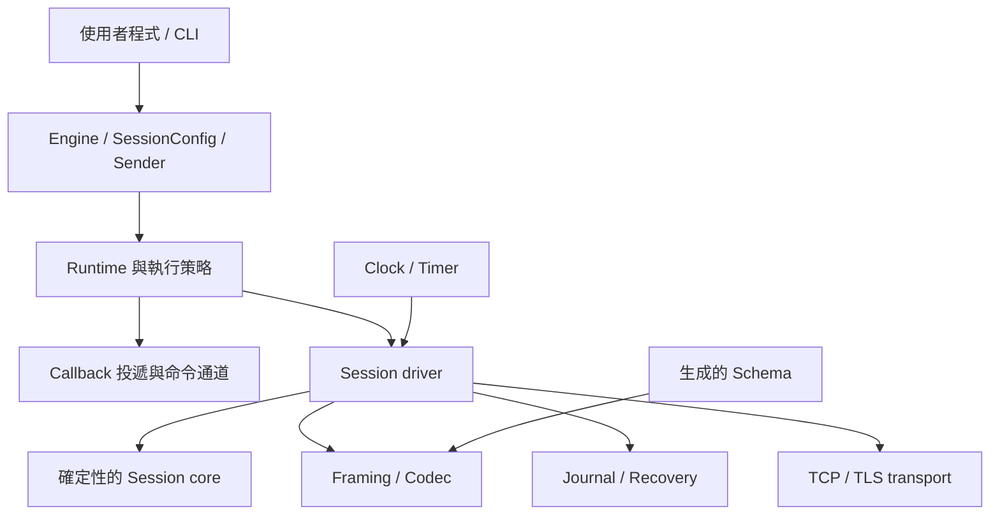

# NimbleFIX 從零重寫設計提案

- 日期：2026-10-20
- 分支：`rewrite/usability-first`
- 原版基準：`d74031b85af5cb9dbb11eec62a11881d99cae594`

本文件是新實作的設計基線。本分支目前只有設計文檔；文中的 API、命令、檔案結構與驗收目標均為提案，尚未實作，也不代表已有相應效能或相容性成果。

## 1. 我會把 NimbleFIX 做成甚麼

**一個讓 C++ 開發者容易接入、能清楚理解執行行為、並能按需要降低延遲的嵌入式 FIX 引擎。**

使用者應能把時間用在訂單與回報邏輯，從公開 API 看懂何時可以發送、誰擁有訊息、失敗之後會發生甚麼。字典、執行緒、儲存與編碼策略由引擎提供一致且可驗證的契約。

保留的宗旨：

- C++20、可嵌入、低延遲、可控制資源使用。
- initiator 與 acceptor 共用協議核心。
- 完整的 session 生命週期、序號、重發與恢復能力。
- 字典驅動的型別化訊息，以及正確的多層 repeating group。
- 對效能作分層量測，對第三方提供簡單且有文件的介面。

設計決策按以下順序取捨：

1. 協議與資料恢復的正確性。
2. API 的可理解性、錯誤可診斷性與行為一致性。
3. 延遲、尾延遲、分配次數與記憶體用量。
4. 功能廣度。

不以犧牲前兩項換取局部 benchmark 數字。每項優化必須同時通過協議、生命週期與使用者流程驗收。

## 2. 這次重寫的邊界

從乾淨的程式碼樹開始設計，不保留舊 API、舊設定格式、舊二進位 artifact 或相容包裝層。原版留在 `main` 與 Git 歷史中，作為行為參考及效能比較來源。

可以重新表達已確認的協議案例及需求，但新測試的預期結果必須經過規範核對。舊實作的輸出不能直接成為正確性的唯一依據。

第一個可交付版本聚焦：

- Linux 上的 C++20 函式庫、命令列工具與可直接執行的範例。
- FIX 4.4 tag-value、initiator、acceptor、完整 session 處理。
- 型別化業務收發、巢狀 group、有限容量佇列、持久化及恢復。
- TCP 與可選 TLS、重連、基本 session 時段設定。
- 真實外部程式的安裝、連結與部署驗證。

架構將 transport/session 版本與 application schema 分開；後續逐步加入 FIX 4.2、4.3 與 FIXT.1.1。每個版本必須獨立聲明和驗證支援範圍。

Router、HA、自動接管、熱更新、Orchestra 行為規則、Web 管理介面及其他編碼，延後到核心產品達標後再評估。這些能力各自有恢復、一致性或相容性成本，不能靠預留空介面宣稱支援。

## 3. 先定義使用者成功的樣子

| 使用者任務 | 產品承諾 | 驗收方式 |
| --- | --- | --- |
| 第一次執行 | 完成工具鏈準備後，一條範例命令完成本機登入、下單、回報與登出 | 在全新工作目錄執行，檢查退出碼及實際 FIX 流量 |
| 第一次寫程式 | 標準 FIX 4.4 不需要手動指定 profile id、生成 artifact 或處理 buffer | 只用已安裝的公開頭與套件 target 編譯應用 |
| 接入對手方 | 常用的 CompID、Logon 欄位、TLS、心跳、重連及儲存都有直接入口 | 執行帶認證、TLS 和重啟恢復的整合案例 |
| 從其他執行緒下單 | 一般發送 handle 能安全使用，不受 callback 曾在哪條執行緒發送所影響 | 多生產者、callback 同時回覆及重連壓力測試 |
| 加入自訂欄位 | 修改一份可閱讀的 schema 輸入，建置系統自動生成並驗證 | 修改 schema 後只觸發必要的重新生成與編譯 |
| 發送失敗 | 能區分尚未接受、已接受但傳送失敗，以及對手方業務拒絕 | 針對各故障點驗證結果、事件與日誌 |
| 部署工具 | 執行檔離開原始碼目錄後仍可使用 | 移走原始碼、變更工作目錄後重跑案例 |
| 調校延遲 | 知道預設成本，能明確選擇 inline 與資源上限 | 對每種模式公布完整量測條件與結果 |

上手文檔的時間目標是：在支援的工具鏈已就緒時，讓未接觸過專案的 C++ 開發者在十分鐘內完成第一筆本機收發。這是需要實測的產品目標，不能把下載依賴或編譯時間隱藏在計時之外。

## 4. 一套業務 API，明確的進階選項

公開 namespace 統一為 `nimblefix`。標準 schema 使用 `nimblefix::fix44` 等可辨識名稱；自訂 schema 由使用者指定 namespace。

一般使用者只需理解五個概念：

| 概念 | 職責 |
| --- | --- |
| `Engine<Schema>` | 擁有 runtime，註冊 session 與 callback，負責啟動及停止 |
| `SessionConfig` | 描述對手方身份、連線、認證與恢復政策 |
| callback context | 當次回呼中的 session 資訊與發送能力 |
| generated message / view | 用業務欄位建構或讀取訊息 |
| `Sender<Schema>` | 可保留、可交給普通應用執行緒的發送 handle |

不再要求使用者自行安排 Boot、LoadProfiles、Bind、建構 live wrapper 和開啟 listener 的順序。schema 綁定、資源初始化與執行緒建立都屬於引擎生命週期的一部分。

codec-only、raw inspection 與手動驅動迴圈仍可獨立使用，但不另建一套行為不同的業務收發 API。

### 4.1 目標 API 範例

以下示意一般 initiator 的形狀；標準 FIX 4.4 頭文件隨套件提供。正式實作時，此類範例必須直接來自可編譯的原始碼。

```cpp
#include <iostream>
#include <utility>

#include <nimblefix/engine.hpp>
#include <nimblefix/fix44.hpp>

namespace nf = nimblefix;
using namespace nf::literals;

int main()
{
    auto created = nf::Engine<nf::fix44::Schema>::create();
    if (!created.ok()) {
        std::cerr << created.error().message() << '\n';
        return 1;
    }
    auto engine = std::move(created).value();

    engine.on_error([](const nf::ErrorEvent& error) {
        std::cerr << error.format() << '\n';
    });

    engine.on<nf::fix44::ExecutionReport>(
        [&engine](auto& context, nf::fix44::ExecutionReportView report) {
            std::cout << context.session_name()
                      << " execution=" << report.exec_id() << '\n';
            engine.request_stop();
            return nf::Status::success();
        });

    engine.on_session_active([](auto& context) {
        auto sent = context.template send<nf::fix44::NewOrderSingle>(
            [](auto& order) {
                order.cl_ord_id("DEMO-001")
                    .symbol("AAPL")
                    .side(nf::fix44::Side::buy)
                    .transact_time(nf::UtcTimestamp::now())
                    .order_qty(100)
                    .ord_type(nf::fix44::OrdType::limit)
                    .price("150.25"_dec);
            });
        return sent.status();
    });

    auto session = engine.add_initiator({
        .name = "venue-a",
        .sender_comp_id = "BUY",
        .target_comp_id = "SELL",
        .endpoint = nf::TcpEndpoint{"127.0.0.1", 9876},
    });
    if (!session.ok()) {
        std::cerr << session.error().message() << '\n';
        return 1;
    }

    auto result = engine.run();
    if (!result.ok()) {
        std::cerr << result.error().message() << '\n';
        return 1;
    }
    return 0;
}
```

範例刻意只在 session active 事件中發送第一筆訊息。真實應用需自行決定重新登入後是否再次下單；引擎不替業務層決定訂單唯一性或自動重送策略。

### 4.2 Callback 必須被可靠地綁定

- 用 `on<Message>(callable)` 明確註冊訊息處理器，保存具體 callable 與對應的呼叫入口。
- 簽名錯誤在編譯期給出聚焦的診斷；不使用「偵測不到 typed 方法就默默成功」的分派規則。
- 重複註冊、缺少 schema 或設定不一致，在 `validate()` / `run()` 啟動前一次列出。
- `on()` 記錄冷路徑設定；正式啟動後凍結分派表，第一版不允許動態換 handler。
- 管理訊息由協議核心處理，業務 callback 不需要接管心跳或序號。
- 對有效但未支援的業務訊息套用明確的拒絕政策，發出結構化事件；刻意忽略必須透過 `ignore<Message>(reason)` 聲明。
- callback 回傳的失敗會觸發明確的 session 處理及 error event，不把業務邏輯故障偽裝成網路 EOF。

### 4.3 設定應覆蓋日常接入需求

同一份 session 設定直接提供：身份與可選 qualifier、連線或 listener、Logon 額外欄位、認證來源、TLS、心跳、重連、儲存與恢復、驗證規則、session 時段。

帳密是常用設定，不應迫使使用者改走另一套底層 API。標準身份與管理欄位由引擎產生；自訂 Logon 欄位不能覆寫序號、BodyLength 或 CheckSum 等受管理欄位。

`SessionId` 由引擎分配，使用者用名稱查詢與識別。持久化身份由協議 session key 明確定義，不能把可修改的人類可讀名稱當作唯一恢復依據。

## 5. 生命週期與發送結果

### 5.1 啟動不做隱藏的網路操作

建立 engine、註冊 callback、加入 session 都不連接對手方。`validate()` 執行離線檢查；`run()` 或手動模式的 `start()` 才開啟網路與工作執行緒。

`run()` 與 `start()` 共用同一啟動狀態機。初始化失敗會回收已取得的 socket、執行緒與 store lock，不留下半啟動的 engine。

對外狀態使用可理解的階段：

```text
configured → connecting / listening → logging_on → active
                                            active → recovering → active
                                            active → logging_out → stopped
                                   connection loss → reconnect_wait
                                     unrecoverable → failed
```

這是產品狀態視圖，不能取代內部完整的 FIX session 狀態機。每次狀態轉移帶有 session 身份、時間與原因。

### 5.2 `send()` 的承諾

`send()` 成功表示引擎已取得完整訊息的所有權並接受處理，**不表示已寫入磁碟、已寫入 socket，或已被對手方接受**。

- 回傳 `SendReceipt`，提供本機關聯識別碼；它不是 FIX 序號或訂單識別碼。
- 未 active 時預設回傳 `not_ready`；容量不足回傳 `queue_full`，不靜默丟棄或無限堆積。
- 編碼、schema 或欄位錯誤在接受前回傳；拒絕接受的訊息不取得 FIX 序號。
- 接受後的持久化或傳輸失敗透過可關聯的事件回報，並保留可查詢的 session 錯誤狀態。
- 對手方業務接受與否由 ExecutionReport / Reject 等協議訊息表達。
- 預設不自動重試業務 `send()`；不能讓不明確的超時結果造成重複訂單。
- 所有失敗結果使用 `[[nodiscard]]`；文件明確說明每個錯誤是否可以原樣重試。

斷線期間的離線排隊是明確選項。啟用時需要容量、過期時間及恢復政策；尚未進入 session 發送順序的訊息不提前取得 FIX 序號，發送時間在實際發送流程中產生。

### 5.3 停止與資源擁有權

- `request_stop()` 可從普通應用執行緒呼叫，提出有期限的優雅停止要求。
- 引擎停止接收新業務發送，依政策處理已接受訊息，嘗試 Logout，完成必要儲存並 join 所有自有執行緒。
- 超時、強制停止與未完成訊息的處理都有事件和最終結果。
- callback 內只提出停止要求，不能等待自己所屬的工作執行緒退出。
- engine 析構保證資源被回收；需要確認最後發送和落盤狀態的程式，必須顯式停止並檢查結果。
- engine 已結束後仍保留的 sender 回傳 `engine_stopped`，不解參照失效的 runtime。

## 6. 執行緒模型：把易用性成本說清楚

### 6.1 預設使用 queued callback

`Engine<Schema>` 預設把業務 callback 放在與 session I/O 分離的應用 executor。每個 session 的事件保持順序，callback 不會對同一 session 並行執行；不同 worker 可並行處理不同 session。

這讓一般應用不必因一次稍慢的業務處理直接停止協議收發。預設也必須明說：有限佇列會飽和，同一應用 worker 上的其他 session 仍可能受慢 callback 影響；獨立 executor 不能消除無限阻塞的後果。

佇列容量、深度、高水位與 callback 執行時間都可觀察。可靠業務收發預設不使用 drop-newest；飽和時暫停相應投遞並執行有界的 backpressure。若持續飽和導致協議無法服務，明確關閉受影響 session 並記錄原因。

### 6.2 低延遲模式明確選擇 inline

`Engine<Schema, Inline>` 在 session owner 執行緒執行 callback。它保持相同的業務欄位與發送語義，但文件明確要求 callback 有界、不可阻塞。

兩種模式採用同一套協議狀態機及訊息模型，內部以 execution policy 實例化 worker 與 callback context。模式在建構或啟動邊界選定，穩態迴圈不反覆判斷 dispatch mode。

callback 的 `context.send()` 依具體 execution policy 選擇正確路徑：inline 可直接交給 session owner；queued 必須提交已擁有的訊息。公開 API 不會給 queued callback 一個只能在 inline 執行的 handle。

預設 queued 與可選 inline 都是正式產品路徑，必須分別量測與測試。對外效能宣稱必須標示使用哪一種模式。

### 6.3 普通執行緒發送有安全的預設

`session.sender()` 取得可保留的 `Sender<Schema>`。普通 sender 支援多生產者，以有限容量的命令通道交給 session owner；callback 發送與外部執行緒發送可以共存。

不把內部某個 worker 的 SPSC 限制偽裝成「每個 handle 可以各自指定一條執行緒」。多生產者成本必須計入預設模式的 benchmark。

需要進一步降低成本時，提供明確的 producer lane：每條 lane 綁定單一生產者與有限容量，跨執行緒誤用回報具體錯誤。lane 是進階的效能選項，不能成為普通多執行緒下單的前置知識。

來自同一 producer 的命令保持順序；不同 producer 的相對順序以 session owner 實際採納處理的順序為準，不能從呼叫開始、返回時間或 SendReceipt 推導全域順序。跨連線與跨 session 不提供額外的全域順序保證。

## 7. 訊息、schema 與所有權

### 7.1 標準使用路徑不需要手動 codegen

套件提供建置時生成的 FIX 4.4 型別及描述資料，範例與一般使用者直接 include。標準使用路徑不要求 runtime 尋找來源倉庫內的 `.nfa`。

自訂 schema 保留 codegen，但輸入從使用者已經持有的 FIX XML 字典開始；以一種有版本的 overlay 表達 venue 擴充。第一版不另要求學習中介 `.nfd` 格式。

生成器輸出：型別化欄位、enum、message builder/view、group 描述、驗證資料與 schema fingerprint。標準與自訂 schema 使用同一生成器，不維護兩套手寫訊息模型。

建置 helper 自動安排生成依賴、include 路徑及增量重建。輸出放在目前 build directory，內容可重現；來源目錄保持可唯讀。

fingerprint 由正規化 schema 內容及生成器格式版本決定。需要外部 schema 資產的工具在啟動時檢查一致性；錯誤包含預期與實際 fingerprint、來源路徑及重新生成指令。使用者不必手工管理數字 profile id。

### 7.2 Builder 安全地接受一般 C++ 值

- 使用者傳入的字串與欄位值在 setter 返回前取得穩定儲存，不能悄悄保留短命的 `string_view`。
- `send()` 返回後不保留 populate lambda 或其引用捕獲。
- 以預配置的訊息儲存與 byte arena 控制分配；超過設定容量會明確失敗，沒有隱藏的熱路徑 heap fallback。
- fluent setter 可以累積第一個建構錯誤，`send()` 統一驗證並回傳欄位路徑；錯誤不會被後續 setter 清除。
- 型別、required field、enum、group count、管理欄位衝突在接受發送前完成檢查。
- 價格與數量以 decimal / fixed-point 表達；示例的 `"150.25"_dec` 在編譯期解析，外部文字輸入則以可失敗的解析函數處理，避免預設經過二進位浮點數轉換。
- 時間欄位有明確的 UTC 與精度型別，不把格式化字串當成唯一介面。

### 7.3 View 的生命週期只有一條主要規則

callback 內的 view 有效至 callback 返回。callback context 不可複製或移動，不作為可長期保存的 session handle；需要在外部發送時取得 sender。需要跨 callback、跨執行緒或長期保存訊息時，呼叫明確的 `copy()` / 擁有化入口。

inline、queued 與 owned message 的 group accessor 使用同一份結構描述；複製後不能失去巢狀 group 的存取能力。queued 路徑在投遞前取得完整 frame 或穩定的 slab 儲存，不能把 I/O buffer 的短命指標交給應用執行緒。

擁有化物件的拷貝、移動與共享成本要有文件。預設不允許使用者無限制保留接收 slab 而耗盡網路接收池；跨 callback 的擁有化使用獨立且有上限的儲存資源。

### 7.4 自訂欄位與驗證政策

正常業務使用 generated setter 與 typed group。未知欄位、enum 擴充、非標準欄位順序及 malformed 欄位各有明確政策，不能用一個模糊的 permissive 開關關閉所有保護。

raw inspection / forwarding 是獨立的進階能力，明示會保留或修改哪些 wire bytes；它不能繞過必要的 frame 邊界、長度、資源與 session 安全檢查。

FIX 版本、schema 方言和驗證政策分開建模。多 schema 接收端在啟動時註冊明確的身份與協商路由，選定 schema 後才進入相應的 typed dispatcher，不在每次業務讀取時重新猜測字典。

## 8. 內部架構：讓核心足夠小、足夠可驗證



依賴方向保持單向：

- codec 不依賴 socket、執行緒、store 或 engine。
- session core 接收已定義的事件，輸出明確的 action，不直接讀時鐘、開 socket 或同步呼叫業務程式。
- driver 解譯 action、協調 store 與 transport，將完成或失敗結果送回 core。
- runtime 安排 session owner、命令與投遞資源，不複製 initiator / acceptor 的協議邏輯。
- CLI 把設定轉成公開模型，格式化公開事件；它不能持有另一套 session 行為實作。

### 8.1 純粹且可重播的 session core

輸入包括已驗證 frame、連線事件、timer 到期、應用發送命令、journal 完成與傳輸結果。輸出包括發送管理訊息、提交 journal、請求 replay、投遞業務訊息、調整 timer 及關閉連線。

core 顯式記錄尚待完成的 action；需要落盤之後才能推進的狀態，必須等待相應完成事件。用固定容量的 action buffer 或回呼式 action sink 避免每次 transition 配置動態容器。

這使登入、斷線、gap、resend、replay、持久化失敗與日切可以在沒有真實網路、沒有真實 sleep 的情況下逐步重播。

### 8.2 所有 protocol state 由單一 owner 修改

每個 session 有且只有一個 owner。任何應用執行緒透過命令通道提出要求；protocol sequence、timer、重發範圍與 store 順序都由 owner 決定。

initiator / acceptor 共享同一 driver；差異集中在連線建立、Logon 身份匹配與重連。身份匹配以本地視角定義，診斷同時列出 local 與 remote CompID，避免 sender / target 在接收端產生歧義。

未知對手方預設拒絕。動態接入需要顯式 factory / allowlist 與建立 session 的資源上限；不能僅因開啟 acceptor 就接受任意身份。

### 8.3 transport 與 timer 的邊界

先以穩定的 socket backend 完成非阻塞 TCP。TLS 是相同 byte-stream 介面的另一實作，不改變 session 的序號與儲存語義。io_uring 與其他 backend 在量測證明有收益後再加入。

連線、TLS handshake、Logon、讀寫停滯、Logout 及重連都有獨立且可設定的期限。timer 使用 monotonic clock；FIX 時間欄位、session 時段與日切使用明確的 wall-clock 規則。

時鐘跳變、部分 frame、黏包、短寫、半關閉與暫時不可寫都是常規測試輸入。網路層有明確的 frame 大小和緩衝上限。

第一版 session 時段使用 UTC；其他時區在有明確時區模型與夏令時間測試後才開放，不能只依賴部署機器的隱含本地時區。

### 8.4 手動驅動模式保留完整語義

需要與既有 event loop 整合時，提供 `start()`、`poll_once()`、喚醒與下一個 deadline 的明確契約。手動模式由呼叫者服務 I/O 與 timer，不私下建立另一組自動輪詢執行緒。

業務 callback 的執行策略仍由 engine 型別決定；`poll_once()` 不改變 context 的發送合法性。第一版先支援自有 runtime，手動模式在同一 driver 上擴充，不能複製一份協議實作。

## 9. 協議正確性、持久化與恢復

### 9.1 完整 session 能力先於正式發布

首個正式版本需覆蓋所宣稱 FIX 4.4 範圍的 Logon / Logout、心跳與 TestRequest、序號檢查、ResendRequest、replay、GapFill、SequenceReset、重連與恢復。

重複與過期訊息、PossDup / OrigSendingTime、管理訊息 replay、同時發生的 resend、錯誤 frame、錯誤身份與 reset 政策都必須有獨立案例。不同 FIX 版本的差異以明確的版本規則處理，不靠使用者組合一堆不相容的布林開關。

建立支援矩陣，逐項區分「實作並驗證」「不適用」「尚未支援」。只公布已核對來源與預期語義的案例覆蓋，不能用測試總數代表協議完整性。

### 9.2 對使用者只提供清楚的儲存選擇

第一版對外提供 memory 與 journal 兩種模式；journal 的同步政策另外設定。mmap、批次寫入與檔案佈局是 backend 實作選擇，不各自長成行為不一致的 session API。

| 選擇 | 承諾 | 需要明說的代價 |
| --- | --- | --- |
| memory | 程序生命週期內的 session 與 replay 狀態 | 程序結束後沒有恢復保證 |
| journal + 同步確認 | 依明確落盤邊界恢復，發送前滿足設定的 journal 要求 | 磁碟與同步操作可能主導延遲 |
| journal + 有界批次 | 依設定的批次和同步邊界恢復 | 程序或機器故障可能遺失最後尚未同步的資料 |

同步政策定義的是故障模型與確認邊界；不能把寫入 OS page cache 描述成所有情況下的持久化。檔案輪替、目錄與 metadata 的同步也屬於承諾的一部分。

### 9.3 恢復流程不能依靠猜測

- journal 記錄版本、session 身份、schema / encoding 相容資訊、長度與完整性檢查資料。
- 恢復時檢查紀錄連續性與序號，辨識 torn tail，依政策修復尾部或明確拒絕啟動。
- 同一 session store 有排他鎖，避免兩個 engine 同時寫入。
- outbound frame、序號推進與恢復 checkpoint 必須有一致的提交模型；故障注入測試每個提交邊界。
- inbound 投遞前後的紀錄與 checkpoint 順序也需明確：重啟可能重新投遞的範圍必須有文件與 replay 標記。
- 不承諾應用 callback、外部資料庫與對手方之間的 exactly-once；業務層需要自己的去重或交易協調。
- journal 損壞、磁碟滿、同步失敗與不相容版本都必須阻止不安全的 session 推進。
- reset sequence 是明確且可稽核的操作；不能因一個一般啟動旗標靜默抹去恢復狀態。
- archive retention、可重發範圍與刪除條件互相一致，不能刪掉仍受承諾保護的 replay 資料。

單元測試使用 fake clock、fault-injecting store 與可控制的 transport；整合測試另外驗證真實檔案重啟恢復。針對斷電的承諾需要相應的系統層驗證，不能由一般 kill-process 測試替代。

## 10. 一個可預期的命令列入口

對使用者提供一個 `nimblefix` 執行檔，子命令共用參數、設定與診斷實作：

| 命令 | 用途 |
| --- | --- |
| `nimblefix init` | 建立可執行的本機連線範例與設定；遇到既有檔案預設拒絕覆寫 |
| `nimblefix validate --config PATH` | 離線檢查格式、跨欄位規則、資源與本機功能相容性 |
| `nimblefix run --config PATH` | 執行 initiator / acceptor，顯示生命週期與結構化錯誤 |
| `nimblefix schema ...` | 自訂字典生成、檢查及摘要 |
| `nimblefix inspect ...` | 查看訊息、schema 或 journal，預設唯讀 |
| `nimblefix doctor` | 顯示編譯能力、TLS/backend 狀態與本機設定問題 |
| `nimblefix bench ...` | 執行明確指定邊界的量測；屬於可選開發元件 |

`validate` 不開 listener、不連接對手方，也不聲稱已驗證遠端認證或網路可達性。可能會修改 journal 的恢復工具必須與唯讀 inspect 分開，明示修改計畫並採用明確的寫入選項。

### 10.1 使用一份有版本的 TOML 設定

選擇 TOML 作為 CLI 公開設定格式，以具名欄位表達，不使用依賴位置的長欄位紀錄。使用固定版本的解析器，不自行發明通用格式解析器。函式庫接受相同的結構化設定模型，不要求應用一定從檔案載入。

```toml
version = 1

[engine]
dispatch = "queued"

[[sessions]]
name = "venue-a"
role = "initiator"
schema = "fix44"
transport = "FIX.4.4"
sender_comp_id = "BUY"
target_comp_id = "SELL"
endpoint = "127.0.0.1:9876"

[sessions.logon]
username = "demo"
password_env = "FIX_PASSWORD"

[sessions.persistence]
mode = "journal"
directory = "./state/venue-a"
confirmation = "sync"
```

CLI 的 `dispatch` 在啟動時選擇 queued 或 inline engine 實例。設定不能在穩態收發時改變 execution policy。

設定契約：

- 命令列直接指定的路徑相對於目前工作目錄。
- 設定檔內的相對路徑相對於該設定檔所在目錄；若日後允許 include，各檔案以自身目錄解析。
- 不從編譯機的原始碼根目錄推導任何執行期路徑。
- 優先順序固定為內建預設、設定檔、明確 CLI override；不隱含讀取同名環境變數覆寫任意欄位。
- 密碼等秘密使用明確的環境變數或 secret provider 參照；錯誤、dump 和有效設定摘要都必須遮蔽。
- 未知欄位直接報錯，防止拼字錯誤被忽略；格式升級有版本和遷移說明。
- 本機憑證與 key 的格式、可讀性，以及所需 TLS 能力在預檢時確認；遠端身份驗證在 handshake 時執行。
- 設定要求 TLS 而套件未包含 TLS 時明確失敗，不能降級成明文連線。

### 10.2 CLI 的錯誤契約

`--help` / `--version` 成功退出；操作成功用 0、執行失敗用 1、參數或設定錯誤用 2。中斷訊號觸發有期限的優雅停止，並保留對應的訊號退出語義。

數字解析必須消耗完整輸入並檢查符號和範圍；錯誤值不能截斷或環繞。輸入錯誤不會以未捕捉的例外終止程序。

設定錯誤一次彙整，包含來源位置、欄位路徑、原值、合法範圍與修正方向。例如：

```text
venue.toml:12:12: invalid_value [sessions.venue-a.endpoint]
  received: "127.0.0.1:65537"
  expected: TCP port in 1..65535 for an initiator
  fix: set endpoint to a valid remote host and port
```

同樣要求適用於 XML、overlay、schema 與 journal 診斷。提供穩定的錯誤代碼及 JSON 輸出；人類可讀文字可以改善，不作為程式解析介面。

## 11. 可觀察性是基本能力

每個 session 至少可取得：狀態與最近原因、local / remote 身份、目前連線端點、下一個收發序號、最後收發時間、重連次數、重發範圍、佇列深度及 journal 狀態。

事件帶有 session、operation、error code 與可用的關聯識別碼。CLI 預設顯示登入成功、斷線原因、重連、恢復與停止結果；函式庫提供結構化事件、查詢 snapshot 及可選 sink。

- callback 失敗、queue 飽和和 store 錯誤必須保留原始原因。
- 正常收發不在 owner 執行緒同步格式化或寫入文字日誌；使用有界事件記錄及非熱路徑格式化。
- 日誌通道飽和時增加丟失計數，保留可查詢的最後錯誤，不能造成無界記憶體增長。
- 未註冊 error observer 時仍保留錯誤 snapshot；engine 級致命錯誤透過 `run()` 結果傳回。
- 對應用 callback 的例外有明確政策：在啟用例外的建置中捕捉、標記 callback failure 並停止受影響 session；error observer 再次失敗則停止 engine，不能靜默繼續。
- 預設不記錄完整業務 payload 或秘密；啟用 message log 需要明確選擇與遮蔽規則。

## 12. 建置、安裝與對外整合

### 12.1 開發主路徑使用 xmake

倉庫開發、測試及 benchmark 以 xmake 為主要入口。首次成功收發不要求先編譯全部測試、QuickFIX、fuzzer 或效能比較工具。

目標上手命令為：

```sh
xmake build hello-fix
xmake run hello-fix --self-test
```

`--self-test` 在本機配置臨時端口和獨立狀態目錄，啟動真實 acceptor / initiator，完成登入、下單、回報、登出後自行結束。輸出清楚的成功結果及非零失敗碼，使用者不需要猜測執行檔所在架構目錄。

另提供兩個終端的分開啟動流程，讓使用者能觀察連線與手動發送。正常範例使用正式公開 API，不把內部測試 harness 當作使用者工具。

### 12.2 CMake 消費入口必須完整

提供 CMake 的函式庫建置及安裝套件；公開 target 為 `NimbleFIX::nimblefix`。使用者以 `find_package(NimbleFIX CONFIG REQUIRED)` 取得 include、C++20 要求及所有必要的連結依賴。

TLS、系統執行緒或可選 backend 的依賴由 target 傳遞，不要求使用者手工猜測 `-lssl`、`-lcrypto` 或 `-luring`。套件檢查版本與必要 component；不支援的功能在預檢時列出。

自訂 schema 提供 xmake rule 與 CMake helper；兩者呼叫同一生成器並驗證其版本。優先支援建置主機與執行目標相同的環境；交叉編譯需要可顯式指定的 host codegen 工具，不能嘗試執行目標平台二進位。

公開頭不包含原始碼路徑，不透過可選巨集改變公開物件佈局。第一版公開聲明原始碼相容性範圍，暫不承諾跨 compiler / 標準函式庫的二進位 ABI。

### 12.3 依賴與生成物保持乾淨

- 核心協議與 codec 的依賴保持精簡；XML / TOML 解析器限於需要的工具或設定元件。
- TLS 為明確的建置能力；基本 TCP 不依賴 TLS。
- Catch2、QuickFIX 與 fuzz 工具只屬於測試或可選 benchmark，關閉相關目標後不能阻礙核心函式庫的 configure / build。
- 依賴版本與來源固定，離線發行包包含相應來源及授權資訊；建置過程不能暗中下載。
- 所有輸出寫入 build directory，不同建置目錄互不污染，支援唯讀 source tree。
- 重建時恢復必要的生成物，不把測試生成資產寫回來源 fixture。
- 載入 XML 或 overlay 的生成器也要限制深度、項目數與輸入大小，並拒絕未明確允許的外部資源解析。
- 開始實作時恢復適用的 LICENSE，保留原專案及重新採用之第三方內容的授權與歸屬。

## 13. 以使用者流程組織測試

測試分成四層，任何一層都不能取代其餘三層。

### 13.1 協議與資料模型

使用 fake clock、純 session core 與 fault-injecting store，覆蓋版本規則、frame 邊界、序號、resend、group、required field、enum、容量及恢復。搭配 property-based / fuzz 測試驗證長度、巢狀結構與 parser 邊界。

### 13.2 對外 API 的契約

- 不正確的 callback 簽名有可理解的編譯失敗；正確 callback 必須真的被呼叫。
- queued 與 inline 分別驗證 callback 所在執行緒、session 順序及發送結果。
- 跨執行緒 sender、producer lane、停止後 handle、慢 callback、queue 飽和與取消都有驗收。
- 短命字串、臨時值、view 複製、巢狀 group 和保留訊息都以生命週期工具驗證。
- 啟動失敗的資源回收、callback 內停止、重複停止與析構不會死鎖。

### 13.3 真實使用流程

以 subprocess 與 loopback socket 驗證 CLI、TLS、Logon 認證、登入到訂單回報、斷線恢復及 journal 重啟。端口由 OS 配置，不依賴固定端口或特定 cwd。

錯誤案例核對退出碼、診斷內容與 session 結果；不只斷言內部函數有返回值。特別保留跨目錄執行、錯誤端口、schema 不匹配及業務 callback 失敗案例。

### 13.4 真正的外部消費者

CI 把套件安裝到臨時 prefix，再在倉庫外建置獨立應用。驗證時不提供內部 include、原始碼根目錄或倉庫 build 產物，並測試 TLS 開關、可選 backend 和支援的 build configuration。

README 的程式碼片段、上手命令和預期輸出由同一批可執行範例產生或檢查。文件中的程式碼若無法編譯，視為產品回歸。

舊版可以作為差異比較對象；協議相容性另以獨立對手方和經核對的標準案例驗證，避免兩端同時存在相同錯誤而互相通過。

## 14. 效能策略與衡量邊界

不沿用舊版數字作為重寫版的成果。先建立可重現的基準，再以 profile 決定優化順序。

| 量測邊界 | 包含 | 必須額外標示 |
| --- | --- | --- |
| codec | framing、解析、驗證、group 存取、建構與編碼 | schema、訊息大小、group 數、字串複製成本 |
| session | protocol transition、timer、序號、重發 action | store 模式、管理或業務訊息、正常或恢復路徑 |
| 應用交付 | typed dispatch、queue hop、sender 提交 | queued / inline、producer 數量、callback 工作量 |
| 端到端 | 真實 socket、重連、TLS、儲存與應用交付 | 機器、核心綁定、負載模型、同步政策、網路條件 |

每層提供 throughput、p50 / p99 / p99.9、分配次數、記憶體與飽和點；同步儲存和恢復路徑不能混進「純 codec」數字。

同時測試低負載、接近容量與過載，使用能辨識排隊延遲的負載方法，避免只測串行 request-response 而隱藏壅塞。樣本數、暖機、編譯器、CPU、schema 和原始結果都要可取得。

設計目標：在明確配置的容量內，inline 的穩態 codec / session 路徑不做 heap allocation、不取共享鎖；queued 路徑的訊息儲存與佇列預配置，維持有界使用量。這些都是需要量測證明的目標，不涵蓋啟動、診斷格式化、業務程式自行配置或外部 I/O 成本。

第一份穩定 baseline 建立後才訂定數值回歸預算。一般 CI 做功能與 benchmark smoke；專用機重複量測效能，避免把共享 runner 的單次抖動當作效能結論。

優化順序為：資料結構與複製次數、生成程式碼與查表、buffer 重用、批次與 cache locality，最後才考慮 SIMD、busy poll 及可選 I/O backend。優化不能讓使用者改寫業務 API。

## 15. 建議的程式碼與文檔結構

下列是未來實作目標；本次重置只保留這份設計文檔。

```text
include/nimblefix/        少量公開頭與標準 schema 入口
src/codec/               framing、欄位與 group 編解碼
src/session/             狀態機、版本規則與 action
src/runtime/             owner、driver、執行策略與命令通道
src/transport/           TCP、TLS 與 poller
src/store/               journal、checkpoint 與恢復
src/schema/              生成器共用的 schema 模型
src/diagnostics/         錯誤、事件與 snapshot
tools/nimblefix/          單一 CLI
tools/schema/             字典生成器
schemas/                 固定版本來源與自訂 overlay 範例
examples/                hello-fix、認證、TLS、持久化、外部 sender
tests/                   契約、協議、整合與外部消費者驗收
bench/                   分層量測與固定負載資料
cmake/                   匯出套件與 schema helper
docs/                    使用者文件與設計決策
```

公開頭直接位於可安裝的 `include/nimblefix`，私有頭留在 `src` 的相應模組。生成細節不作為使用者需要 include 的文件入口。

README 聚焦產品定位與第一筆收發。後續文件依任務安排：接入對手方、收發與執行緒、認證/TLS、恢復、自訂 schema、部署排查及效能。各選項都寫出預設值、效果、成本和失敗行為。

中文與英文至少同步覆蓋上述核心使用流程；詳細設計先集中維護一份權威文件，避免多份過時設計稿互相矛盾。重大決策記錄原因及驗收證據，不保留與現況混雜的歷史 API 指令。

## 16. 實作順序與完成條件

| 階段 | 交付內容 | 進入下一階段的條件 |
| --- | --- | --- |
| 0：設計基線 | 本提案、公開契約、錯誤與支援範圍 | 對 API 和容量/所有權契約完成審查；尚無可執行產品 |
| 1：第一條垂直流程 | build / install、FIX44 schema、基本 codec/core/runtime、hello-fix | 真實登入、下單、typed 回報、登出；queued / inline 都成功；外部應用能連結 |
| 2：完整 FIX44 session | 全部宣稱的 session 行為、group、驗證與 backpressure | 支援矩陣、協議案例、故障注入及獨立對手方驗收通過 |
| 3：部署與恢復 | journal、重啟、認證、TLS、時段與診斷 CLI | 重啟及損壞案例、資源回收、錯誤輸出、離開來源目錄部署全部通過 |
| 4：方言與擴充 | XML / overlay、建置 helper、其他 FIX 版本、手動驅動 | 各版本獨立驗收，自訂 schema 增量生成，公開 API 維持一致 |
| 5：效能與發布 | 壓測、benchmark、依證據優化、文件與套件穩定化 | 預設模式與 inline 都有數據，回歸預算達標，正式發布範圍完全通過驗收 |

階段交付可以只有部分功能，但必須使用最終架構中的真實元件，標明尚未支援的能力；不以固定回應或空實作假裝功能完成。第一階段的連通性示範不等於可投入交易使用。

每階段都同時交付程式碼、公開 API 說明、可執行範例及對應測試。不存在「先把功能堆完，最後再補易用性」的階段。

第一個正式發布的最小門檻為階段 1 至 3，以及階段 5 的品質與量測要求全部滿足；階段 4 的每項擴充獨立列入支援範圍，未通過前不宣稱支援。

## 17. 對上一輪審核的設計回應

| 已發現的使用障礙 | 新設計的根本約束 |
| --- | --- |
| queue 範例在錯誤的執行環境發送 | execution policy 決定 context 實作；兩模式各跑真實訂單收發驗收 |
| typed callback 被基底型別抹除後默默略過 | 明確的 `on<Message>(callable)` 註冊與編譯期簽名檢查 |
| 外部連結需要猜測傳遞依賴 | 安裝套件匯出完整 target，CI 建置真正的外部應用 |
| 非法 CLI 參數造成例外終止或截斷 | 共用的完整輸入解析、範圍檢查與穩定退出碼 |
| 執行路徑綁定來源倉庫 | CLI cwd / config 所在目錄的固定規則，部署移除來源樹驗收 |
| 簡易 API 無法提供 Logon 認證欄位 | 常用接入設定直接納入唯一的 session 設定模型 |
| 首次成功需要自行拼接大量步驟 | 內建標準 schema、自動生成依賴及可自行結束的 hello-fix |
| 錯誤找不到來源與欄位 | 結構化診斷攜帶來源位置、欄位路徑、原因與修正方式 |

## 18. 仍需用實作與量測回答的問題

本提案已選定預設 queued、可選 inline、可多生產者的普通 sender、純 session core、有版本 TOML 及完整安裝套件等方向。以下細節在建立 baseline 後決定，不能先用無依據的 magic number 固化：

- 每種負載的預設 queue、frame、group、slab 與擁有化容量，以及對應記憶體預算。
- 多生產者命令通道的實作、爭用成本與 producer lane 的實際收益。
- builder 的穩定欄位儲存與最終編碼之間，哪些複製可以安全消除。
- journal record / checkpoint 佈局、同步與批次政策的成本及故障驗證。
- 每個 execution policy 的效能回歸預算、長時間負載下的尾延遲與飽和行為。
- 哪些額外 backend 或編碼優化有足夠收益，值得增加建置與維護成本。

如果某個機制需要大量說明才能讓一般使用者避免誤用，應先調整 API 或預設值；如果某項優化無法用一致的公開契約描述，就不能直接進入主要業務路徑。
